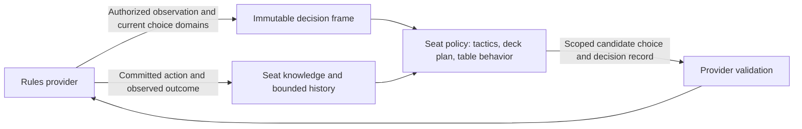

# Multiplayer AI framework and investigation

Investigated 26 October 2026 against source `c801eaf9b70b53f07f7234148def4f1811fa5db7`.
The source implementation now includes a complete seat driver and an initial
casual policy. This is not in the published installer yet. The reported live
games have not been replayed, so their individual decisions are not diagnosed.
Human review of a replacement policy is pending.

## What explains the targeting pattern

There is a concrete mechanism for multiple independent AIs to concentrate on
one player without a shared vendetta or a human-targeting rule:

- [Player](../../forge-game/src/main/java/forge/game/player/Player.java)
  defines `getWeakestOpponent()` and `getStrongestOpponent()` using life totals.
  These names do not mean weakest board or greatest likelihood of winning.
  Opponents are returned in turn order relative to the acting player;
  [PlayerCollection](../../forge-game/src/main/java/forge/game/player/PlayerCollection.java)
  uses `Collections.min/max`, which retain the first tied element.
- [DamageDealAi](../../forge-ai/src/main/java/forge/ai/ability/DamageDealAi.java)
  begins `damageChoosingTargets` with the lowest-life targetable opponent.
  Subsequent branches may instead choose a creature, planeswalker, or another
  mandatory fallback. It is not correct to say every damage effect hits that
  player. [DamageAiBase](../../forge-ai/src/main/java/forge/ai/ability/DamageAiBase.java)
  also reasons about a weakest opponent when deciding whether to burn a player.
- [AiAttackController](../../forge-ai/src/main/java/forge/ai/AiAttackController.java)
  scores every opponent, then adds `(min(20, startingLife) - life)^2` when that
  opponent is alive and below the threshold. At 12 life in this fixture the
  bonus is 64, even when there is no lethal attack or threatening permanent.
  Combat also values monarch/initiative and considers life-loss restrictions.
  It randomly chooses among opponents within `10 + turn` of the best score.
- [ComputerUtil.evaluateBoardPosition](../../forge-ai/src/main/java/forge/ai/ComputerUtil.java)
  includes hand count, lands, evaluated creatures, planeswalkers, other
  permanents and predicted damage to the AI. Combat is therefore more nuanced
  than simply attacking the lowest life total. It still mixes threat and
  elimination opportunity into one score.
- The combat controller retains its chosen defender during attack planning.
  Planeswalkers, battles, requirements and an unavailable attack can change it.
  Several other effect handlers call the defender helper independently.
  [DiscardAi](../../forge-ai/src/main/java/forge/ai/ability/DiscardAi.java), for
  example, shuffles opponents for one path and prefers low life for another.
  There is no single opponent-ranking function governing all these choices.

The likely feedback loop is: an initial hit or life payment makes a player a
preferred target for some effects; more damage lowers their life further; combat
eventually gives them a large elimination bonus; several bots independently
converge. This is an inference from the code and probe, not a replay of the report.
The inspected selectors do not distinguish a human from another AI. That does
not establish that every Forge heuristic is free of role-sensitive behavior.

## Reproduction, scope and provenance

[MultiplayerAiProbe.java](../../scripts/mana-table/MultiplayerAiProbe.java)
calls the real combat-preference and mandatory damage-targeting routines in an
isolated engine process. It creates four AI seats, empty boards/hands/libraries,
40 starting life, main phase and turn 8. Every case resets seed 261026. Each
actor samples the unchanged combat preference 256 times and a one-damage,
opponent-only mandatory targeting choice 16 times. No attacks or damage resolve.
All seats are AI; changing the low-life seat separates life preference from a
special human or fixed absolute seat identity.

| Life totals | Observation for the other three seats |
| --- | --- |
| 40 / 40 / 40 / 40 | Combat samples vary across opponents. Mandatory pings consistently select the first opponent in each actor's turn order. |
| 30 / 40 / 40 / 40 | Combat remains varied. All 48 ping samples select seat 0. |
| 12 / 40 / 40 / 40 | All 768 combat-preference samples and all 48 ping samples select seat 0. |
| 40 / 12 / 40 / 40 | The concentration follows seat 1: all 768 combat samples and 48 pings from its opponents select it. |

These are repeated selections from static fixtures, not independent games,
population estimates, measured unfairness rates or evidence of actual attacks
on an empty battlefield. The forced ping does not exercise payment or optional
casting. This probe characterizes current behavior; it deliberately does not
assert that these outcomes are desirable or lock them into regression tests.

The initial run used the locally installed **0.2.122** engine, source
`e1694825da82975798f16b55d4f6fc6c7a580f34`, with a separate disposable profile.
The inspected combat, damage, collection, profile and controller code is
unchanged between that source and the audited master. The `Player.java` changes
in that interval concern land-play access, not opponent enumeration/comparison.
This is not a claim that the latest release was exercised end to end. The output
records the actual engine JAR path/hash, Java version, seed and fixture limits.

Run against an explicit built or installed engine bundle with JDK 17+, from the
repository root. Supply the resource directory containing `cardsfolder` and `ai`,
usually `engine/forge-res`; do not pass the parent `engine` directory. Use a new
profile under `.tools`, never a player's active profile:

```powershell
$engineJar = 'C:/path/to/bundle/engine/forge-engine.jar'
$engineResources = 'C:/path/to/bundle/engine/forge-res'
$probeClasses = "$PWD/.tools/ai-targeting/classes"
$probeProfile = "$PWD/.tools/ai-targeting/profile"
javac -cp $engineJar -d $probeClasses scripts/mana-table/MultiplayerAiProbe.java
if ($LASTEXITCODE -ne 0) { throw 'AI probe compilation failed' }
java -cp "$probeClasses;$engineJar" forge.api.MultiplayerAiProbe $engineResources $probeProfile
if ($LASTEXITCODE -ne 0) { throw 'AI probe failed' }
```

The generated `targeting-probe.json`, engine caches and logs stay outside source
control. Run the probe as its own process: Forge's RNG and AI cache are global.
This diagnostic is optional and adds no CI shard or player-facing control.

## What the previous controller supplied and restricted

[Upstream's AI guide](https://github.com/Card-Forge/forge/blob/master/docs/AI.md)
describes heuristic play, with stronger aggro/midrange behavior and weaker combo
play. The local [AI guide](../AI.md) provides headless self-play commands.

`PlayerControllerAi` delegates decisions to `AiController`, combat controllers
and `SpellApiToAi`. The latter dispatches semantic effect APIs such as damage,
draw, counters, animation and zone changes to shared handlers. `AILogic` script
hints and `SpecialCardAi` add exceptions. Missing API handlers can fall back to
`CannotPlayAi`; legal rules support is not equivalent to competent AI support.
`AiDeckStatistics` derives mana/cost information from cards rather than choosing
a separate executable strategy for each preset.

The legacy [MatchTable.ai](../../forge-api/src/main/java/forge/api/MatchTable.java)
passes a normal deck to `LobbyPlayerAi` with the `Default` profile and an empty
simulation-option set. It also disables the rules' AI-card warning. Our
[MatchSession](../../forge-api/src/main/java/forge/api/MatchSession.java) and
[SyncLobby](../../forge-api/src/main/java/forge/api/SyncLobby.java) restricted deck
selection to opponent/preset IDs. That preset list was our product restriction;
Forge's controller already accepts a deck. Removing that restriction alone
would not make difficult combo/control decks play well.

Forge has `SpellAbilityPicker`, `GameCopier` and `GameStateEvaluator` for search.
We do not select hybrid/full simulation in `MatchTable.ai`. Turning it on is not
a multiplayer/social fix: the evaluator uses its own utility, the copier has
`PRUNE_HIDDEN_INFO = false`, and copying cards can be expensive. The existing
controller holds live engine objects, so information isolation needs an actual
boundary. This observation does not prove that the shipping heuristic AI uses
every private card it can reach. Similarly, `Default.ai` enables mana smoothing,
but `GameRules` defaults its required cheat-shuffle gate to false and our table
does not enable it; the profile line alone does not establish cheating.

`AiCardMemory` tracks tactical cards, reserved mana and revealed cards. It is
not a table-wide model of pressure, player relationships or recent harassment.
Adding a permanent vendetta would make the reported experience worse.

## Useful reference boundaries

The [Hearthstone AI Competition's tutorial](https://hearthstoneai.github.io/tutorial.html)
separates the agent from a partially observed game, offers available moves,
executes a move and returns a refreshed observation. Its simulator supports
forward evaluation of offered choices. This is a useful contract pattern, not
Blizzard's production AI implementation. It does not solve Magic's priority,
costs, targeting chains or multiplayer social behavior.

[OpenSpiel](https://openspiel.readthedocs.io/en/latest/intro.html) separates
game dynamics, player information and algorithms, including multiplayer and
imperfect-information settings. Its explicit
[legal actions](https://openspiel.readthedocs.io/en/latest/api_reference/state_legal_actions.html)
and [player information state](https://openspiel.readthedocs.io/en/latest/api_reference/state_information_state_string.html)
are the relevant ideas. Adapting those concepts does not require replacing Forge
with OpenSpiel or imply its algorithms immediately handle arbitrary Magic decks.

[Wizards' Commander introduction](https://magic.wizards.com/en/news/feature/introduction-commander-2016-10-28)
explicitly describes social interaction and consideration of everyone's game.
That establishes the product goal; the policy below is our proposed adaptation,
not an existing Arena multiplayer bot algorithm.

## Functional seat and all-AI simulation

Native composition owns `AiTableHost`; `Mana.AI` still depends only on
`Mana.Contracts`. The host enables the rules provider's optional
`automated-seats` capability before creating a table. Each bot uses the normal
input/cost/target/stack machinery through an explicitly automated controller,
with human auto-yield preferences and Forge strategic auto-payment disabled.
`isAI` is deliberately not used for that role: upstream code uses it to select
and cast to its own strategic controller. There is no runtime fallback to it.
Legacy callers which never negotiate this capability retain their old behavior.

`IAutomatedSeatProvider` is a host-only port. The renderer and remote seat receive
neither bot hands nor bot commands. Each bot has its own snapshot, command scope,
seed, history and policy evaluation. Public stack events establish observed
outcomes; accepting a command does not establish resolution. Unknown receipts
stop execution rather than replaying. A rejected unchanged decision or an
unsupported policy capability produces an explicit table diagnostic instead of
silently stalling, passing, or conceding.
An engine failure's original exception remains in private host diagnostics;
public seat and spectator errors cannot expose a bot's private card or choice.

`DecisionActionDomain` enumerates all timing-legal routes in engine-owned source
zones, separately from highlight/auto-pass scanning. It caches each domain for
the current input and rules-event version. Opaque route IDs remain scoped; a
stable route identity is used only for planning memory. Action semantics include
effect categories, target viability, resource production and typed cost parts.
Base costs are estimates: modifiers and commander tax are applied by the engine
when paying. `Unknown` affordability is retained explicitly, not treated as an
absent action. The current payment exposes exact unpaid shards, usable producer
colors and legal floating-pool colors, including colorless. Spending existing
pool mana is a scoped `SpendPoolMana` command. These paths do not invoke Forge's
strategic mana planner. A face-down route is available only when the actual
viewer's engine permission allows knowing it; its public face stays hidden.

Current sources outside player-zone presentation, such as a spell with a legal
stack activation or an owned companion, use explicit scoped `ActionSources`.
A historical stack face alone never grants an action. Library searches expose
their authorized, canonically indexed choices in the decision, not a parallel
ordered library or an accidental top-card disclosure in zone state.

Combat completion is also a rules fact. An invalid joint attack declaration
includes a legal requirement witness from the engine's constraint solver; the
policy can repair its assignments without parsing a warning or repeatedly
accepting a rejected completion. A causal episode ID keeps the decision budget
across replacement input handles, with distinct identities for extra combats.

`CasualCommanderPolicy` handles all fifteen decision families. It uses public
board resources, current characteristics, typed effects and recent observed
pressure. Low life alone is not a threat bonus. It makes legal choices from the
provider's domains, not names or rules-text matching. This is a bounded baseline,
not a combo solver or a promise of competent play with every card. Unknown
required effects can receive a legal generic choice; an unrestricted text task
without a legal domain is explicitly unsupported. Activated routes are currently
attempted conservatively once per turn. The independent per-turn attempt set
cannot be evicted by the diagnostic ring; a hard bound stops further planning
instead of permitting an infinite cast/cancel loop.

`IAutomatedSimulation` starts an explicit four-bot Commander table. Normal live
tables still require a human. The simulation ends through the rules engine's
normal outcome; losing a nonexistent human does not terminate it. Its public
spectator is an independent audience with ID -1, not one bot's private snapshot.
It has no decision, action keys, private activity, hand faces or library order.
Observations copy cached state published at input boundaries and cannot advance
the game. Private seat diagnostics are retained separately from public traces.
Card rules wording includes current granted abilities, but excludes Forge's
unscoped remembered-object debug text, which can contain a hidden library card.

The main real-game check uses four different decks: green starter, red starter,
a saved Rhys token deck and a saved Toothy/Pir partner deck. Identical decks can
serve a small isolation fixture; they are not the main strategy evaluation.
Saved opponents use `deck:<saved-id>` and pass the same detached-deck format and
Commander/partner validation as a human deck. Deck contents are pinned at start;
the policy does not receive shuffled library order or an opponent's saved list.

Run the existing native test driver with `--smoke-whole-seat-ai`, a current
engine bundle/JAR and a fresh `--profile`. It writes `whole-seat-ai-public.jsonl`
for public observations. `whole-seat-ai.json` and
`whole-seat-ai-private-final-observations.json` are host-private diagnostics:
they contain seat decisions, command evidence and failures. The same check runs after the
normal `--smoke-headless-engine` journey in its existing JVM. Automated progress,
privacy and legality checks remain separate from human judgments of engaging play.
Use `--ai-complete` with the standalone mode to continue to a natural winner,
with a two-minute/160-turn diagnostic limit. The shorter CI continuation covers
five table rounds, paid token creation, partner searches, counters and combat.
The policy seed is recorded; Forge's shuffle and rules randomness are not
controlled by that seed. An archived state sequence is not a claim of identical
engine re-execution from a seed.

## Replaying state and presentation

The public JSONL timeline retains complete snapshots at published board revisions,
with a format version, host step and monotonic elapsed capture time;
seat-private decisions and receipts have a separate diagnostic audience. Compare
public facts only at the same game and board revision: input revisions can differ
between seats, and two sequential reads can straddle an actual game transition.
Agreement detects synchronization regressions; independent canonical rules
assertions are still needed to establish that a particular result is correct.
The public spectator currently omits activity entries and structured pending
effects. These are sampled checkpoints, not a complete causal event stream;
transient stack entries can occur between reads. Exact animation replay needs
an ordered, audience-filtered event capture alongside the checkpoints.

For UI regression work, the next step is feeding that timeline into the existing
native renderer, preserving occurrence identities, camera state and elapsed animation
time. Pair a rendered frame with its authoritative checkpoint, window size and
input gesture. Capture both transitions and settled frames: a final battlefield
alone cannot show whether a played card traveled through the stack, a counter
change was visible, or a camera move preserved spatial context. The existing
`--fixture` path can inspect a single saved snapshot without granting it action
authority. Interactive replay must use the correct actor's filtered observation,
not invent private choices from the public spectator.

Mechanical checks can compare visible current stats/counters to their source
occurrences, detect stale or missing objects and verify that a hit region answers
the displayed decision. Retain representative screenshots at 1000×740 and a
larger window, then review the source → pending effect → target → settled result
as an actual sequence. These checks and image diffs do not establish readable
grouping, clear attention or a pleasant game. Record human visual feedback and
the exact candidate separately from conformance results.
The player's MTG Arena references motivate the journeys: an announced card
remains readable on hover, attachments sit beneath their host, and changing
counters remain attached to the creature whose current stats changed. Replay
those gestures on the four-seat and crowded battlefields as well; Arena's
two-player framing does not settle our multiplayer spatial design.

## AI quality work before merge or release

The current change remains a draft. The player's 26 October direction is to
develop and test the AI framework before merging or releasing it; UI clarity
work follows that effort. Passing build checks or reaching a natural winner
does not satisfy this quality gate.

The source now separates a finite operation graph from a strategic estimate.
Graph nodes retain their actor, source, recipient bindings, target domains,
quantities, costs and sequence/mode/conditional links. A later effect can refer
to the same targets or their controllers instead of independently choosing a
beneficial recipient. Unknown quantities, token characteristics, conditions and
resource coupling stay explicit. The adapter exports rules facts; the policy
prices their consequences. Semantic candidate IDs do not become action handles.
The current finite assessor estimates supported public effects and selected
branches, and reports incomplete, unsupported or exhausted work separately.
It is not a forward rules simulator or a forecast of opponents' responses.
Optional optimization uses local work slices. A completed plan can retain a
partial estimate when further search reaches its limit, without claiming an
optimum or exhausting the whole seat episode. Required target selection reserves
enough work to finish its known minimum, then uses current authorized candidates
when optimization cannot continue.
Combat comparisons use the same bounded approach: completed attack/defender
estimates and block pairs survive a local search limit, while incomplete
defender scans are discarded. A legal staged declaration can finish without
spending the entire causal allowance on further tactical comparisons.

Mana production preserves alternatives and simultaneous bundles. The bounded
assignment planner chooses at most one route per physical source, keeps exact
colored/colorless and hybrid requirements, and excludes a source reserved for
the initiating action's tap cost. It returns a nominal witness, shortfall,
unknown or budget result. Base action costs can be reduced or replaced, so a
base-cost shortfall cannot certify that a cast is unavailable. The remaining
bill in an actual payment input is stronger evidence. Source dependencies,
spending restrictions and replacements which are not modeled remain unknown.
Known output and a guaranteed consuming tap can still establish a nominal
capacity upper bound for a paid filter. Insufficient capacity rules out that
nominal assignment; sufficient capacity does not solve its dependencies.
The policy waits on nominally unfunded optional actions, including casts with
uncertain effective costs, rather than repeatedly opening and abandoning their
payments. This strategic choice does not remove or relabel the provider's
offered route. Authoritative payable knowledge overrides the estimate. Until
effective-cost facts improve, the policy can miss discounted or alternate casts.

Controlled tactical cases establish specific expectations independently of
self-play: preserve a necessary early land when discarding, account for an
animated land's creature body, avoid a losing first-strike/deathtouch exchange,
block to prevent player lethal, distinguish attacks at a planeswalker, avoid
known self-lethal bundled effects, and keep modal target requirements on the
selected branches. Small exhaustive mana assignments provide an independent
oracle. Enumeration and display-text transformations check that decisions
depend on typed knowledge rather than names, prose or input order.

The diverse campaign uses four shared singleton Commander deck manifests with
normal spell/land ratios: Rhys green-white tokens, Pir/Toothy green-blue
counters, Balmor blue-red spells, and Traxos colorless artifacts. It reuses one
initialized JVM, rotates seats, bounds turns/time, and separates mechanical
failures, witnessed mechanics, missing coverage and review findings. An accepted
command is not an observed effect. A compulsory return of one's own land is a
review finding, not proof of bad targeting. Missing rare draws are coverage gaps.
Policy seeds are recorded; rules randomness remains uncontrolled, so rotated
runs are not identical-shuffle paired experiments.

`AiDecisionReplayCase` retains one seat's exact state, domain, semantics,
history, evaluation seed and remaining allowance. `AiDecisionReplay` runs a
candidate policy through the production scoped session without an engine
connection. The native test driver accepts `--replay-ai-decision <case.json>`
and writes a private `ai-decision-replay.json` in its disposable profile. The
result is a proposal, never an accepted receipt or resolved outcome. Captures
and reports are host-private. Repeating decision evaluation is distinct from
replaying an entire rules game or reproducing wall-clock timing exactly.
Prior commands survive serialization as immutable kind/payload evidence; they
are not executable commands and do not grant new or historical action authority.

This extends the partial-observation, offered-move and refreshed-observation
pattern documented by the
[Hearthstone AI Competition](https://hearthstoneai.github.io/tutorial.html).
Its single-action simulator is a reference boundary, not Blizzard's production
controller or a solution for Magic's nested priority/cost choices. Evaluation
must also match the game: OpenSpiel's
[exploitability implementation](https://github.com/google-deepmind/open_spiel/blob/master/open_spiel/python/algorithms/exploitability.py)
explicitly restricts that metric to two-player constant-sum sequential games.
It cannot be copied as a complete quality measure for casual four-player Commander.

Before promotion, inspect captured poor decisions, retain tactical regressions,
and distinguish remaining planning limitations from engine faults. Important
open work includes mana-ability dependency chains, uncertain effective costs,
joint attack/block plans and rules-provided block-repair witnesses,
retaliation/commander-damage planning, own-deck plans,
typed numeric purposes and X investment, conditional effects and belief/forward
search. Human assessment of enjoyable
opponents remains necessary; win rate or equal targeting cannot substitute.
Ordinary damage history currently identifies its recipient separately from its
source occurrence, but lacks an explicit event-time source controller. The
policy must not reconstruct that historical controller from current ownership;
its social pressure/focus estimates remain incomplete until that fact is supplied.

## Decision framework foundation

The player's clarified scope is **all AI behavior**, with a framework built
before replacement policies. The combat/damage findings are canonical regression
cases, not the boundary of the new controller. A targeting-only production patch
does not meet this scope. Published releases still predate this implementation.

The initial implementation is [Mana.AI](../../mana-native/Mana.AI/Mana.AI.csproj),
a graphics-free library depending only on `Mana.Contracts`. It reuses the existing
fifteen closed decision payloads instead of adding a second AI move protocol:
priority, opening hands, payment, attacks, blocks, targets, entities,
confirmations, ability/options choices, ordering, reveals, numbers, text and
allocations. A whole-seat policy must declare every family. That declaration is
not evidence of good strategy; unavailable situations remain explicit results.

`AiDecisionFrame` binds an authorized snapshot to a game, seat, input, observation
revision, board revision and source-offer version. Changed catalogs need a new
offer version even within one snapshot revision. Catalogs must name the exact
disclosed occurrence and action IDs. A policy cannot manufacture an offered route
or turn an unspecified card click into an action. Combat requires its actual
combat constraints. Current contract permissions still validate every answer.

Priority/payment source coverage is explicitly partial by default. A complete
domain is a provider claim requiring conformance evidence, not something the
policy or caller can infer from an empty array, highlighted cards or `CanAutoPass`.
Known offered actions can be used under partial coverage; passing cannot be
justified through it. Existing per-card `ISourceActions` reads alone do not certify
a complete domain for a seat. The automated provider supplies its separately
verified complete discovery.

`AiSeatSession` owns one game's one seat. Immutable requests contain the current
frame, copied history, an episode seed, remaining time and a cooperative work
allowance. Refreshing an input does not renew its budget or seed. Where the
provider supplies a causal episode, replacement input IDs retain that episode's
budget. Combat declarations include the turn, phase, actor and combat ordinal;
other inputs currently fall back to their input ID. This is not yet a complete
cast/cost/resolution episode model. Cancelled, replaced, closed
or late computations cannot publish a command. The await is time-bounded even
if a policy fails to return; this is not a process sandbox or forced termination
of arbitrary computation. Implementations must cooperate with cancellation/work
limits; isolated model workers can enforce stronger resource limits later.

Policies return proposals and never receive the engine connection. A ready
proposal has one host handoff; the host uses the existing scoped command path.
The host reports an accepted, rejected or uncertain execution receipt. An
uncertain receipt blocks further commands until host recovery, and never means
retry, pass, concede or defeat. A refreshed observation can arrive before the
receipt without relabelling it as the next decision's result.

History bounds both typed decision records and deduplicated observed event facts.
It retains the proposed/accepted semantic answer and its original stamp, seed
and policy reason separately from later observed effects. Those old handles do
not grant current authority. Retained events omit printed names, faces and prose;
they preserve exact typed changes/impacts and causal IDs already supplied to that
seat. A new game/seat needs a new session. Evidence stays seat-private, not in a
shared bot brain or a player-facing stream of explanations.

The existing headless client suite covers every family plus scope/offer changes,
work/time exhaustion, late answers, one-shot submission, uncertain acknowledgements
and bounded private history. The existing real-engine journey also exercises a
scripted framework policy through starting-player selection, keeping a hand and
a current offered land action, then observes the authoritative battlefield.
Scenario setup uses explicit test-driver passes where needed; it does not pretend
partial action discovery authorizes AI passing. No new CI shard or JVM startup
is added. This verifies framework mechanics, not casual play quality.

The initial baseline and bot-seat host now exercise this boundary. A strategic
deck planner, belief model and forward search are still future work. Those systems
must consume the same contracts and execution lifecycle as the full replacement,
with no fallback to Forge strategic handlers presented as our own implementation.

## Proposed AI boundary

Build on the [action-execution migration](Mana-Table-Architecture.md#action-execution-the-next-boundary-migration).
The same source, costs, choices, targets, pending effects and outcomes should
support both a human's presentation and an AI's decisions. Do not build a second
rules model from card text or give a model arbitrary engine-object access.



| Boundary | Required meaning |
| --- | --- |
| Seat observation | Authorized current state, own private cards, public history and explicitly remembered disclosures. Knowing one's own deck composition does not reveal its shuffled order. Host access to all decks or a preset ID must not reveal an opponent's hidden list. |
| Decision frame | Actor, game/revision/answer scope, execution episode, source, mandatory/optional status, current candidate domains and constraints. Reading material never grants action authority. |
| Action description | Structured effect/cost/target semantics and available routes, with explicit unknown/unsupported features. Preserve those routes; do not hide a card because the strategy evaluator cannot understand it. |
| Choice proposal | One offered choice, allocation, ordering or bounded continuation, bound to its exact scope. It does not invent card IDs, targets, mana or a pass during a required choice. |
| Forecast | Budgeted isolated branches, uncertainty and terminal outcomes under the seat's knowledge. Unknown hands/order use explicit hypotheses, not the live host's hidden truth. Branch handles cannot execute on the live table. |
| Decision record | Candidate features, estimated utility, uncertainty, chosen route, tie/random seed, policy version and fallback. Link eventual execution/results separately from proposals. |

The decision frame/session described above is implemented; structured effect
semantics, causal joining and forecasts in this table remain proposed. Policy
execution currently uses the neutral .NET library in conformance checks.
Forge-specific objects, `AILogic` dispatch and mutations stay outside that
library. Replacing Forge then requires a conforming provider, not rewritten
deck personalities or renderers.

The current native `GameSnapshot` is an observation, not a clonable engine.
`AvailableActions.ActionScan` is a bounded auto-pass/discoverability aid whose
`complete` flag can be false; it is not the full AI action space. Generating all
target permutations, X values, payment plans and attacker subsets up front is
also impractical. Publish current choice domains incrementally, preserve engine
constraints, and report candidate-search coverage separately from rules legality.
An unevaluated route is not an illegal route or permission to auto-pass.

## Social play without arbitrary targeting

Evaluate actions, not just players. Removing a dangerous engine, attacking an
undefended monarch and dealing one incidental damage have different purposes.
Separate immediate danger to the bot, table-wide winning threats, profitable
actions and genuine elimination opportunities. Life is one feature, not a
universal ordering of opponents.

Keep a small per-seat ledger of publicly observed committed pressure: incoming
attacks, damage, removal and previous discretionary choices, with source,
recipient, turn and reason. Decay it across turns. It can reduce repeated
low-value pressure when comparable alternatives exist, without imposing a turn
rotation, damage quota, permanent grudge or an invisible alliance among bots.
Each bot's private knowledge, policy state and RNG remain independent.

Forced targets, goad/attack restrictions, required defensive responses and a
verified winning line override variety preferences. Eliminating one opponent is
not the same as winning the game: model the remaining opponents and exposure.
Persistent real threats can justify repeated attention. Casual table behavior
and competitive win-seeking should be explicit policy settings, not hidden
rubber-banding based on which seat is human.

Deck understanding and personality are separate. Derive a provisional deck plan
from the bot's own list and current effect relationships: resource development,
card advantage, combat, tokens, counters, sacrifice, recursion and combinations.
Update it as the game changes. Personality can tune risk and interaction timing;
it must not require a hand-authored script for each commander or ignore legality.
A future learned ranker or language model can suggest plans or rank offered
choices behind this same boundary. Neither should invent executable rules.

Accepting any engine-supported legal deck is an achievable input contract.
Playing every unseen interaction expertly is not a credible blanket promise.
Measure planning gaps, unsupported semantic features and fallback use by mechanic,
including composite mechanics; do not silently substitute a known preset.

## First implementation and efficient evaluation

1. **Establish the complete framework before policies.** The initial library
   supplies typed requests, scoped proposals, budgets, history and host receipts.
   Extend the provider with complete action domains, structured semantic facts
   and causal execution identities before using it as an autonomous seat.
2. **Build a full casual policy and exercise every task.** Opening hands, play
   sequencing, abilities, costs, combat and required effects belong to the same
   policy system. Use the combat/damage pile-on cases to verify consistent table
   reasoning. Correlate committed actions and observed effects; target probes
   mutate tentative abilities and must not manufacture harassment history.
   Merely changing `getWeakestOpponent` or delegating unimplemented tasks back
   to Forge's strategic AI does not meet the replacement goal.
3. **Allow saved deck versions on AI seats.** Reuse deck storage/legality,
   format and partner validation. Pin the assigned version, keep Ready/host
   authority, and separate deck choice from personality/skill. Show unsupported
   AI coverage as such instead of hiding warnings and implying expert play.
4. **Add bounded search or learned ranking after the seam is demonstrated.**
   Cache semantic features per relevant revision, update a small history per
   committed event, cancel stale work and budget simulations per decision episode.
   Safe fallback must still answer the actual legal task; inability to decide is
   an explicit diagnostic, not a silent concession or fabricated action.

Use a small reusable canonical set: equal opponents; incidental life loss;
a low-life player beside a genuine leader; a newly emerging lethal threat;
repeated marginal pings; forced targeting/hexproof/goad; a real finishing line;
elimination invalidating a plan; counter-cost and multi-step targeting choices;
and an imported partner/counter/token/recursion deck the evaluator has not seen.
Add seat/role permutations and hidden-card/order substitutions: information the
seat cannot know must not alter its policy inputs or choices. These are semantic
properties, not a request to enumerate all possible Magic interactions.

Start with cheap fixed-state probes and short real-engine continuations. Use
paired seeds/seat rotations for deeper self-play only where needed, with limits
on wall time, branches and turns. The existing `MatchTable` requires a human
seat, so all-AI evaluation needs an explicit headless runner; do not quietly
remove that live-table invariant to get a benchmark working.

Measure legal completion, response latency, candidate coverage, stale/fallback
rates, concentration of discretionary pressure, reaction to changed threats and
deck-plan execution. Separate required effects and justified lethal/defensive
choices from discretionary targeting. Wins and target-count equality cannot
establish engaging play. Review actual four-player sequences with humans before
calling a replacement fair or enjoyable.

Decision records initially belong in local development evidence. Player-facing
understanding should use the game's existing source/target/stack announcements
and hover inspection. This proposal does not add a running wall of AI prose,
extra dialogs or a promise of diplomatic deals the policy cannot honor.
