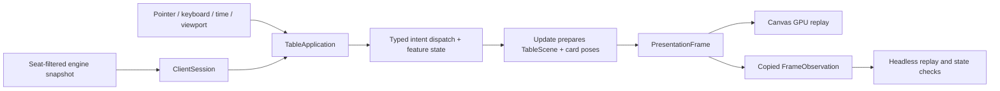
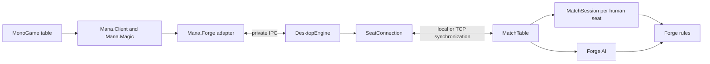

# Mana Table architecture

Mana Table's sole client is MonoGame (`mana-native`), backed by the Java adapter
(`forge-api`). Forge remains the installed rules engine. Switching a seat between local and remote must not change game logic,
decisions, visibility, or presentation.

This map describes the current source, which can be ahead of the public installer.
Use the package's `SOURCE.txt`/`build.json` and release notes to identify its behavior.
The [native development guide](../../mana-native/README.md) is the build/run entry
point for the Windows client.

## Rules-provider boundary

Forge is the installed rules provider; replacing it later must not require a new
renderer, interaction policy or multiplayer client. The shipping `Mana.Table`
executable owns provider construction, startup and disposal. `Mana.Game` contains
the application and window and cannot reference `Mana.Forge` or the executable,
directly or transitively. A build target checks resolved dependencies, and native
checks inspect emitted assemblies. `TableServices` supplies separate catalog,
table-setup and match ports plus explicitly named optional services. Gameplay
never receives `ICardEngine` or discovers capabilities through provider casts.

`IMatchConnection` publishes deeply immutable `GameSnapshot` values and accepts a
closed family of semantic `GameCommand` variants. Arrays and dictionaries in the
entire match graph, including nested decision previews and event causes, use
standard immutable collections. A provider's construction buffers and a
consumer's inspection cannot rewrite a published revision. New observations may
share unchanged values while preserving the preceding frame for transitions.

The same ownership rule applies to catalog, deck, workshop, analysis, pregame
and conversation services. Their results and collection-valued requests use
`ImmutableArray` and `ImmutableDictionary` throughout the nested graph, including
roles, printings, recommendations, test hands and lobby seats. Providers freeze
construction buffers at their boundary; the application retains accepted values
without copying the graph each frame. A new revision replaces a value rather
than editing a previously published document. Immutable values do not grant
authority: document/revision, metadata/fingerprint, table and prompt admission
checks still determine whether a result or command is current.

Commands carry only their variant's required payload: keeping an opening hand,
paying mana and passing priority are different types. Combat pair commands
explicitly describe toggles. `GameCommandPermissions` checks current scope,
semantic task, disclosed candidates and supplied constraints before dispatch;
the provider remains authoritative and revalidates at execution. `Mana.Forge`
alone translates these meanings into its private wire actions. There is no
public nullable reply bag. This does not provide live engine migration or an
installed second rules engine.

Replacing a provider also requires resolving deck contents and printings into
that provider's catalog. Catalog identifiers, match occurrences and current
action handles are different identities; copying opaque saved/provider IDs is
not a migration strategy. Match handles expire at their declared scope and are
never cross-provider replay commands.

| Layer | Owns |
| --- | --- |
| Rules provider and adapter | Legal actions, decision constraints, costs, targets, resolution, effective state, event-time results and viewer filtering. `forge-api` and `Mana.Forge` translate Forge into the shared contracts. |
| `Mana.Contracts` and `Mana.Client` | Provider-neutral state, scoped actions/decisions, command scheduling, observation ordering and stale-result rejection. Opaque handles grant only their declared current authority. |
| `Mana.Magic`, `Mana.Game` and `Mana.Renderer` | Magic presentation language, local inspection/focus, gestures, grouping, layout and visual timing. These layers consume permissions; they do not establish rules legality. |
| `Mana.Table` | Shipping composition, provider lifetime, installation health and update bootstrap. |

`Decision.Purpose` describes semantic choices such as opening hands, targets and
abilities. The Java provider classifies its actual input once and publishes its
semantic task/purpose; the native adapter validates that combination. Unknown or
contradictory tasks fail explicitly. Forge input-class names and context remain
private diagnostics and never become shared decision types. A provider supplies explicit candidates,
limits and permissions rather than asking the client to recognize card names or
reconstruct a rule from prose.

The current source-action slice moves asynchronous catalog reads into
`Mana.Client.ClientSession.SourceActions`: it coalesces source changes, publishes explicit
loading/ready/unsupported/stale/failed states, freezes accepted catalogs and checks
game, decision, revision, viewer and source context before creating a command for a
catalog member. The UI supplies its currently inspected source; the client session
owns the catalog lifetime and independently checks membership, revision, viewer
and current physical disclosure at submission. Accepting a changed/revoked frame,
resetting or closing revokes that authority. The adapter revalidates every command.
Timeout ends the client's wait, not the underlying provider operation; late
completions are discarded. Query capability does not determine whether a card
can be inspected. Current disclosed locations include a revealed library top;
an embedded historical decision face cannot retain action authority after the
occurrence disappears. Cross-zone play gestures use a current offered cast/play
action rather than a UI list of permitted zones. Hand-placement and Auto still
consume their separate explicit provider permissions.

Source-action descriptions can include a visible linked `Card` and its `Zone`.
The face is reading material, not a second action handle. The current use is a
prepared permanent's spell copy in exile: the client submits the original
source key and offered action ID. Forge validates the exact source, linked spell,
timestamps, locations, permission and current input again before selecting the
real spell ability. The prepared designation is an independent public status;
it remains visible when casting is unavailable. A copied spell's artwork uses
its actual face, never incompatible printing metadata inherited from its source.

`CardViews.InZones` enumerates current player-zone occurrences with their owner
and zone, including a disclosed top and masked card envelopes. Occurrence-ID
lookup and current action-key lookup are separate queries. Source authorization,
reader reconciliation and ability placement share this traversal; historical
stack and decision faces remain explicit reference views. They cannot restore a
departed source's action authority. Display reconciliation keeps a current masked
face rather than falling back to an older revealed report. None of these queries
cache a previous snapshot or match a printed name.

Forge priority alternatives are explicit state: Undo, pass turn or none. Native
Undo and pass-turn commands never emulate Forge's overloaded Cancel button.
The Java adapter validates their current meaning both before queueing and on the
input thread; a changed Undo cannot fall through to yielding the turn. Ordinary
priority passing also invokes the explicit pass operation, independently of a
Forge yield-suggestion button. The private IPC remains version 2 and adds the
required `semantic-priority-actions` capability; new clients reject older jars.
An `expectedTask` discriminator prevents a typed answer being interpreted as a
different task by the private wire's generic confirmation operation. Persisted
decks and profiles do not change.

Keep three kinds of data separate. **Current state** describes the viewer's
authorized present board, effective P/T, resources and mechanics. **Event-time
facts** describe what actually changed, with event identity, affected occurrences
and a reported cause when available; they must not be reconstructed by looking up
an object's later state. Pending base damage remains distinct from actual damage
after prevention or replacement. **Presentation state** describes hover, focus,
travel, receipts and timing. It cannot mutate the board, grant a target or delay
the authority's next state. All three obey current visibility: historical facts,
cached readers, art preloading and debug output cannot restore a face or private
choice the viewer is no longer entitled to inspect.

`PublicActivityCursor` consumes the accepted observation's event IDs once and
publishes one immutable `PublicActivityBatch` to the feedback consumers. The batch
binds its new entries to the same before/after snapshots. Initial observations,
game changes and viewer changes establish a baseline without replaying retained
history; a viewer change also clears the previous seat's readers and feedback.
The cursor retains only the game/viewer scope and an event watermark. Consumers
own cue timing and current visibility checks, not separate history cursors. A
bounded-history gap invalidates uncertain old card-impact anchors while preserving
reported new facts. `PresentationPacing` still inspects tentative advancement
checkpoints before publication; it does not consume this accepted event stream.

Projection playback and rules resimulation are different capabilities. Existing
authored scenarios replay projected observations through the production client;
they do not execute Magic rules. A future recorded projection needs ordered,
viewer-filtered observations, event/decision scope and schema/provider versions.
Running those actions through a rules provider again additionally needs a valid
initial rules state, controlled random outcomes and fresh action capabilities;
recorded prompt handles are not portable commands. The existing conformance
runner can compare canonical checkpoints, but current Forge journeys do not
establish another provider's rules equivalence or a complete Forge state oracle.

The boundary is informed by inspected primary material; the mapping above is our
design inference, not a claim about complete proprietary implementations:

- [WotC's rules-engine account](https://magic.wizards.com/en/news/mtg-arena/on-whiteboards-naps-and-living-breakthrough)
  describes finalized legal-action lists, explicit client decision constraints,
  headless scripted rules tests and the need to retain historical values.
- [Blizzard's VFX account](https://news.blizzard.com/en-us/article/22552047/developer-insights-the-art-behind-the-science)
  separates supplied results from mostly client-side visuals and shows how
  targets, gestures and persistent effects require readable visual feedback.
- [HearthSim's protocol documentation](https://hearthsim.info/docs/gamestate-protocol/)
  documents entity state, private options and nested causal blocks. This is the
  maintainers' reverse engineering, not Blizzard-confirmed internal design.
- [HSReplay's maintained format](https://github.com/HearthSim/hsreplay-xml/blob/master/hsreplay.dtd)
  preserves state changes, nested effects, choices, submitted input and build/schema
  identity; replay is more than a prose activity log.
- [SabberStone's public game implementation](https://github.com/HearthSim/SabberStone/blob/master/SabberStoneCore/src/Model/Game.cs)
  supplies a comparable headless input/state loop and explicit cloning/RNG policy.
  It is an independent simulator, not Hearthstone's proprietary engine.

## Deck and pregame journey ownership

Home and pregame share a deck stage rather than a welcome page followed by a
separate setup workflow. Catalog services own the saved document and its
revision, validity and save result. Local selection determines which actual
commander(s), complete names and known art to present; it does not grant a match
action. `DeckSummary` currently contains identity/name/library token, so browsing
the library cannot manufacture commander metadata or open every document just
to paint a thumbnail. Opening another saved document can affect provider deck
selection and connected readiness. Home is ordinary app navigation, with no
separate welcome state or persisted first-run flags to block its controls. The
optional table guide owns only its explicitly opened local overlay state;
opening or closing it writes no completion preference.

One solo Play intent captures the selected saved document and selection
generation, obtains compatible AI setup when needed and starts the exact list.
The shared preparation helper is also used when the player explicitly customizes
an AI seat. It retains compatible chosen opponent IDs and validates the returned
deck association. A later selection cannot silently replace an in-flight Play;
stale completion is rejected. The provider revalidates the actual start.

Host/Join connects the table and brings a valid current list without setting
Ready. A successful connection remains visible if a later deck assignment fails.
Explicit Ready selects the current list if needed, sets readiness and consumes
the returned roster. Start still requires the current host, local readiness and
the provider's CanStart. Choosing another list or editing withdraws readiness;
reading the same list preserves it. The old `confirmedDeckId` name remains an
internal preparation/synchronized-selection cache, never a player role or an
additional confirmation stage. The optional deck-list reader and its Back action
perform no setup mutation.

Build/Tune/Test presentation consumes the same selected document and versioned
workshop/analysis services. Recommendations, questions, manual notes, draw-only
samples and actual rules-game records retain their distinct meaning and exact
version association. Reading a sampled card is presentation state, not a cast,
test outcome or another game decision. Tune keeps its list, selected relationship
and scrollable evidence in place beside a separate full-card reading region.
The read-only card retains the relationship/sample context and cannot edit,
cast or start a game. Persisting a note is not evidence that the engine measured
that outcome.

Start test game captures the selected saved revision, workshop version/question,
seat count and opponent choices in one operation. It prepares compatible defaults
if no current setup exists, checks the captured intent again, starts the versioned
test and observes the opening state. Choosing AI opponents prepares the same
compatible setup for optional customization; it is not a required earlier step.
Draw-only sampling remains separate from this actual rules-game path.

Play controls and Updates share `SystemDrawer` composition. It retains the game
visually, replaces underlying hit targets, and owns backdrop/close input without
committing the underlying game gesture. Update work retains its separate lifecycle:
closing a drawer does not cancel a chosen download, authorize installation or
bypass the actual game/save/input blockers before an explicit restart.

These source changes and their remaining interaction/visual review are mapped in
the [whole-game experience audit](Mana-Table-Experience-Review.md#whole-game-audit-and-redesign-22-october-2026).
The established session/provider/rendering boundaries remain in use; this does
not introduce a second scene framework or give UI layouts rules authority.

## Shared match and synchronization

`MatchTable` owns one Forge game and one `MatchSession` per human controller.
Solo and network matches use that same session, including activity, commander
damage, legal combat choices and private information filtering. Forge's AI remains
inside the authoritative game. The old `NetworkMatchSession` and its separate
network GUI projection have been removed.

`SeatConnection` carries observe/reply/concede operations through `SyncTransport`.
Solo uses a local connection. A lobby can mix local and TCP connections; all receive
complete seat-filtered snapshots from the authority. Networking contains no card,
combat or decision interpretation. `SyncLobby` manages deck selection, readiness
and seat ownership. `PortForwarding` is an independent reachability service.

Concession cleanup can remove a player-control override while the game thread
reads it. `Player` keeps those overrides in timestamp order in a concurrent map
and reads one entry snapshot, falling back to the base controller when empty.
Search-control entries use a synchronized ordered map because a latest entry
with a null player is meaningful and must keep masking older entries.

Sync protocol 3 negotiates its version before joining. Ordered sequence numbers
and cached command receipts prevent replay after a lost response. A resume token
restores the existing seat, followed by a complete snapshot; leaving revokes the
token. Resume covers an interrupted connection while the host process remains
alive, not saved games or host migration. All friends need the same protocol build.

The IPC ready message publishes protocol version and capabilities. `Mana.Forge`
checks both. Snapshots retain publication and board revisions; prompt handles
remain scoped capabilities, separate from opaque card presentation identities.

Public role fields distinguish the priority holder, a required decision owner,
simultaneous choices and resolution without exposing another seat's private
options. Stack controllers and visible decision sources let the client name
the actor and explain the current choice. Named recipient buttons use exactly
the same scoped player handles as portraits; the client never chooses one itself.

## Native client boundaries

The window and application have separate lifetimes. `TableWindow : Game` owns
MonoGame, GPU textures, sound, input sampling, letterboxing and captures.
`TableApplication` composes the shared client session, screen navigation and input
policy. Feature lifecycles have explicit owners; render partials consume their
views rather than independently accepting asynchronous results.

| Owner | Authority and lifetime |
| --- | --- |
| `ClientSession` | Accepted engine observations, current command scopes, serialized commands and recovery. |
| `MatchPresentationLifecycle` | One public activity cursor and the match's effects, presence, pacing, resolution, changes, impacts, mana, priority and departure feedback. A game/viewer boundary revokes readers, poses and transient feedback before baselining the next seat. |
| `DecisionDraft` | The current game/viewer/prompt's ordered selections and bounded numeric allocations. Observing a new scope resets the draft; rendering cannot initialize or edit it. |
| `DeckInteractionState` | Analysis navigation, selected evidence, related-card filters and the workspace reader. Selection changes and deletion reset the owner; closing the editor closes its reader. |
| `DeckWorkspaceSession` | Workshop, analysis, test history and practice results for the selected deck/revision/epoch. One refresh lifecycle coalesces requests; mutation completions require a captured stamp, and reports must match accepted workshop metadata and playable fingerprint. |
| `LatestRead` | Replaceable catalog/printing reads. One active provider request, one latest pending intent, explicit caller-controlled start after debounce, and generation-scoped success/failure admission. Clear and close revoke late results. |
| `AppUpdateSession` | One serialized discovery/download/preparation/verification/install workflow, cancellation, prepared-release identity, persisted startup policy and safe explicit restart. The UI supplies its current installation blocker. |

Changing viewers immediately revokes the published hit frame and retained card
context, including before the next update. A visual occurrence or a retained
intent cannot preserve the previous viewer's authority. UI navigation resets
remain separate from feedback reset, so resetting a control does not baseline or
clear a newly accepted event batch a second time.

Deck workspace refreshes and writes use the same admission boundary. A late
failure cannot replace a newer selection's error, and delete/restore cannot revive
an old workspace stamp even if document identity and revision match again. A
foreground analysis review can finish while ordinary background reads are gated
by application activity. Its deck service graphs are deeply immutable, so a
retained workspace view and a queued metadata edit cannot change through shared
provider buffers or consumer casts. Optional metadata collections retain their
patch meaning: null leaves a field unchanged; an explicit empty collection clears
it. These C# contract changes require providers to rebuild; JSON arrays/objects,
IPC and synchronization versions, saved decks and profiles retain their existing
formats and require no migration. The Java host's single current editor remains
a separate ownership constraint; immutability does not create independent open
backend documents.

Updater discovery never starts a download. Becoming safe after a deferred restart
requires another explicit install gesture; verification rechecks the blocker
before launching. Shutdown cancels and joins the provider's actual task, including
file cleanup, rather than abandoning writes through a cancelled client wait.
An update provider must honor cancellation and finish its cleanup. This lifecycle
does not change update manifests, installed profiles or transport protocols.

The application still owns navigation and transient layout caches. Update applies
input and reconciles feature navigation before emitting the frame; command
emission can populate temporary geometry and painter queues, but must not change
the selected page, reader or decision draft. This is not a full rules-state replay
or proof that another rules engine can replace Forge.

`DecisionDockPresentation` projects the current decision and public acting seat
with explicit local control facts. The application shares its inspection/chat/
interaction gate between Auto dispatch and the dock; a background observation
does not become an action or pause. Transport flags are excluded from this
projection: an in-flight reply cannot replace the actual prompt with a submitted
or passing announcement. Its explicit surface is quiet for routine automatic
priority, beside the portrait for manual responses and bounded pass intent, and
a workspace for required choices. Another seat's required workspace can coexist
with the local Take control action. These presentation facts grant no permission:
replies still require the current engine decision and token.
It can initialize, update and compose with no `Game`, window or graphics device.

Default live tables with two, three or four players use the shared card
presentation path. Two-player tables frame the actual opponent above the viewer
and reserve distinct role lanes, portrait resources and the pending-effect area.
Their complete rows stay centered independently; controller identities, action
keys and command scopes remain unchanged. The classic compatibility renderer's
global seven-group fallback does not participate in default two-player play.

The portrait turn controls shipped in 0.2.83 consume these same facts and shared
pause gate. Six local phase markers represent recurring own-turn stop preferences;
the active opponent's phase is read-only. Current phase, saved stop, Auto/Hold and
bounded-yield state remain separate facts even when composed beside one portrait.
Moving the priority-pass action there does not move required target/search/payment
decisions or authorize answers. Saved stops prevent local automatic passing at
an offered priority opportunity, not engine-scheduled waypoints. New guaranteed
phase pauses or wider yield permissions would require a separate authority
contract. The user accepted the presented native preview at revision
`adac239e1d2b11f86afe90a384415051411e274b`; individual review gestures and window
settings were not recorded. This does not close the remaining dense-field audit.
Its optional `PresentationResources` supplies textures and sound for a real window;
an empty resource set uses the production rules-text and neutral-surface fallbacks.

`TableApplication.ArtPreload` prepares exposed snapshot faces and the selected
local deck before their first paint. `CardArt` prioritizes reading over visible
faces, then warms the selected deck's disk cache. One worker deduplicates exact
printing/face requests, replaces obsolete speculation and bounds pending image
bytes and GPU uploads. Face-down objects and effect markers never request art;
preloading never consults an opponent's deck or guesses hidden library order.

Table entry uses `TableArtworkPreparation` as a central presentation handoff for
solo, hosted/guest and workshop games. Engine starting is a separate waiting
state: an empty snapshot or absent viewer cannot release the table on a zero-of-
zero image count. After the first playable seat-filtered snapshot, the opening
waits for actual GPU textures, not downloaded bytes queued for upload. Failed or
missing faces settle to their readable fallback; the artwork wait is bounded to
eight seconds per opening handoff. A required pre-deal choice can appear after
its public cards prepare; when the player's first readable hand is dealt during
pregame, that hand gets its own preparation. This neither waits for a future deal
before answering its prerequisite nor consumes the hand's preparation on cached
commanders alone. Fresh polls do not restart the budget, and ordinary later
observations do not reopen loading. A changed game or
viewer, or a reset, invalidates the previous handoff. The remaining known local
deck continues warming the disk cache in the background.

`PresentationResources.Artwork` reports device readiness from `CardArt` to the
application. This progress belongs to rendering/presentation, independently of
rules-provider command completion; it grants no action or access to hidden
cards. `MagicArtSource` writes downloaded bytes to a unique temporary file and
publishes the cache entry with a same-directory move only after the write
completes. Cancellation removes that temporary file rather than leaving a
partial payload at the trusted cache path. Decode/upload failure still uses the
readable fallback.

The production pipeline is:

`TableApplication.Update` prepares and publishes ordered typed `DrawCommand` data through
`DrawList`, a frozen `InteractionFrame`, prepared card occurrences, a scene and
the exact game/revision/decision stamp. `ReadPresentation` only returns that
completed frame; it requires an update first. `TableWindow.Draw` reads and replays
it without reconciling navigation, advancing animation or running interactions.
Application preparation owns one deferred list
pairing each lifted card with its painter; it drains in stable layer order before
frame publication. The card controller owns poses, reading and layers, without a
second queue or sequence-key join. CPU font geometry and GPU text rasterization use
the same `TextLayout`; measuring a label creates no texture. Card readers and
travel belong to `CardPresentationController`, and indexed scene seats and
occurrences avoid rebuilding layouts or scanning the whole battlefield per card.
Hit regions use those same displayed poses, including connected metadata and the
original hand anchor.

Published controls carry closed `MatchIntent`, `DeckIntent` or `ShellIntent`
records instead of executable callbacks. Their explicit scope kinds select the
current game/viewer/prompt, source, or feature-modal lifetime. Dispatch requires
both a current scope and membership in the latest published interaction frame;
a retained control from a removed panel cannot execute. Debug IDs identify
controls for diagnostics and automation; they do not select a scope or replace
engine validation. Intent handlers own navigation and call the existing
permission-checked command builders for rules actions. Hit-shape predicates and
temporary painters describe geometry and painting only; they are not actions.

Current and previous displayed card poses each share a buffer with their
coordinate-space flag. `BeginFrame` swaps and clears those buffers instead of
copying every pose and pruning a separate space map. Reader/drag transitions
rebase from the previous frame's pose, while repeated preparation within the
current frame retains its latest space. Canonical `SceneMotion` remains separate
from displayed poses, so reading or holding a card does not alter board layout.

`RenderViewport` maps logical composition to the integer fitted backbuffer area
and maps mouse pixels back through the same transform. `TableWindow` keeps one
MSAA surface at that area's actual pixel dimensions, recreates it on size or
scene-aspect changes, and copies it to the backbuffer at 1:1. Logical coordinates
remain 1600x900 for games and 1600x1000 for setup. Sprite and triangle painting
share the same output transform.

Text measurement and wrapping remain logical. `Canvas` includes output density
in its glyph-cache keys, rasterizes at destination density, and paints each text
texture with inverse scaling at a snapped physical origin. Accessibility
`TextScale` stays independent. Physical surface readback must map logical crops
with `RenderViewport.ForSurface`; it must not fit an already fitted surface.

`FrameObservation` copies public text commands, card values, full projected poses,
controls and scope into serializable records. It retains no action callbacks,
engine connection or graphics resources. It describes submitted presentation
data; pixel clipping, texture appearance and physical-window readability still
need human review of actual screens, transitions and manual interaction.
Frame publication does not answer the engine's pending
decision. Every command still passes current game/decision scope checks.

The native launcher selects `SharedTableStudy` by default when building
`TableScene` for two, three and four seats. `--classic-table` retains the previous layout,
and the Experience Lab offers the study through `--table-study`. It uses fixed controller role lanes
and flat scan faces without global density/stack repacking. `SceneCard.ScanFace`
selects battlefield painting; full readers retain a canonical battlefield anchor
and share its exact scoped hit geometry. Their current P/T and typed state come
from the same authorized occurrence. The study's pending-effect area is reserved
before packing and can use the remaining space beside a reader. This comparison
uses no automatic camera movement and alters no engine permissions.
The native launcher enables this layout for live games through `TableWindow`;
it does not enable automation or inject
authored state. `StudyBattlefieldFamily` associates same-name
public occurrences while preserving strict state/availability cohorts and exact
member IDs; required candidates are separated before packing. A bounded copy fan
does not grow with the number of matching tokens or lands.

Manual battlefield inspection changes `BoardView` instead of rebuilding a duel
layout. `TableScene` retains every controller's canonical role lanes, card
occurrences and seat IDs throughout. `BoardViewMotion.Navigate` eases a uniform
pan/zoom over those positions and the table surface. Retargeting samples the
currently displayed camera; returning reverses it. It holds while a card is
pressed, dragged or read and scopes its state to the game/viewer. Required
player targets take precedence over navigation. Reduced motion settles directly.

The hand, portraits, player resources and zone controls remain in screen space.
Card presentation applies the camera after canonical pose smoothing and maps
projected perspective as well as size/position. Reading stays in screen space;
its live battlefield anchor, family captions and counter-effect obstacles use
the displayed camera. Draw-command clips constrain battlefield painting to the
same viewport that filters board input; clipping is preserved by both sprite
and triangle painting and cannot leak into a published frame. The actual
two-player match retains its dedicated canonical rows; multiplayer inspection
no longer drops other fields or creates a second layout.

Camera framing and crowded recognition still require human review. A scoped
geometry or command check does not establish an understandable spatial journey;
see the [experience review](Mana-Table-Experience-Review.md).

Simulations inject elapsed/total time and pointer/keyboard state into the same
application methods used by the window. Recovery checks and recovery text share
an injectable `TimeProvider`; use a controlled provider when replaying connection
failures. Background engine completion order and artwork availability are inputs,
not promises of deterministic asynchronous scheduling. Controlled projection
scenarios check scoped input and projection behavior; separate real-Forge journeys
check rules and transport behavior. Both support human review of the experience.

`Mana.Scenarios` holds versioned authored projections shared by the explicit
Experience Lab and regression drivers. The lab runs those snapshots through the
same `TableApplication`, composition, hit testing and `TableWindow` as normal
play. It starts without Forge, uses an isolated temporary profile and reads
already-cached art without a network request. Its controls advance authored
stages, not Magic rules. Reset/back creates a fresh scope and replays the baseline
before later changes. See [Experience review](Mana-Table-Experience-Review.md) for one-click
launching, transition captures and the required human review. Automated command,
geometry and privacy checks cannot establish readability, clear causality or a
comfortable interaction; those require actual screens, transitions and manual play.

### Experimental multiplayer turn orientation

The current source implements the shared board-view boundary and opt-in
**Follow turn** diagnostics in the Experience Lab's two turn-orientation cases.
It has not yet produced meaningful camera movement on the current table layouts:
the ordinary four-player layout's requested 28-design-pixel horizontal shift
would overlap fixed controls, so the path guard leaves it stationary. The crowded
case also remains stationary. A stable layout with reserved travel space is
needed before a useful stationary/follow human comparison. That comparison has
not been reviewed or accepted; there is no production setting or changed default.

`TableApplication.BoardView` can request a small translation at a reported turn
boundary. Priority handoffs alone do not move the view. Only battlefield cards,
their board labels and connected presentation geometry participate. The hand,
portraits, player resources, Command/Library/Graveyard/Exile controls, stack,
decision dock and reader remain anchored. Zoom and seat orientation stay fixed.
Two-player, reduced-motion and dense-table views remain stationary; an unsafe
path also leaves the view in place rather than concealing another seat or control.

Hover, reading, board pointer activity, a held pointer, dragging, a modal/focused
battlefield workspace, combat, stack activity or a required choice suppress or
interrupt motion. The current turn stamp is consumed even while blocked: closing
the reader or completing a choice does not cause a delayed shift. A later eligible
turn boundary can request movement again, subject to the same space guard. An
extra turn with the same desired framing does not repeat the movement. The lab
header's **Whole table** restores the stationary
view and disables following until **Follow turn** is enabled again. Opening or
resetting a case establishes a baseline before any subsequent turn movement.

Canonical `TableScene` coordinates remain separate from immutable `BoardView`
presentation pan/zoom. `BoardViewMotion` consumes public match/turn/active-player
identity, supplied time and interaction state. Card presentation applies the view
after canonical pose smoothing, then publishes matching draw and hit geometry.
Reader/returning-card transitions convert presentation spaces once rather than
applying the view twice. Path checks include card and label footprints against
fixed reservations; cards are not repacked during movement. `PresentationFrame`
and its copied `FrameObservation` include the effective view and enabled mode.
`TableWindow` retains its existing viewport/letterbox transform.

Follow controls submit no engine commands and change no priority, pass policy,
ownership or visibility. The authored ordinary/crowded journeys currently expose
the layout constraint; they do not demonstrate a successful follow experience.
The lab distinguishes **Follow: limited space** from **Follow: full table** rather
than implying that enabling the toggle guarantees movement. Finding the relevant
seat still depends on grouping, source feedback and explicit response ownership.
Reconnect and elimination need live-game review before any production proposal.
Zoom, rotation, seat swapping and per-spell tracking remain outside this increment.
See the [turn-orientation comparison](Mana-Table-Experience-Review.md#experimental-turn-orientation-comparison)
for the diagnostic captures and human review needed after the layout is ready.

The normal native Commander setup defaults to four seats or starts one human with
three Forge AI opponents. A friends' host can choose two, three or four seats;
three humans can play without filling a fourth seat. The builder's Test workspace
offers two- or four-seat Commander experiments. Existing non-Commander decks use
a two-seat AI setup.
The host of a friends' table can fill open seats with AI using the same compatible
opponent catalog, including a three-human/one-AI Commander game. AI slots are
separate from occupied human connections, show the chosen deck to every guest,
and ready automatically. Only the host can switch open/AI slots before play;
human readiness survives AI deck changes. Return-to-lobby keeps those AI choices
while humans ready again. Connected humans and mid-game departures cannot be
replaced by this control.
Changing total seats uses a separate host/setup operation bound to the current
table ID. It cannot remove an occupied human slot. Same-format changes preserve
selected decks and reset human readiness; compatible AI stays ready. The backend
does not renumber connected seats to fill a gap.
The Java API supports broader format/seat configuration, including two through
six Commander seats. The Mana Table lobby's size controls stop at four.

In the game-home source candidate, native startup opens the ordinary shared deck
stage, with Solo/Friends modes and library navigation. Choosing a mode or browsing
the library never imports a deck, hosts a table or readies a seat. The obsolete
welcome state, invisible input gate and `experience.json` loader/writer are
removed; existing files are ignored. Games open directly at their current
decision. `ControlGuidance` remains available to the explicitly opened F1
reference, with its own input scope; opening it preserves the underlying
decision and play policy and writes no first-run/completion flag.

Native priority controls offer a per-ability pass preference until the player's
next turn. `AvailableActions` produces a complete legal activation list alongside
the normal actionable card set. `PriorityAbilityPass` owns opaque handles for an
exact card timestamp, zone and ability; its controller expires preferences at the
start of that player's next turn and revokes changed sources on the next scan.
Ignoring an activation leaves its card usable and highlighted. The engine's
`canAutoPass` permission considers every other available action and treats a
partial scan as a reason to stop. Required decisions remain manual.

`MatchSession` projects legal activations on the priority prompt and current
preferences in each seat's snapshot. Setting a preference preserves its decision
and board revision; Undo also works between prompts by updating the seat's copied
snapshot without reading a running board. The native dock places the setting
beside Pass, explains the selected ability, and keeps an Undo indicator visible.
`ClientSession` serializes Undo behind any in-flight pass and cancels further
buffered passes. Full control, Hold and saved phase stops retain precedence.

**Pass for now** is a separate explicit policy for empty-stack priority on an
opponent's turn. The engine issues a private `quietYieldToken` for a copied public
situation. Every `passUntilPublicAction` command supplies that original token and
the current session/prompt scope. The engine rechecks both at acceptance and on
the owned input thread; a revoked queued action restores the unanswered prompt.
Public state changes, interrupting events between snapshots, a new turn or a
required choice revoke the permission. Empty combat setup and another seat
choosing no attackers retain it; actual attackers, defenders and blocks remain
part of the baseline. Other required choices still revoke through public
decision ownership/class without disclosing their options.

The draw step marks its exact turn-based draw in engine movement/draw events.
An opponent's normal draw advances only the expected Hand/Library counts in
the copied baseline; visible faces, revealed library tops and all other state
remain compared. Effect and replacement draws retain ordinary interruption
behavior. History retains both movement and draw entries, with an additive
`interruptsQuietYield` flag (missing means true). A separate monotonic history
sequence and the shared native interruption predicate use that classification.
Draw triggers and their required choices still stop passing. Unchanged stat
recomputation and retained-mana refreshes do not count as actions.
`DecisionAdvance.RunQuietlyAsync` observes ordinary priority handoffs but submits only against
a current local priority prompt with that exact token. It never adopts a replacement
token or consumes targets, payment, searches or other required decisions. Hold,
Take control and manual game actions stop further quiet passes; an already submitted
command is reconciled before the connection is reused. Inspection pauses passing.
Routine background observations leave the control enabled and its pointer state
stable. Arming during a poll records local intent; submission waits for the poll
and revalidates the original token against the accepted state.
This policy is match-local intent, not a saved F6/end-turn preference, and does not
broaden the existing `canAutoPass` availability permission.

`TableApplication.Loading` tracks explicit operations separately from session polling and
gameplay replies. Startup stages advance only after each awaited engine request.
Setup commands acknowledge input immediately and own a scoped foreground surface;
game entry and host/join use the same full-screen table motif as startup. Routine
deck saves use inline feedback. A short minimum presentation time prevents fast
operations flashing or accepting clicks through the handoff; slow requests hand
off as soon as they finish. Failure surfaces retain the destination and require an
explicit Back or startup Retry. Retry reuses a healthy Forge process or drains a
failed process and its reader tasks before creating a new process generation.

`ClientSession` retains the last accepted replica and its synchronization time
after a failed request or a stalled poll. `NeedsRecovery` blocks commands and
Auto until an ordered fresh state arrives, while inspection remains available.
The recovery dock shows the age, reconnect state and whether the last action's
acknowledgement is uncertain. Reconnection observes the authority rather than
resubmitting that action. Queued priority-setting changes wait for recovery.
Local action failures remain acknowledged until dismissed or a new action starts;
a successful background poll does not erase them. Host/guest departure confirms
its consequence; an eliminated seat can watch or leave.

| Project | Responsibility |
| --- | --- |
| `Mana.Contracts` | Catalog, deck, setup and match-connection interfaces; typed seat snapshots and commands; visibility enumeration and art-source contract |
| `Mana.Client` | Generic versioned replica, command scheduling, stale-poll protection, main-thread completion delivery and local artist asset loading |
| `Mana.Magic` | Phase language, legal-target interpretation, click/drag command construction, Auto priority, Magic card classification and Magic art provider |
| `Mana.Forge` | Process lifetime, protocol negotiation and Forge-to-contract mapping |
| `Mana.Renderer` | GPU replay, typed draw commands, CPU font metrics, immutable table layout, projection, motion and effects |
| `Mana.Game` | Headless application, interaction publication, card presentation, screen composition and thin native window |
| `Mana.Scenarios` | Versioned authored projections and isolated Experience Lab sessions shared with presentation checks; no Magic rules simulation |
| `Mana.Conformance` | Test-only semantic scenarios, canonical full checkpoints and first-divergence reporting for two engine adapters |
| `Mana.Client.Tests`, `Mana.Table.Tests` | Headless behavior checks and separate native test/automation executable |

`TableScene` describes battlefield groups, command cards, piles and hand placement.
Current native source uses `BattlefieldLayout` to include every projected
battlefield occurrence, with ordered groups and exposed individual hit regions.
Sparse boards keep projected role lanes. When crowding requires bounded packing,
all seats switch together to upright cells inside separate player regions;
`BoundedBattlefieldLayout` reserves space for piles, commanders, resources and
controls. Dense headers carry owner/status while life, mana and player-state
ribbons remain at their player icons. Redundant role and hero creature counts
have been removed. Matching public-state
copies share small fans; every occurrence stays rendered and independently hit.
Each scene seat prepares group membership and occurrence lookup once. Effect
transitions and impacts use the same group front and members instead of rebuilding
groups from paint order. Focused tiles expose their displayed membership and art
pose through the same layout owner. Event attribution, departure visibility and
counter landing remain with their existing consumers. Long hands and
selection/inspection galleries still page. Release 0.2.39 introduced unpaged
battlefields at revision `c11a3094be6c95ba1bddbafbe54aa7ad8fe3a7db`; current packing
includes later changes. Inspect package metadata before attributing source
behavior to an installed release.
Painting and input use the same displayed pose. Card names never identify an
occurrence. Client inspection, effects and interactions enumerate the same allowed
views, so revoked information is removed consistently. Artist image loading is
separate from GPU texture creation; the default Magic provider is replaceable.

The table renders to a 1600x900 design surface, while setup uses 1600x1000.
`TableWindow` scales and letterboxes that surface into the actual backbuffer and
maps physical pointer coordinates through the inverse transform. A design-surface
capture does not establish physical-window readability. Review the actual window
at the supported small and large sizes as well as the underlying layout.
`Canvas` uploads rendered text through `BitmapPixels.ReadArgb32`, preserving
signed-stride row order and premultiplying alpha once, without an image-codec
round trip. `SceneMotion` caps pose smoothing after a hitch but advances its
bounded travel arc using the full finite elapsed interval.

The native setup's **Deck builder** opens after file or clipboard import and is
available for saved decks and new drafts. Its library, deck list and large face
preview share one workspace. `IEngineCatalog` exposes paged name/rules/type search,
color-identity and mana-value filters, deck creation/editing, undo/redo, text export, and
authoritative commander candidates/partner compatibility. Search is debounced
and runs independently of deck edits; generation checks discard stale results.
The contract preserves exact printing IDs, alternate faces, mana values and
color identities. The view provides quantity edits, Main/Sideboard moves, deck
filtering, commander roles, nonland mana curves, live validation and save retry.
Each saved edit returns structured engine issues with codes, affected sections,
and opaque printing IDs. The builder marks affected rows, explains the selected
card's issues beside its controls, and keeps deck-wide checks visible while editing.
Fixes, undo and redo refresh these annotations automatically. Save status remains
separate from deck conformance; neither requires a review dialog. Back to setup
returns directly to the lobby, where deck selection and readiness remain explicit.

`TableApplication.Decks` routes every mutation through the same readiness, persistence
and refresh path. Each native edit carries both the deck ID and revision; the
adapter rejects commands for a different active document or an older revision.
Opening the builder refreshes its document after match setup has reopened it.
Forge's `DeckCommanders` moves existing occurrences between Main, Sideboard and
Commander in one `DeckEditor` batch; replacing a commander returns the old card
to Main. Duplicating creates a separate persisted deck with identical printings.
The optional `IDeckTokens` port supplies exact token definitions and cosmetic
printing choices independently of playable catalog entries. `Mana.Forge`
negotiates `deck-tokens`; providers without it expose no Tokens control. The
native gallery uses existing `LatestRead` owners for deck/revision and selected
definition/page, rejecting late results and old hits. Full-face selection uses
the existing persistence session and Undo/Redo; there is no confirmation stage.
`Deck.tokenPrintings` survives detached match copies and seat synchronization,
while playable fingerprints, legality and test versions ignore it. Forge
`TokenInfo` chooses the exact printing per token owner/definition at creation;
the adapter projects that actual image key rather than applying client-side art
substitution. Selected-deck `tokenPreviews` feed the existing preload queue.
Unknown token artwork stays readable without a same-name image guess. See the
[API contract](../../forge-api/README.md#desktop-transport-and-deck-commands)
for additive save and older-peer compatibility.
The optional `IDeckLibrary` handles saved-deck deletion and restoration. It binds
deletion to the saved bytes through `LibraryToken`, independently of the currently
open editor. The adapter negotiates `deck-library`; older engines hide these
controls. Deleted files leave the active library while retaining the same ID and
all workshop/analysis/test metadata. Restore receipts survive restart and never
select a deck over the user's current choice. Delete/restore require an offline
library with no active game; they do not silently leave a lobby or change readiness.
The same saved list feeds solo and network setup. Validation remains authoritative
in Forge, and invalid or unsaved decks cannot enter setup.

`Mana.Client.DeckPersistenceSession` owns the active document's save
acknowledgment, pending mutation and failure. Captured document/revision/generation
stamps reject obsolete responses. Admit an authoritative mutation before the
independent saved-library refresh: a failed list read must not discard a saved
revision or cause retries against an obsolete editor. The UI consumes this state
beside its return-to-play control. Commander pairing hints come from the
provider's rules metadata; only actual compatible IDs authorize selecting a pair.

Deck validation separates structural conformance from bundled format eligibility.
The editor, analysis candidate filter and match setup use the shipped format
definitions when available, with restricted-copy totals across printings and
playable sections. Considering is outside the playable list. Missing format data
stays unknown, and a successful bundled check does not assert live tournament
legality.

The native Build, Tune, Test and Results tabs share one saved deck and workshop
metadata. Analysis starts with useful defaults and exposes optional preferences
as questions. Its automatic land target uses the highest positive commander
mana value or turn three; an explicit player target takes precedence. Limited
availability combines entered pool names and unused Sideboard cards, excluding
Considering. Inferred defaults are explained without being saved as player choices.

Recommendation review retains the latest decision per suggestion and playable
fingerprint; Reopen returns it to undecided without deleting history. Results
retain the frozen list from each test. Read-only saved-list inspection and
section/name quantity comparisons never restore or save a deck. Question answers
remain the player's notes alongside observed aggregates. Each workshop dialog
owns its page state, so background lists cannot reset a source or history review.
Archidekt import/manual refresh requires a whole-list confirmation of quantities
and source-baseline effects before an existing token-guarded application. It
does not authenticate, continuously synchronize or write back to Archidekt.

`TableApplication.LobbyFlow` separates selecting, playing, readying and starting.
The deck chooser and builder return to the shared deck stage. Optional Deck list
reading is noncommitting; there is no Review/Confirm preparation gate. One solo
Play prepares the captured valid deck if needed, then starts it. In multiplayer,
Host/Join can bring that list but only explicit Ready submits any needed
`SelectDeckAsync` before setting readiness. Selection and builder entry await
ordinary `SetReadyAsync(false)` before opening or changing a document. Browsing
the chooser or reselecting the current document preserves readiness. The internal
confirmed ID is only a setup/assignment cache; rules and the synchronized roster
remain authoritative.

`TableApplication.LobbyView` renders the four-seat roster, commander preview, saved/precon
chooser, optional Deck list, native invite entry, and connection details. Its hit
scopes include the active reader, selected deck, setup cache, mode, readiness and
start permission. Scoped input cannot reach controls behind it. Friends Start
requires the local host's readiness and the engine's CanStart state. Builder edits
retain compatible selected AI opponent IDs when the updated deck is prepared.
Returning from a network game
refreshes the lobby before showing its controls; readiness must be declared again.

`TableApplication.LobbyDecks` shares the searchable chooser between saved/precon lists
and engine-owned AI opponent choices. Its read-only deck review browses the loaded
document by section, name, type and rules text, with exact-printing previews.
Browsing or reselecting the current deck makes no engine mutation and preserves
readiness. Entering the builder from a reviewed card first withdraws readiness,
refreshes the editor revision, and selects that printing in its original section.
`TableApplication.DeckPresentation` shares the main-deck curve and alternate-face rendering
between building and review. Search and page state participate in hit scoping.

Table social features use the optional `ITableSocial` contract independently of
`IMatchConnection`. `sync.TableConversation` owns a bounded 200-entry transcript,
stable participant IDs, display names and a monotonic social revision. The same
`SyncTransport` dispatch supplies the authoritative sender seat for local and TCP
connections; a client cannot nominate a different sender. Every social command
is scoped to its table ID, and ordered transport receipts prevent duplicate sends.
Names, text, message kinds, fixed emotes and rate limits are checked at the host.
Ready/deck/join/leave/start/return events share that transcript without changing
rules or game decisions. Names enter the existing RegisteredPlayer setup.

`ConversationReplica` rejects old/table-mismatched snapshots and calculates
unread state and local mutes using participant identity rather than reusable seat
numbers. Social polls and sends use their own asynchronous state, never the
game-command epoch or Busy flag. The native drawer uses a separate input scope,
consumes its own pointer area, and isolates text entry from gameplay shortcuts.
The rest of the table remains interactive. Full messages can be expanded, and
older pages retain an anchor while new messages arrive. Chat exists only while
connected to a human table; solo AI does not simulate human conversation.

Native hover highlights cards at their compact size. During ordinary priority,
clicking a visible hand, battlefield or command-zone card opens a persistent
410x574 reader. The same scene occurrence animates upright and is painted once;
its displayed pose supplies its hit region, while original hand slots remain
available for browsing. Clicking the same card or empty space, pressing Escape
or starting a drag dismisses the reader. Escape dismisses the reader before its
parent workspace. Pointer exit alone does not dismiss it or replace it with
another card. The reader retains the complete original card image. Source-aware
hosts expose concrete authorized actions beside the face, together with current
effective P/T, damage and typed counters. Reading has no previous/next pages;
unusually long action lists scroll in their adjacent area. There is no separate
Close card control. A hand drag begun on the enlarged reader requires 32 logical
pixels of deliberate movement, then shrinks the held face to 132x185 at pointer
offset `(0, -72)`. The former reader area permits a legal drop; the original hand
slot must still be left. Ordinary hand and combat drags retain their 9-pixel
threshold. Current UI/control scopes and engine permissions gate every drop.
Escape or right-click cancels a drag. Subtle corner marks share the legal-drop
geometry, and the held card lights when its drop is legal; there is no duplicate
narrow lane or large drop panel. Clicking still reads. An available hand land's
secondary Play land shortcut uses quiet text with hover feedback.
The local portrait and life total sit at the center above the hand, using the
same seat anchor as incoming combat lines, commander entrances and life effects.
The fan sits behind the portrait, with local battlefield ranks shifted forward
to leave room. Enlarged faces and state panels keep the local target area clear;
the portrait is painted after the hand so travelling cards cannot obscure it.
Revealed gallery faces use the same reader through an explicit click. Required
choices remain compact and use clicks for selection; right-click inspection
preserves the chosen set. Anonymous faces have presentation identities scoped to
the decision and original item slot; names never identify an occurrence. Paging,
search and Continue/Confirm stay available. Changing a choice's scope, page or
granted visibility removes its old reader or private inspection.
Pointer hover uses a neutral light rim, soft edge glow, dark separation and
corner marks without moving the card or opening a reader. Selection has a
separate gold edge and selection mark or ordered number; engine-authorized
availability uses a quiet blue edge. Pinned reading state is separate from
pointer hover. `TableApplication.Controls` shares the button and custom-surface
painting used by text choices, pass policies and phase stops. Resting
importance or selection stays separate from hover and pressed feedback.
Shield-only panel backgrounds do not advertise a clickable action. Source-aware
readers keep printed rules intact and place concrete engine actions outside the
card image. Reading and choosing an action remain separate. Human
acceptance remains open; see [Experience review](Mana-Table-Experience-Review.md).
Combat connections and pointer aiming share a straight, filled arrow in the
renderer: a tapered shaft, broad directional head and dark separation from card
art. Attacks are red and blocks blue. Endpoints use the displayed card edges or
portrait rim; short connections scale the head down, and aiming inside the source
card hides the arrow. The renderer contains no combat legality or input logic.
The battlefield groups creatures, support and lands. Ordinary cards carry an
attached strip for current power/toughness, marked damage and a compact dice/count
marker. The marker shows the leading counter amount; an ellipsis means additional
counter types, whose qualified names and amounts remain available in the reader
and inspector. Dense cells connect the thumbnail to its name and one combined
stats row; counter types share that row instead of adding detached rows. Only
matching public states share a fan. Connected metadata extends the same
occurrence's hit region rather than clicking through to a neighbor.

`PaintInteractionCard` shares this current-state presentation across source,
choice, stack, combat and allocation previews. `CardViews` resolves exact
public occurrence IDs against the current snapshot for display, including a
current face-down projection. It never matches printed names or changes the
original choice index, action handle, allocation threshold or reply. If an
occurrence is absent, only the face already disclosed in that current interaction
is available as a fallback. Power/toughness always comes from the engine and is
never recomputed from counters: continuous effects can change P/T while the
counter amount stays the same. Counter rows use the measured text height at the
current text scale. Text-only ability choosers also show the current source
preview. Inspection of an alternate printed face remains separate from
the current battlefield face.
Public player counters, progress and statuses share persistent seat ribbons and
paged context in the player inspector. `forge-game`'s `PublicPlayerStateRegistry`
declares typed public providers; the API forwards immutable snapshots and native
rendering uses their kinds and declared progress maxima. Current coverage is
positive counters, Speed, monarch, initiative and the city's blessing. New public
mechanics require a descriptor and visibility/lifetime review; private fields are
not discovered automatically. Generic `GameSnapshot.States` carries table-wide
mechanics, currently Day/Night, to persistent header indicators and a complete
detail view. Cached font metrics bound ribbons at 100%, 115% or 130% text.

Decision instructions use the rendered font metrics to grow upward above their
action buttons. Overflow exposes Read all for the exact current engine message.
Help pages are measured to fit above navigation controls and retain all text;
opening or paging help never answers the decision.

Public attachment references link visible battlefield occurrences by opaque
`combatId`, with face-down names/types redacted. Native badges, hover connectors
and inspection show those relationships without treating attached cards as one
occurrence or recalculating the host's current characteristics. Grouping preserves
attachment differences so identical card names do not hide separate equipped
states. Phasing retains the public relationship; leaving visible zones removes it.
Cards publish typed `PublicState` descriptors from the engine's effective keyword
view, including qualified costs, protection restrictions and repeated instances.
The engine copies descriptors before keyword-set deduplication; older published
snapshots cannot change when an ability changes. Native presentation recognizes
some keys for familiar icons and uses the engine's label/detail for every other
ability. No native keyword allowlist determines whether an ability exists.
`Card.States = null` supports older adapters through `combatKeywords`; an empty
typed array authoritatively means no current descriptors. Grouping includes the
complete typed state, so different Ward costs or protection qualities do not
collapse into the same fan. Long qualified labels keep a compact table marker
and remain complete in inspection. Public face-down characteristics do not
expose printed identity, text, artwork or hidden abilities.
Familiar keys drive distinct markers for flying, reach, trample,
first/double strike, deathtouch, lifelink, menace, vigilance and indestructible.
Summoning sickness has an hourglass marker. On ordinary projected boards, flying
raises the same card pose used for hit testing and combat arrows, with separated
shadow and air trails; reduced motion keeps its height while stopping idle
movement. Dense cells use compact state markers without lifting faces into
neighboring labels. Losing an ability
or removing counters updates the existing occurrence, without interpreting
printed rules text or retaining markers after the projection revokes them.
Reduced motion uses the same poses without tweening. A reader's concrete action
submits only the current engine-owned handle; a legal hand drag remains an
alternative. Older adapters without source actions retain their existing reader
tab. Zone browsers and inspection retain explicit use actions. Required card
selections and combat keep direct clicks; source-aware mana payment permits
reading a mana source before choosing its actual ability. These surfaces
still have different reading and selection gestures, which need review together.
Card choices may include an optional `cardId` linking a currently visible
battlefield, command-zone or own-hand occurrence. `TableChoices` validates those
links against the current snapshot. Eligible table choices stage their engine
indices on the original cards and use the normal action button (or Space) to
confirm. Ordered sets require battlefield links and at most twelve choices;
larger sets and ordered hand/command choices use the numbered gallery. This
changes the choice surface, not which battlefield cards are rendered. Unordered
sets retain their existing routing without that twelve-item limit. Ordered
choices use click order; minimum/maximum counts come from the engine. Their task
line reports the count, order requirement and selected total without a repeated
click tutorial. Gallery faces remain anonymous, and library searches, private
reveals and non-card
choices retain their chooser.
Selecting a gallery face retains its compact geometry. Card selection decisions
collapse an existing reader so it cannot intercept the next adjacent choice.
Selection uses the original prompt-scoped index, independently of names and reflow.

`ISourceActions` is an optional, capability-negotiated engine boundary. A lazy
`matchSourceActions` query runs on the input owner, preserves the current prompt
and board, and returns opaque handles plus genuine action descriptions for one
disclosed source. The catalog is separate from the conservative Auto-pass scan,
which intentionally excludes mana abilities. `useSourceAction` validates the
exact input, source instance, game version and handle before calling the engine's
existing priority or mana-payment ability path. Costs, targets and resolution
continue through Forge. No native rules-text parser determines legal actions.

`Mana.Client.SourceActionSession` owns read-query coalescing, catalog freshness and
scoped reply creation; `TableApplication.SourceActions` supplies the current
readable occurrence and presents that session's state. Action hits include their query
generation and binding so a held press cannot activate a refreshed first option.
The selected canonical occurrence is composed by `SourceActions.View` using its
complete original face, with current counters, P/T, damage and authorized action
rows alongside it. Rare overflow scrolls without replacing the face or paging
through rules and actions. A genuine empty result gives
no invented action. Only an explicit unsupported-method response from an older
table host disables the optional capability; stale queries do not.
Graveyard and Exile zone browsers support the same current-occurrence reader;
reading preserves the browser until an explicit use action. Eligible hand-card
placement options, including Gaea's Touch, retain the existing `HandPlacements`
and `UseHandPlacement` route, followed by Forge's required card selection.

Target choices use the provider-neutral `DecisionPurpose.TargetSelection`. Their
source is highlighted on the table, pointer aiming links it to legal cards or
portraits, and the dock retains engine-permitted cancellation without calling a
mixed card/player decision "Choose a player" or synthesizing a stack card.

`TableApplication.AbilityChoices` handles genuine later single-select
`DecisionPurpose.AbilitySelection` choices beside the actual source occurrence. This task includes abilities and
casting modes. Pending engine input is separate from visual overlays: the table
and source reader stay available while unrelated gameplay commands are blocked.
An explicit action click submits its original index; optional Cancel submits an
empty choice. Inspection and outside clicks never answer the prompt. The source
must be currently disclosed before its board position is used; an embedded
historical source alone cannot establish a live board anchor.
If that occurrence is not displayed, actions use its current zone or controller
as context. Opening an ability does not manufacture a stack copy. Choosing the
action collapses the reader so the engine's resulting board state is visible.

`TableApplication.Allocation` presents numeric assignments using `AllocationGuide` and
the engine's source, units, recipient occurrences, limits and optional required
amounts. Each row keeps public art/name/seat, current stats, marked damage,
counters and the proposed amount visible. Detail inspection preserves the draft.
Confirmation copies a fresh scoped `values[]` reply in original recipient order.
The UI never computes lethal damage or predicts death; an engine-provided
threshold constrains assignment before the defender only where supplied.
`HandPlacements` likewise consumes projected hand/source/target handles rather
than recognizing printed card names. Its real gesture can lead to an engine
source choice or later required input, which remains a separate scoped decision.

Auto uses `Mana.Client.DecisionAdvance` through the same seat connection locally
and over TCP. It drains engine-authorized empty priority windows, publishing only
the next actionable decision, visible checkpoint, or bounded wait (350 ms / 32
passes). Engine rules and every command receipt still run in order. Duplicate
prompts are not resubmitted; stale revisions and retired-session results are rejected.
Hold, Full control, changed stops, typing, inspection and pointer gestures cancel
further passes; an already submitted command is reconciled. Required decisions,
including blocks, payment and cleanup, are never consumed by Auto.

Auto and explicit quiet yield use one bounded executor and one `ClientSession`
cancellation/acceptance lifecycle. Their entry points construct only their own
command variant and retain separate submitted-prompt histories. The unchanged
`QuietPriorityPolicy` owns quiet token, turn and interruption gates; it cannot
authorize ordinary Auto. The application checks eligibility and presentation
pauses without keeping another submitted-prompt cache or constructing a discarded
pass command. The session owns submission and reconciliation.

`PresentationPacing` pauses for visible events, not empty phase changes. Board
changes get 1.1 seconds, ordinary stack changes 1.25, targeted spells or retargets
2.5, resolution 2.6, combat/damage 1.6, and turn changes 1.2. Repeated polls and
new decision handles do not extend a beat. Real choices remain immediately
available during animation. The dock has one stable following state for automatic
empty windows and waits; Auto, Hold and phase stops use a match-scoped input
identity so prompt churn cannot cancel those clicks.

`CardActions` retains availability highlighting and legacy inspection routes.
Source-aware readers use engine-owned action descriptions in the live card's
adjacent action area. Neither path infers playability from rules text.
Stack projections include viewer-safe card/player targets (including subabilities).
`TableApplication.Priority` composes one effect surface per actual stack item.
The expanded row normally leads with `StackItem.Text`, a source thumbnail, controller,
order and reported targets with direct arrows; later items retain ordered rows.
The surface fits measured content. Its background has no hit or hover fill.
Only overflow and secondary-effect summaries open complete effect inspection
by the exact current item ID. Genuine stack-target decisions retain their engine-owned
selection path. The former separate stack-card copy, Details button and stack-count
opener are removed. Payment and recipient source context remain separate from the
actual pending effects. Human acceptance of this iteration remains open.
`TableApplication.PendingReferences` makes the source art/name and individual
target names references to their public cards. Hover highlights the actual
displayed battlefield face when present and shows a full read-only card with current stats and
counters beside the effect. The preview holds its position while being read,
shields the cards underneath and offers no actions; canonical card poses and hit
regions never move. A player reference highlights the actual portrait instead.
Auto pauses while a card reference is being read. Visibility and the current
stack-item identity bound the reference's lifetime.

Optional `Decision.Effect` and `StackItem.Effect` carry the same typed pending
damage context. `forge.api.PendingEffects` copies only allowlisted constants,
captured trigger amounts and paid-X bindings; target-dependent or unknown values
remain null. Every amount precedes replacement and prevention. Captured counter
context is omitted when its card recipient cannot be disclosed. Only standalone
simple targeted damage replaces the full description; chained, conditional and
unmodeled effects retain their existing presentation. Captured counter
additions retain their authorized recipient and increment, independently of its
current total; the renderer never evaluates rules strings or subtracts totals to
recover them. Single, per-recipient and divided-total amounts stay distinct.
`TableApplication.PendingValues` replaces the typed targeting prose with a
source-linked value and full counter-origin context, plus an attached board
receipt when space permits outside card faces. Required target limits and
confirm/cancel permissions still come from the current prompt. The same value
body appears in the existing stack face. Source/origin hover reuses read-only
reference previews, bounded by the current decision or stack item and its
disclosed faces. This context is not a game command or a resolved-damage event.
The smaller target-adjacent marker retains the `base` qualifier and tries free
recipient gutters, then arrow gaps, without covering card faces or controls.

The responder band states `Your priority` or names the actual priority holder;
it does not frame holding priority after your own action as a reply to another
player. `TableApplication.PendingConnections` binds a gold source → effect link
only to a currently disclosed, displayed occurrence. Red effect → target links
use current card poses or player portraits. Same-side ports follow the endpoints'
vertical order; adjacent cards move a port to a feasible edge position without
reversing that order. `PanelConnection` routes stay outside the complete panel,
including its responder band and later rows. Missing live source occurrences are not
reconstructed from the stack's retained source face.
`MatchActivity` retains public resolution descriptions and spell rules, plus
token arrival names. Routine successful resolutions and draw/shuffle outcomes
remain in History rather than opening a detached result panel over the table.
`ActionFeedback` still retains resolution details, and an engine-reported failure
can produce a timed notice. Recent changes are reported without inferring causality.
Typed resolution outcomes distinguish resolved from not resolved. Actual public
draw/shuffle events supply counts; a library-to-hand movement alone does not
produce a draw cue. Repeated snapshots do not replay those event IDs, and absent
legacy outcome data remains unspecified rather than inferred from message text.

The optional `ActivityEntry.Impact` (`impact` in JSON) carries actual event-time
damage or a signed life change. It is separate from `Decision.Effect` and
`StackItem.Effect`: base damage can be three while the engine reports two dealt
after prevention. Damage identifies its recipient explicitly; the legacy
activity-level card ID is not a reliable recipient. Source references are
optional disclosed occurrence IDs, not a resolution/ability identity. No client
joins an impact to a pending effect by its name, amount or neighbouring event.
Damage, life loss and marked damage remain distinct; infect and loyalty loss do
not authorize the renderer to subtract from life or current P/T.

`ImpactFeedback` consumes the shared accepted activity batch and expires its
short cues without extending them on polls. Baselines and history gaps come from
`PublicActivityCursor`, rather than another independently maintained event cursor.
It revalidates recipient visibility against the current snapshot. Public
graveyard/exile departures retain an occurrence; a hidden transition revokes its
anchor, and an anonymous battlefield recipient acquires no disclosed face.
Older hosts can retain an observed life-total transition without an invented
damage amount or source. Typed impacts suppress the duplicate marked-damage
cue; formatted activity text is never a numeric fallback.
`TableApplication.Impacts` places actual damage/life receipts beside the current
recipient or its brief public departure, preserving current characteristics and
life totals. Same-observation receipts can aggregate actual amounts for the same
recipient/kind, without attributing the aggregate to one inferred source.
Equal per-copy amounts across a displayed group share an `each` receipt with
exact affected-subset membership; different amounts remain separate, never
summed into one hit on the front card. A newer observed burst replaces that
recipient's older transient cue while retaining both in History. Covered or
offscreen focus occurrences cannot reuse their old whole-table positions.
Retained public event text and details remain available in History. This damage-result path is
source-only pending release verification and human review.

New public battlefield occurrences receive arrival cues. Departures to public
graveyard/exile travel briefly from the former position to their actual public
pile; reduced motion places the cue at that pile. Hidden transitions
immediately revoke it. No extra game rules or multiplayer-specific path is added.
Reported counter changes use their engine-supplied cause and exact affected
occurrences. Feedback travels from the source as a small spark and lands at the
owning card's actual counter marker. Brief signed increment receipts include the
counter property (the familiar +1/+1 type uses the settled badge's counter glyph),
retain per-copy versus affected-subset meaning, and reserve
free space outside faces, current totals, P/T, focused tile details and decision
controls. Hovered recipients and local fronts take precedence when space is
limited; a blocked receipt never hides a permanent or its settled state. Reduced
motion keeps static increments without travelling sparks. This presentation does
not infer a cause from neighbouring timestamps or add the reported delta to a
card's authoritative current stats. The new receipts are source-only; their
clarity and comfort still need human review, and the crowded whole-table layout
remains an open design problem.
`TextureFiltering` builds GPU mipmaps once per loaded image; anisotropic card
sampling handles angled minification, and table surfaces request 4x MSAA.
Full-resolution artwork and rendered rules text remain available for inspection.

Native updates are separate from engine commands. Supported managed installations
use `IncrementalAppUpdates` and the pinned Velopack SDK for selected full/delta
packages, verified preparation and explicit restart. The user chooses when to
download. Older installer clients retain `GitHubAppUpdates` and the compatible
Inno bridge through `WindowsUpdateInstaller`; the bridge establishes the managed
layout before patch updates become available. Stable checks require a versioned
release package. Preparation verifies exact source/artifact identity; restart
requires leaving the game/friends table, completing work and saving the deck.
Profiles remain outside installation roots. The
[release guide](Mana-Table-Releases.md#compatible-migration-and-portable-copies)
defines supported layouts, migration and update verification; a portable or
legacy path must not be described as already using the managed SDK.

`TablePresence` turns public hand/library counts and life changes into seat cues.
Opponent draw cues contain no card identities; the local hand animates only its
authorized visible cards. `SceneMotion.Hold` keeps direct manipulation attached
to the pointer, then continues from the held pose when a new snapshot arrives.
Spells rise into the central response area before settling onto the battlefield.
These effects never submit input, postpone snapshots, or hold game priority.
Reduced motion skips travel, entrance delays, anonymous draws and impact rings.

The [rules-provider boundary](#rules-provider-boundary) supports selecting another
backend while retaining the native client. The conformance runner requires
canonical occurrence aliases, controlled random outcomes and complete rules/seat
checkpoints from each adapter. A complete Forge rules-state oracle remains
separate work from the existing test-only seat-view audit.

## Where to change things

| Area | Owner |
| --- | --- |
| Window, GPU, input sampling and captures | `mana-native/Mana.Game/TableWindow.cs` |
| Application composition and interaction | `TableApplication` and its feature partials |
| Snapshot ordering, commands, assets and updates | `mana-native/Mana.Client` |
| Typed DTOs and capabilities | `mana-native/Mana.Contracts` |
| Forge process and protocol mapping | `mana-native/Mana.Forge` |
| Magic presentation and projected action guides | `mana-native/Mana.Magic` |
| Typed drawing, layout, geometry, motion and effects | `mana-native/Mana.Renderer` |
| Shared authored experiences | `mana-native/Mana.Scenarios` |
| Command host, deck tools and seat-filtered snapshots | `forge-api/src/main/java/forge/api` |
| Authoritative rules, card scripts and AI | Existing Forge modules and `forge-gui/res` |

See the [native layer map](../../mana-native/README.md#where-to-change-things)
for project responsibilities and the [API contract](../../forge-api/README.md)
for protocol fields. Repository documentation/artifact/publication tools live
under `scripts/mana-table`; they are not an application runtime.

## A game action, end to end

1. Forge publishes an immutable snapshot for the trusted human viewer.
2. `ClientSession` accepts its game, revision and current decision scope.
3. `TableApplication.Update` prepares the visible cards and controls into one frame.
   Drawing and hit testing use the same displayed occurrences.
4. A deliberate input dispatches its current published typed intent, then resolves
   the occurrence and prompt-scoped handle.
   `Mana.Forge` sends the command over the private process protocol.
5. The host validates the session, prompt and permission before dispatching to
   the shared human controller. The client reconciles the next snapshot.

Serial command ownership, stale-result rejection and Auto cancellation belong
to the client session. Required decisions remain explicit. Animation never
grants permission, submits an answer, or delays authoritative state.

## Identifiers with different jobs

| Value | Use | Lifetime |
| --- | --- | --- |
| Catalog printing `id` | Deck entries and printing lookup | Supplied catalog; opaque and case sensitive |
| Deck `revision` | Reject stale edits and setup previews | Current deck editor; monotonically increases |
| Match `id` / action `sessionId` | Bind an answer to the active game | One session |
| Prompt `id` / action `promptId` | Bind an answer to the pending decision | One prompt |
| Card `key` | Select an engine-authorized card for that decision | One prompt; never reuse it |
| Card `visualId` | Correlate visible cards for presentation | Session visibility; not an action capability |
| Card `combatId` | Correlate combat positions, including redacted face-down cards | Visible combat position; not a rules identity |
| `revision` / `boardRevision` | Refresh status versus the last stable board | One session |
| Activity event `id` | Deduplicate displayed history | One session; not a replay or save cursor |

Hidden zones publish counts, not identities or ordered placeholders. Library
searches expose only the engine's temporary selection/reveal set. Face-down
objects and alternate faces must follow the adapter's visibility rules. Do not
serialize live Forge objects, raw logs, or mutable views directly to the renderer.

## Extending the app

**Presentation:** use the current typed projection and existing scoped action
path. Keep domain layout, card presentation and application interaction separate;
publish final drawing and input geometry together. Review visible changes in
the real window with the [Experience Lab](Mana-Table-Experience-Review.md).

**Commands:** update Java dispatch/validation, `Mana.Contracts`, `Mana.Forge`
mapping and the API contract together. Verify the shipping process boundary with
the relevant native real-engine journey.

**Projected state:** capture immutable, visibility-reviewed data at stable
engine/controller boundaries. Do not read live mutable views from transport or
rendering threads, infer permissions from card names, or retain a face after its
visibility is revoked. Add a focused engine regression for the changed contract.

## Upstream boundary and current limits

Card scripts live in `forge-gui/res`; core rules and AI stay in their existing
modules. The adapter reuses the shared human controller without starting Swing
or LibGDX. Existing integration touchpoints include event unsubscription,
explicit resource/profile paths, and reusing initialized `StaticData` through
`FModel.getMagicDb`. `IGuiGame.chooseColor` retains the source card in API color
prompts while its default delegates to the existing picker for other clients.
Keep further shared changes small and reviewable.

Public state remains a reviewed engine projection, not serialization of every
internal field. `PublicPlayerStateRegistry` supplies generic player mechanics.
`CardView.getPublicStates` copies effective public keyword labels, reminders,
qualifiers and repeated instances into immutable descriptors; `MatchSession`
projects them as card `states`. Native `CardPresentation` uses that typed list,
including Shroud, qualified Ward/Protection/Hexproof and unfamiliar keys. A null
typed list supports an older adapter's `combatKeywords`; an empty typed list is
authoritative. The former seventeen-keyword adapter filter has been removed.
The compatibility `combatKeywords` array still carries presence keys only, so
older consumers that read that field do not gain qualified rendering merely
because the engine now exports the descriptors. Review each projection consumer.

Table-scoped `GameSnapshot.States` currently includes day/night. Storm,
Ring-bearer and dungeon/room relationships need their own typed, visibility-
reviewed projections rather than entries invented in the player-state collection.
Public face-down characteristics remain available without printed identity, rules
text, artwork or hidden faces. Raw keyword scripting strings and live mutable
engine views are never a fallback for missing public coverage.
