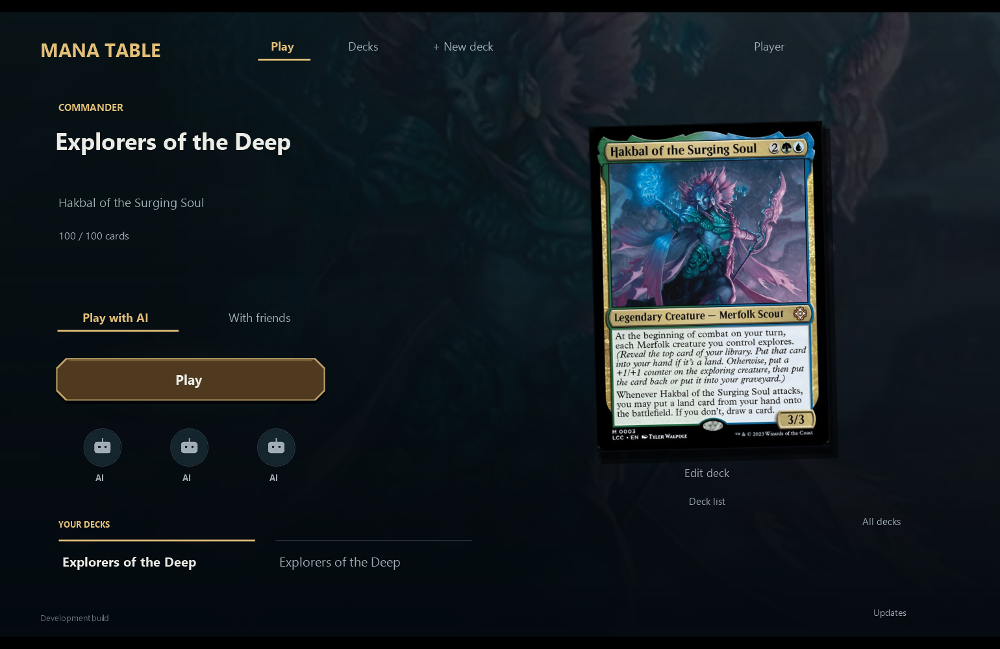
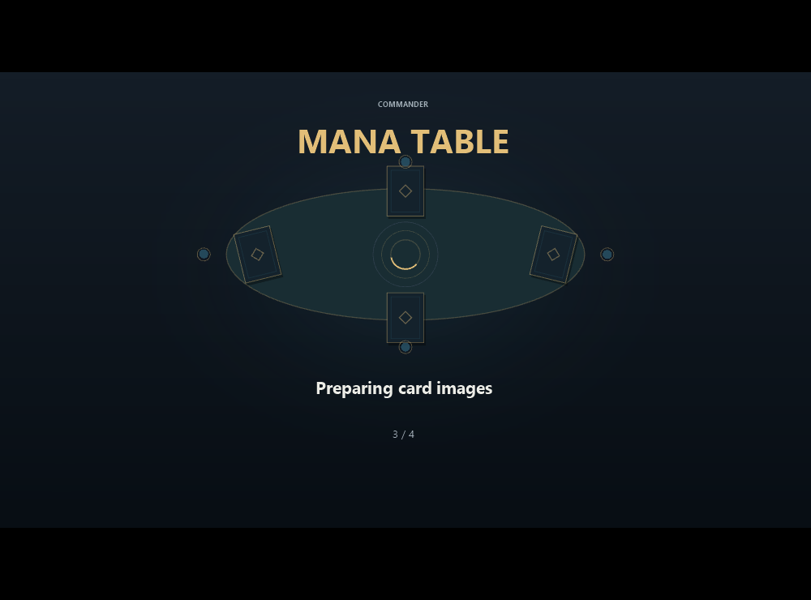
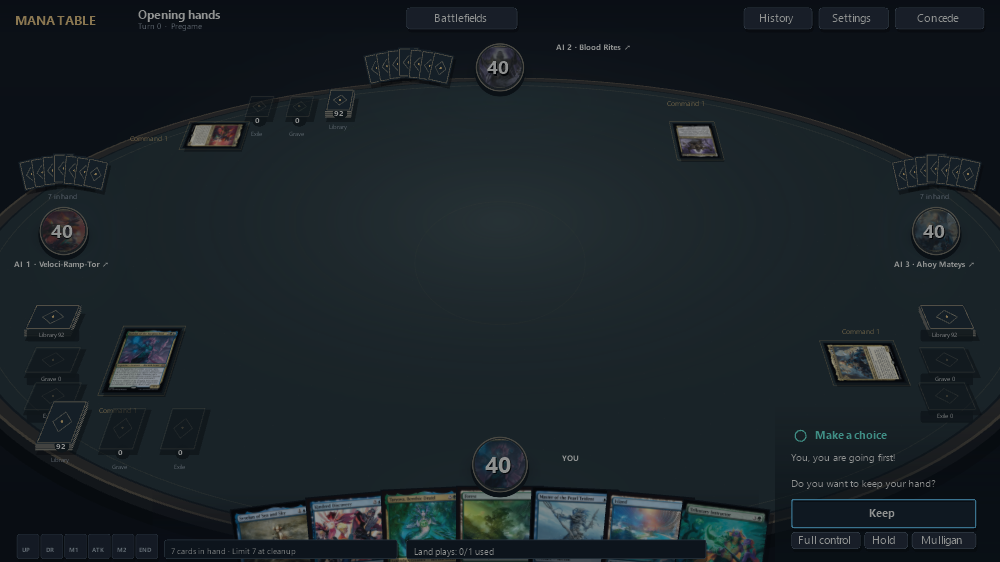
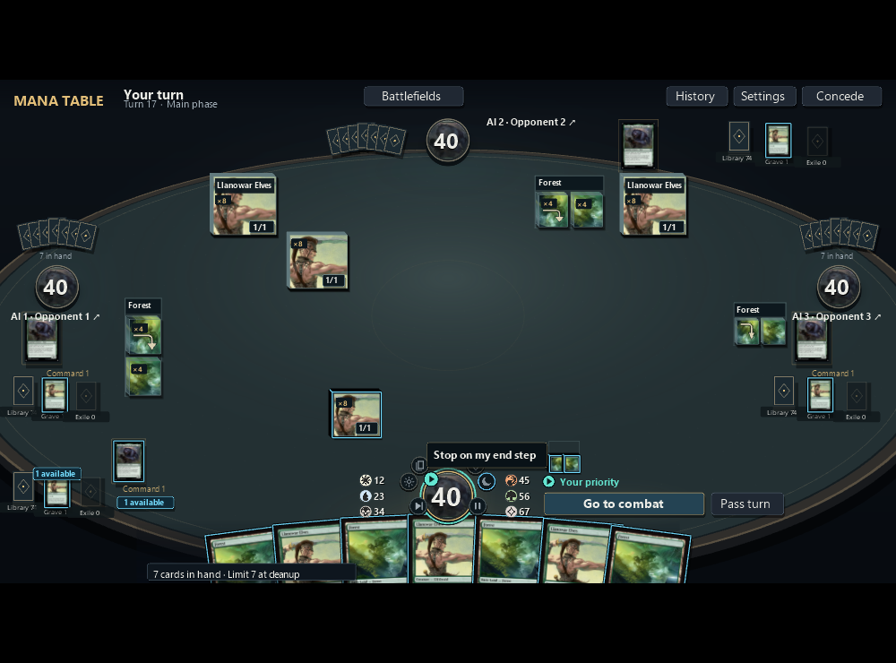
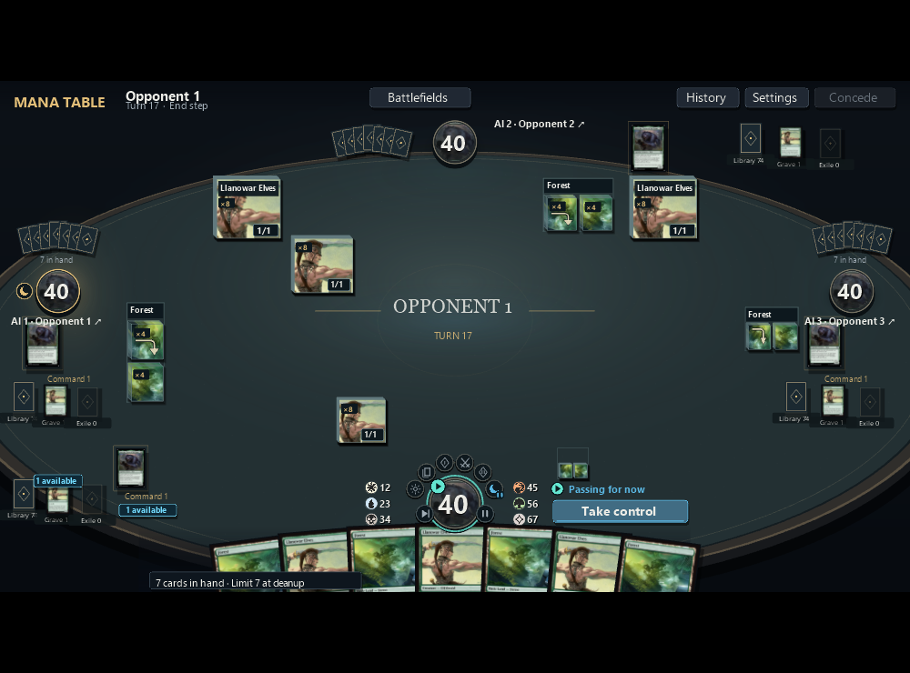

# Review the Mana Table experience

Use the Experience Lab to reproduce a presentation problem immediately, then
review the corresponding live-game behavior. Automated checks establish scoped
command safety, state projection, privacy and geometry invariants. They do not
approve the UX. A count of passing checks, represented cards or captured frames
does not establish that a person can understand or use the screen.

## Design rules learned from player feedback

1. **Design the journey before its controls.** Identify the player's intent,
   source, target, gesture and visible result. Moving the same generic Activate
   button from a dialog to a corner or over the artwork does not fix its purpose.
2. **Use the right detail for the task.** Battlefield faces prioritize identity,
   art and current characteristics; inspection preserves a recognizable full card
   with complete rules and authoritative live state.
   Keep the battlefield context. Reading is noncommitting; hand play uses the card itself.
   Concrete engine actions belong beside their source, with quieter alternatives
   for routine gestures. A live card face can integrate changed characteristics;
   replacing it with a cropped illustration, generic prose panel and rules pages
   loses its identity.
   Card names are identity, not disposable summaries: never replace their endings
   with ellipses or shrink the font to squeeze them in. Reserve room for complete,
   wrapped names. A genuinely compact overview face needs a complete name on
   inspection or a source-attached hover cue; a partial word is not a useful label.
3. **Show state and causality where they happen.** Connect source, pending effect,
   affected objects and settled state. Current stats, counters, resources and
   gained abilities must remain inspectable after an animation, with their sources
   where the engine reports them. Repeated labels and a paragraph of
   changes cannot substitute for that relationship.
   Public-zone inspection also needs the relevant casting route, its cost and
   conditions, and reliable recent zone history. A public capability is distinct
   from a current legal action, especially when inspecting an opponent's card.
4. **Keep asynchronous work from disrupting interaction.** Preload authorized
   likely artwork; prioritize visible and inspected cards. A background observation
   should not flicker, disable or move an unchanged control. Retain local intent
   and revalidate its exact engine permission before commitment.
5. **Let the engine describe the game.** Use authoritative current characteristics,
   action handles and decision constraints. A list intended for auto-pass is not
   a complete action catalog. Simplify presentation without inventing availability,
   skipping required choices or hardcoding a mechanic's maximum.
6. **Treat rejection as design evidence.** Revisit the interaction and information
   hierarchy before polishing its container. Review the actual entry, gesture,
   interruption and result with realistic art and the relevant crowded state.
   Use existing canonical cases and focused checks; record human feedback and its
   scope separately from automated safety results.
7. **Separate seating from attention.** At multiplayer tables, keep controller
   territories and reading direction stable. Turn ownership, priority and required
   decisions are different facts. Direct attention to the relevant source,
   recipients and responder without rearranging everyone's battlefield.
   Reserve room for portrait resources before packing cards. Mana quantities
   must remain separate from both card faces and the life total.
8. **Reduce repeated interaction through explicit, bounded intent.** A burst of
   equivalent choices should support assigning them together, followed by an
   interruptible continuation. Keep every underlying trigger, target restriction,
   response window and effect in the engine. Grouping presentation does not make
   separate effects simultaneous or authorize choosing for another player.
9. **Finish the everyday lifecycle.** Deck management includes creating, naming,
   editing, saving, importing, duplicating, exporting, deleting and recovering a
   deck. Review these ordinary journeys before describing the experience as complete.
10. **Make game intent the navigation.** Home and pregame are one place to choose
    a deck and play. A local prepared/confirmed flag is an implementation detail,
    not another role the player must complete in a form. Joining a table,
    selecting a list, becoming Ready and starting a game are distinct actions;
    keep real multiplayer consent explicit while removing redundant review gates.
    Build, tune and test the same deck in context. Do not make a player translate
    between administrative dashboards or find a role menu before taking the next
    natural action.
11. **Keep timing intent attached to the player's seat.** Show the current phase
    separately from a planned stop, and state whose turn that stop applies to.
    Stable local controls should remain beside the local portrait while another
    player's actual phase directs attention to their seat. Auto, Hold, a bounded
    yield and a required decision have different authority and lifetimes; visual
    consolidation must preserve those distinctions.

## Whole-game audit and redesign: 22 October 2026

The player rejected both the landing screen and the following lobby as a website
rather than a game. Repainting their panels would retain the problem: the player
first chose a role, then entered another setup screen, then reviewed and confirmed
a deck before reaching Play. The redesign starts with the player's actual deck
and commander identity and continues into the actual people at their table.

This is the full journey audit, not a claim that the whole game has been
redesigned. The home, deck and opening-artwork slice was developed on
`feature/game-home-20261022`, based on published 0.2.78, and merged through
[PR #20](https://github.com/proflayton/Mana-Table/pull/20). The current portrait
turn-controls candidate is **`feature/portrait-turn-controls-20261022`**, based on
that merge, `e620af527c3eb5525334e230b352d602ac86a0d0`. Those timing controls
remain a source candidate; use an installer's build identity for shipped behavior.
Final commit/build identity, actual-window evidence and human acceptance must be
recorded in the PR. **Human review of the new portrait turn-controls iteration
is pending; earlier preview acceptance is scoped below.** Older dated
entries below record their own review scope and must not imply acceptance of
these new journeys.
The player's latest "looks a lot better" records positive feedback on the
experience they viewed; it does not establish acceptance of the whole game or
changes they have not reviewed.

### Preview acceptance and review captures

On 22 October 2026 the user accepted the linked native preview with "lgtm"
after the opening-artwork update. The reviewed product candidate is
`4f2a6a002c02e53b9f27970f94be879c3bc6ac8b`, with `Mana.Game.dll` SHA-256
`1C101B421FBBCFED426C5191D9CEE3AACCFF82A3B4562B700636D094AB3CE364`.
This accepts the presented preview; it does not establish review of every audit
scenario or remote CI. The user's individual window settings were not recorded.

These agent captures use the bundled Explorers of the Deep precon and a
controlled loading fixture, rather than a user's saved deck list. Home is shown
at 1540 x 1000; loading is an actual 1000 x 740 window; the opening hand is the
1000 x 625 rendered table within that window. They illustrate the implemented
journeys, rather than supplying human acceptance by themselves.







### Portrait turn controls: release 0.2.83

The player's Arena reference places phase and timing intent beside the avatar
and hand, with an explicit hover action such as "Stop on my end step". The
lesson is the relationship and scope, rather than another row of distant buttons.
The former bottom-left abbreviated phase cells and bottom-right Auto/Hold/pass
controls split that relationship. "Always pause" also overstated a saved stop
that only applied on the local player's turn.

The new design anchors six compact own-turn markers beside the local portrait.
The actual current phase lights separately from the persistent saved-pause mark.
Hover describes adding or removing a recurring own-turn stop. The active
opponent gets a read-only actual-phase cue at their portrait; local controls
remain stable instead of creating four sets of controls. Auto/Hold icon controls
explain their state and F/Ctrl shortcuts on hover. The explicit priority pass,
bounded Pass for now and Take control share that portrait-side area. Required
targets, searches and payments keep their current source/decision context.

This is a presentation iteration over the same `DecisionDock` facts and shared
pause gate. Auto still requires authoritative `CanAutoPass`; Hold only suspends
local automation for the current turn. Pass for now still requires the engine's
current opponent-turn quiet-yield token, and Take control cancels future passes
while reconciling an already submitted command. Own-turn stops recur until
removed and prevent automatic passing at a legal priority opportunity; they do
not create a phase where the engine offers no input. Per-ability until-next-turn
preferences retain their distinct engine-owned scope and expiry.

The user accepted the presented native preview with "lgtm" on 22 October 2026,
at revision `adac239e1d2b11f86afe90a384415051411e274b`, recorded in
[PR #21](https://github.com/proflayton/Mana-Table/pull/21). The merged controls
shipped in 0.2.83. Individual manual gestures and window settings were not
recorded; this acceptance does not close the remaining dense-field audit.

The captures below are actual 1000 x 740 windows from the existing card-state
journey, using authored four-player state and cached card art. They show the
own-turn stop gesture and the explicitly armed quiet pass; they do not simulate
rules or by themselves establish human acceptance. The same journey also runs at 1540 x 980.





### Findings, current slice and remaining scope

| Area | Audit finding | Candidate work or remaining design |
| --- | --- | --- |
| Home and deck selection | A large title, three explanatory routes and a decorative table concealed the player's saved deck and added another setup destination. | Current branch uses the selected commander's real card/art, complete deck identity and a compact saved-deck rail. Play modes change in place. Empty libraries lead to existing import/precon/build actions. |
| Solo pregame | Review/Confirm was a mandatory administrative stage before preparing AI seats and enabling Start. | One Play intent captures the valid saved deck, prepares compatible opponents if needed, then starts it. Reading the optional deck list is entirely noncommitting; its Back action does no engine preparation. An explicit opponent-customization gesture prepares compatible choices on demand. |
| Friends pregame | Deck confirmation, readiness, seat occupancy and the host's start permission were explained through multiple panels and repeated instructions. | Current branch presents actual seats, portrait/identity and readiness together. Host/Join brings a valid chosen list but never readies it. Explicit Ready assigns the current list if needed; only a ready host with authoritative CanStart can start. |
| Build, tune and test | Separate builder/analysis/workshop presentations make one deck feel like different tools; reading a sampled card can divert into another detail flow. | Build/Tune/Test/Results retain the same selected document and version. Tune keeps its selected relationship and evidence beside a separate full-card reading region; Test keeps the sampled hand intact while its card is read. One explicit Start test game prepares compatible opponents if needed, then starts the captured version. A draw sampler is not a rules-game or a measured land-drop result. |
| Card and ability interaction | Ordinary source reading, stack references and legacy action paths compete; generic Activate and role labels can obscure the concrete action. | This slice removes redundant reader/action surfaces and keeps offered costs/actions beside the current source. Remaining alternate-face and required auxiliary readers need the same read-only policy; do not delete their visibility safeguards to simplify the UI. |
| Small choices and ordering | A handful of cards can still appear inside a paged form with search, navigation and repeated prose. | Sparse-choice decluttering is part of this source slice. Prefer the actual choices and visible order marks, retaining complete names and the engine's constraints. Large searches still need discovery/navigation; small choices should not inherit their furniture. |
| Combat and damage assignment | Allocation still uses paged recipient rows and a nested amount editor, separating the assignment from effective P/T, marked damage and lethal constraints. | Remaining redesign: edit the amount at its actual recipient while keeping source, blockers and current characteristics visible. Preserve every minimum, maximum, lethal-order and optional-skip rule. |
| Priority and yielding | Players hesitate to advance a pending effect and repeatedly pass because one response exists. Per-ability yield controls still open a large paged settings surface. | Release 0.2.83 groups own-turn phase markers, Auto/Hold and bounded passing beside the local portrait, with the active opponent's phase read-only. The presented preview was accepted as recorded above. Remaining redesign: put an ability's until-next-turn policy at its source and show its armed/paused/expired state. Passing does not perform a later search or choose its answer. |
| Results and crowded fields | Detached summaries, repeated counter labels and hidden copies break the connection between a cause and its actual affected objects. | Preserve the existing stable four-seat field, family membership, mana halos, current P/T, exact per-recipient receipts and source/target connections. Review dense composition and settled state as well as animation. Representation counts do not establish readability. |
| Settings, history and system work | Large generic modal surfaces can make ordinary game navigation feel like an administration tool. | Play controls and Updates now share the same right-side system drawer. The table remains visible; scoped drawer input cannot activate it. History, player details and remaining required auxiliary surfaces still need a deliberate size/hierarchy review. Destructive concession and genuine system consent remain explicit. |
| Conversation and table identity | Names, invitations and chat are useful table context but can cover or steal input from the player's current game decision. | Preserve explicit drawers, current table scope, local mute preferences and text-input ownership. No game command, readiness change or other player's private state may be inferred from a message or drawer transition. |

### The journey before the controls

Each row defines what the player is doing, rather than a new screen to add.
Reading never grants an action; a visual transition never supplies a rules result.

| Player intent | Source and target | Gesture | Authoritative transition | Meaningful visible result |
| --- | --- | --- | --- | --- |
| Return to a deck | Saved list and its actual commander(s) | Choose its library entry | Open that exact saved document; selecting another list withdraws any old readiness | The chosen identity becomes the focus, with valid Play or the concrete issue to fix |
| Bring or build a list | File, copied list, precon or new saved document | Import/create deliberately; open the deck to edit | Catalog import/create/edit and persistence return their actual result | The saved list appears in the same library; errors retain the previous selection and the user's input |
| Manage a saved list | Exact saved deck/version or named deletion receipt | Rename, duplicate, export, Delete or Undo explicitly | Storage acknowledges that exact operation; removal is unavailable during a game or connected table | The intended row changes, Undo restores its saved history, and an unrelated selected deck stays selected |
| Tune and test that deck | Selected cards, recommendations, exact version and test question | Read a card, adjust a list, sample a hand or start a rules test | Deck/workshop services record the relevant revision and evidence | Changes, recommendations and outcomes remain attributable to that version; no invented win rate or automatic test conclusion |
| Play against AI | Current valid saved list and chosen/default compatible opponents | One Play | Prepare the captured list if needed, start it, observe the opening decision | Contextual loading leads to the actual opening hand; duplicate input cannot launch another game |
| Gather friends | Current deck, invite and actual table capacity | Host or submit an invite | Connect first; assign a valid chosen deck without Ready | Actual seats appear, including open/AI seats; a later deck-assignment failure does not erase a successful connection |
| Commit a multiplayer seat | Local seat and current saved list | Ready; Not ready reverses only readiness | Select the current list if needed, then set readiness | The local portrait/seat changes state; other players and their decks remain intact |
| Begin the shared game | Actual occupied/ready seats | Host presses Play | Provider permits Start only when its current table can start | Every human receives the real match; a guest cannot start it or answer for another seat |
| Talk to the table | Current conversation and actual participant identities | Open/type/send or mute deliberately | Table-scoped social service records the message; local mute affects presentation only | Readable sender/history and a quiet unread cue, with the underlying game decision and seat readiness preserved |
| Understand a card | Current disclosed occurrence, its complete face and current state | Read/hover/focus; click again to put it back | No game command | One readable card with complete identity, current characteristics and relevant source-linked detail; hidden/revoked objects disappear |
| Play or activate | Current source, exact offered cost/action and required recipients | Deliberate drag or source-attached action, then actual required choices | Submit the current scoped command; engine owns costs, targets and continuation | The source moves/taps/pays as reported; the next required decision remains a separate, understandable step |
| Choose or order | Actual allowed cards/options and source | Select directly; show selection order on the objects | Submit original prompt indices/handles and required order | The selected candidates and their order are clear before commitment, without treating inspection as a choice |
| Assign damage | Damage source, actual recipients and effective combat state | Adjust at each recipient, inspect without losing assignment, then commit | Engine validates distribution and lethal/order constraints | The player can read the intended amount and why that assignment is legal before it is sent |
| Let play continue | Current responder, stack and bounded passing policy | Pass once, Pass for now, or Take control | Engine advances only its own current priority windows; required input interrupts | Status explains who acts next and why automation paused; pending targets and values remain readable |
| Understand what happened | Reported source/event, each recipient and current totals | Watch; optionally read the object or Recent changes | Consume current state and actual event-time outcomes | Source-to-recipient attention, exact increments/actual damage and settled P/T/life remain coherent; pending base values never masquerade as actual results |
| Play again or recover | Actual result, current table or deck-test version | Return, reconnect or retry the failed operation | Keep the intended saved/table context, revoke stale commands, observe fresh authority | The user resumes the correct deck/table or sees the concrete unresolved failure without repeating successful writes |
| Update the app | Available version and current session/save state | Choose Download, then explicitly restart when safe | Updater verifies/prepares the package; installation observes actual game/save blockers | Progress stays in a compact system surface. Closing it does not cancel work or activate a card underneath; no automatic download or midgame restart |

### Implemented source slice and its limits

Home is normal navigation after startup, with no invisible welcome overlay,
WelcomeSeen/TableGuideSeen state, preference loader or completion writes.
The optional Deck list opens the saved document for reading; Back to play only
closes that reader. Neither gesture prepares opponents, selects a multiplayer
deck again nor marks a player Ready. The explicit F1 guide remains available
without becoming a first-run task.

Tune now keeps three distinct places in the workspace: the check/engine/swap
list, its selected relationship and evidence, and full-card reading. Selecting a
relationship keeps its actual required/payoff or current/option cards together;
reading one uses the adjacent region, preserving that relationship and the list.
Long names wrap, the evidence scrolls locally, and only lists with additional
entries expose paging. These layout changes do not establish curated coverage
for every deck or turn estimated recommendations into measured results.

Build/Tune/Test/Results use quiet, consistently placed navigation instead of
another row of boxed tasks. Test is one continuous workspace, with the sample
and optional rules-table setup separated by a quiet divider. Sample captions and
builder rows measure full wrapped names before placing their following content
and hit regions; card-library captions and saved-library names are larger.
Tune normalizes its selected entry, page and local reader scope before header
and navigation hit targets are composed, so a default-selection change cannot
leave those controls stale in the same frame. These changes still require review
with real art, long names and the actual small window at 130% text.

Test separates draw-only practice from a real rules game. Reading a sampled card
uses the setup region while adjacent sample cards remain available; closing the
card restores the current setup. Start test game is one explicit operation:
capture the saved revision, version, question, seat count and chosen opponents;
prepare compatible defaults if needed; revalidate that intent; then start and
observe the real game. Choosing AI opponents remains optional customization,
not a prerequisite button before starting. Draw samples and manual notes retain
their own evidence type and version association.

Settings (Play controls) and Updates use one right-side drawer composition rather
than separate full-screen layouts. Their input replaces underlying hit targets
while the game stays visible. Backdrop/close dismisses the drawer without also
playing a card; closing Updates keeps a chosen transfer running. Updates still
download only after explicit intent and recheck actual game/save blockers before
an explicit restart. These are implemented interaction boundaries, not a claim
that every system, history or auxiliary surface has been redesigned.

Opening artwork now belongs to the table-entry transition. Engine starting and
image preparation are separate: a missing opening seat view cannot appear ready
because it has zero images, and downloaded bytes do not count as ready GPU
textures. The central gate uses current seat-visible faces, lets failed images
settle to readable fallback and bounds the artwork wait to eight seconds after
the first playable snapshot. Other known local-deck art stays background work;
ordinary same-game polls do not interrupt play with another loading screen.
Cache publication uses completed temporary writes before replacing a trusted
entry, so interrupted writes cannot become the next launch's cached image.
Controlled loading checks protect that handoff; actual artwork, fallback and
first interaction still need human review in their relevant window.

### Ownership and removal plan

The provider boundary and rendering refactor support this experience, rather
than introducing another navigation framework:

- The catalog owns saved contents, validity and persistence. A deck summary's
  name/ID is not evidence of its commander art; do not open every list on hover
  or infer its contents to populate a gallery. Use the selected document's real
  commander(s) now; richer read-only summaries require an explicit catalog contract.
- Table setup owns compatible opponents, seats, readiness and CanStart. The
  internal `confirmedDeckId` is only a preparation/synchronized-selection cache;
  it is not consent, a new domain state or a player-facing task. Only an explicit
  Ready intent commits multiplayer readiness. One Play
  intent may encompass several asynchronous setup calls; capture its selected
  document and reject stale completion instead of reading later mutable UI fields.
- `ClientSession` owns serialized command/observation work, decision/source
  freshness and recovery. A failed or empty source-action query is different from
  an unavailable query capability, and none of these states prohibits inspection.
- `Mana.Game` owns local navigation, focus and interaction intent;
  `Mana.Magic` maps semantic tasks and `Mana.Renderer` composes their visuals.
  The emitted game assembly remains isolated from the installed provider.
  Current state, event-time facts and presentation state stay separate, including
  in tests, recordings, grouping, camera focus and cached card readers.
- The shipping host owns installation/provider lifetime. System and deck-tool
  errors must not consume a gameplay decision or silently change a seat.

Remove the obsolete route as its replacement becomes reviewable. The landing
path panels, decorative table and Continue to setup route are replaced by the
shared deck stage. Automatic Review/Confirm navigation is removed from ordinary
selection/import and play. Keep optional deck-list reading and real multiplayer
Ready. The obsolete welcome state, preference loader/writer, first-run flags,
and separate input gate are removed. Home uses ordinary navigation; the table
guide opens only when requested and has no persisted Seen state. Existing
`experience.json` files are ignored, without changing player preferences or
decks. Redundant ordinary reader/action paths, separate Tune detail navigation,
small-choice paging furniture and the former Settings/Updates layouts are also
removed in this slice. Remaining redesign includes the nested allocation editor,
full-screen per-ability policy menu, repeated-target bursts and oversized history,
player and required auxiliary detail surfaces. Do not mark this backlog done by
hiding a control or deleting its authority regression.

### Visual and interaction acceptance for the whole journey

Review actual windows at **1000x740 and a larger window**, with **130% text**,
real cached artwork, missing/slow-art fallback and reduced motion. Record the
candidate commit and reviewer separately from automated safety results. The
following are walkthroughs, not a numerical UX score:

| Case | What the person must be able to understand or do |
| --- | --- |
| Empty first launch; populated return; long and partner commander names | Identify the actual selected deck, choose/import/build one, reach Play directly and read complete identity without a second setup page |
| Solo default Play, custom opponents, invalid draft and failed save | See what will play; get one match from one intent; understand an actual issue instead of a disabled mystery or a forced review |
| Two friends, four friends, three friends plus AI, seat resize and guest | Recognize every actual participant/readiness state, reserve the intended capacity, change only the chosen AI seat and distinguish Ready from host Start |
| Build -> Tune -> Test -> actual game -> Results | Keep the same deck/version/question in mind, read a sampled card without committing, and distinguish a manual note, draw sample and real rules-game evidence |
| Opening hand, multiple abilities, flashback and disclosed library top | Read the intact card and current cost, perform its real gesture, follow payment/target steps, and recover from stale/revoked offers without a guessed action |
| Small private choice/order; large library search; 37 repeated targets | Understand what is required and the chosen order; inspect without selecting; review the remaining repetitive workload honestly. The bounded repeated-choice shortcut is still a separate design/engine task |
| Two-seat and four-seat combat; multiple blockers; changed P/T | Recognize source/recipients, counters, actual stats, assigned/lethal amounts and which player must act, including through inspection |
| `decision-flow.v1`, `counter-damage.v1` and `damage-results.v1` | Distinguish turn owner, responder, required input and Auto pause; see base versus actual damage and the final recipient state |
| `cluttered-changes.v1`, 480 public permanents, Toph/Felidar Retreat | Follow source -> trigger -> affected family/subset -> exact per-recipient counter increment -> settled characteristics, then focus another seat without losing ownership |
| Empty priority, one instant available, ignored ability, new public action | Trust the armed passing policy, know why it pauses or expires, and take control before a meaningful response is lost |
| Import/prepare/connect failure, reconnect and changed decision | Retain input/deck/table context, recognize what succeeded, retry only the failed operation and find the newly authorized interaction |
| Update available, chosen download, cancellation/fallback and restart blocked by game/save | See progress without losing the table, choose when bytes download, close/reopen safely and restart only after explicit safe intent |

Keep the existing headless composition/input, client authority and real-provider
journeys as regression coverage. Update obsolete route assertions to exercise
the new journey; do not restore rejected confirmation screens just to satisfy
them. Use captured pixels and manual interaction to assess comprehension and
game feel. No passing card count, geometry bound or test total supplies that
judgment.

## Partner commander casting: current source, not yet published

A player reported no Cast action for Toothy alongside Pir, during their main
phase with available mana; the installed version was unknown. The exact paired
engine reproduction can cast both and recast Toothy with its own tax. That does
not establish the cause of the player's missing action. The audit found two
concrete client issues: command-zone dragging only supported hand cards, and an
authorized spell action could display only the card name and creature stats.
Commanders now share the deliberate play gesture, and actual engine cast actions
say Cast. The opened source reader also retains the individual commander tax.
Paired pointer checks and a real paid commander journey cover these paths;
inspection alone and a zero-cost commander do not prove paid casting works.

### Accepted hand-play direction: 21 October 2026

The user accepted the linked Adagia preview after reviewing the intact card
reader and then the drag interaction: click to read, drag from the hand or enlarged
face, a compact held card, and a quiet Play land fallback. The hand-play source
was committed as `ab0affd0715`; the reviewed application SHA-256 is
`E261E4540CDC610D5A67057A2F0C207A9E021959E2D5BE4F5A540D64FDC7863D`.
The scripted preview defaults to a `1200x800` window with genuine cached artwork.
Its authored land result and separate real-Forge checks provide different evidence.

This acceptance covers that reader/hand-play direction. Crowded multiplayer
clarity, other ability decisions, artwork latency and quiet-priority behavior
retain their own review status. It does not establish release publication.

## Pass for now regression: 21 October 2026

Player intent is to stop acknowledging empty opponent priority windows despite
having an instant available. The existing one-click control arms that bounded
intent; the engine still owns each pass. Empty combat setup was replacing its
permission before anyone attacked, and normal draws independently cancelled it
through state and history checks. The user reported that it effectively did
nothing. Tests previously started after combat, missing this ordinary journey.

The revised journey keeps the original permission through the exact normal draw
and another seat choosing no attackers. The armed indicator and Take control
remain available; public actions, actual combat, other required choices and a
turn change return control. Reading pauses passing without committing a command.
Real-engine checks and actual application input cover these transitions and the
next spell's unanswered response. Human review of the corrected behavior remains
pending. This fix shipped in 0.2.69.

## Decision area iteration: current source, not yet published

The player could not tell why Auto stopped or what had just happened. The lower
right mixed policy settings, required input, repeated effect prose, waiting and
an additional result plaque. A saved stop looked like an ordinary priority
window; the display could even claim Auto was passing while reading paused it.

The current gesture belongs in one action row. Public actor ownership and the
actual local Auto gate supply its status; background polling supplies neither a
new action nor a new pause. A saved phase stop has a visible pause mark and an
explicit removal control. During empty opponent priority, Pass for now arms the
existing bounded policy in that row; Pass once stays a smaller alternative and
Take control occupies the same row while armed. Required choices remain separate
engine decisions. Pending effects retain source, target and amount together;
their heading identifies resolution order rather than repeating the responder.

Current results remain at the affected objects. The separate Why/Show cards
plaque is removed when the source is visible. A currently public offscreen cause
can use a compact source-to-increment-to-recipient bridge; it never adds changes
across recipients into one apparent creature's total. Retained details stay in
Recent changes. This is implemented presentation, not human UX acceptance.

`decision-flow.v1` is the authored four-player review journey: last land, saved
stop, public responder/choice ownership, damage targeting, a response, priority
and the actual-result payload. Land, target and pass gestures use current scoped
handles; external checkpoints still use Next. It does not simulate Magic rules.
Review the complete window at small and large sizes, with text at 130%, focused
fields and reduced motion. Human review of this iteration remains pending.

## Results stay with their recipients: 22 October 2026

The player's intent is to understand what an action actually changed. The journey
is source and base amount → chosen recipient → pending priority → reported impact
→ settled state. Target selection and priority still use their exact engine
permissions; result cues are noninteractive observations. A pending value is
never evidence of the amount dealt. For example, Urza's Armor can turn three
base damage into two actual damage and a separate two-life loss.

The next source iteration adds typed actual damage/life events, brief amounts
beside their recipient, and exact counter increments beside counter badges.
Current P/T, marked damage, counters and life stay visible after a cue expires.
Amounts use public event recipients; neighbouring resolution events are not
treated as proof of cause. A public departure can retain its impact briefly;
hidden-zone revocation immediately removes its card cue and retained face.
Routine success and draw prose stays in History instead of opening another
panel over the table. A reported failure to resolve still receives notice.

Review `damage-results.v1` through surviving, dying and prevented-damage
checkpoints, and `crowded-counters.v1` through earthbending and the landfall
burst. These are authored presentation cases. Separate real Forge checks
establish the prevention result across four seats. Inspect the actual window,
including a focused seat, 130% text, reduced motion and resize/fullscreen.
Collision and event tests protect data and input; they do not establish visual
clarity. This iteration is source-only until its next verified release. Human
review remains pending.

## Resolution follow-up: 21 October 2026

The user reports that the game does not feel crisp. The previous window path
rasterizes a fixed-size scene and logical-resolution glyph textures, then
bilinearly scales the completed frame. The next rendering revision instead
paints at the fitted backbuffer's pixel dimensions, with separately rasterized
glyphs at that density and a 1:1 final copy. This preserves logical layout and
shared pointer geometry. It is separate from the tested playable release.
Compare actual small/large-window text, fine edges, full-card inspection and
pointer gestures; density/alpha checks do not approve perceived sharpness.
Card-image source resolution and very small overview labels remain separate
constraints. Human review of this revision remains pending.

Agent review compared unscaled window captures at 1000x740, 1540x980 and
1920x1080, including the actual setup controls, a busy focused battlefield and
the full reader with its state column. Menu and reader text are visibly cleaner
at the larger sizes; small overview labels remain intrinsically small. Reviewed
pointer gestures remained aligned, and no new clipping appeared in these
captures. These findings apply to candidate `crisp-r2`, separate from the
published gameplay candidate; they do not establish human acceptance.

The ordinary cached card face is 488x680 pixels. At the current full-reader
size it is slightly enlarged at 1920x1080 and approximately doubled at 4K, so
the printed card text still has a source-image limit. A later higher-resolution
reader cache must preserve printing and face identity, show the existing image
while loading, and bound GPU memory independently of ordinary thumbnails.

## MTGA references reviewed: 21 October 2026

The user's seven Arena screenshots make the battlefield/inspection hierarchy concrete:

| Visible evidence | Mana Table design implication |
| --- | --- |
| Battlefield faces emphasize artwork, a narrow name strip and current P/T; full rules are absent at this scale | Give battlefield, inspection and pending effects distinct presentations of the same occurrence. Preserve full card identity and rules when reading. |
| The first local Pridemate is 3/3 beside a small counter badge showing 1; the second is 7/6 beside a badge showing 4 | Make authoritative effective stats primary. A counter quantity is supporting state, not a formula for current P/T. |
| Related cards sit behind the second Pridemate, with small icons on its frame | Keep attachments visibly associated with their host; retain inspectable identity, counter types and ability details. The still does not establish every icon/effect's meaning. |
| The third screenshot's inspected Pridemate displays 9/8 in its own stat box, six +1/+1 counters, and gained Lifelink/Ward {2}; the detail blocks identify Sheltered by Ghosts as their source | Inspection should explain effective state and provenance while remaining recognizably the card. Keep these details available on demand, rather than displaying every explanation on the battlefield. |
| Creature rows, rotated lands, the hand and the turn cue occupy distinct places | Establish a stable spatial hierarchy before adding labels. Test an equivalent hierarchy across four seats rather than copying two opposing halves. |
| The fourth screenshot keeps Exemplar of Light recognizable as a full card, with a Flying explanation adjacent to it and the battlefield continuing behind | Treat the card and its contextual explanation as one inspection area. Its placement must preserve the current source, eligible targets, hand and decision; four seats make this a layout concern, not just a tooltip concern. |
| The fifth screenshot inspects an opponent's Tidings of War with adjacent Cost Modified, entered-the-graveyard-this-turn, Flashback and Amass explanations; the card's rules include a different result when cast from a graveyard | Make public-zone capabilities and casting context discoverable. Keep printed cost, route-specific cost, conditional effect text, recent history and current legal permission distinct. The still does not establish that the opponent can cast it at that moment. |
| The sixth screenshot presents three Ajani Resolute abilities as distinct faces with shared source artwork, individual effects and prominent loyalty costs of 0, -4 and -10; two have bright outlines and one is muted | A real ability choice can use readable game objects and engine-reported availability. Preserve exact costs, source identity and the continuing battlefield; a chosen ability begins its actual payment/target sequence. Do not infer a disabled reason from styling alone. |
| The seventh screenshot places a small glowing mana symbol and quantity 4 beside the opponent's portrait | Keep actual unspent mana associated with its seat through recognizable symbols and exact quantities. Stable positions and brief change emphasis communicate the pool without rectangular letter labels. The still alone does not establish animation timing. |

Also reviewed sampled frames from [LegenVD's earthbending/landfall match](https://www.youtube.com/watch?v=38QyBm7unec)
(24 November 2025). Full video retrieval returned HTTP 403; public storyboard
samples cover roughly 6:20–13:15 at about ten-second intervals, at 320x180 per
sample. Times below are approximate. These establish visible layout and overlap,
not continuous motion, exact gesture timing or hard-to-read effect semantics.

| Sample | Observation | Apply or avoid |
| --- | --- | --- |
| [About 7:48](https://www.youtube.com/watch?v=38QyBm7unec&t=468s) | An enlarged original face sits beside the continuing hand and battlefield | Preserve identity and context during inspection. |
| [About 8:48](https://www.youtube.com/watch?v=38QyBm7unec&t=528s) | Trigger ordering presents the actual cards between explicit Last/First endpoints | Show order spatially, with its direction clear. A dedicated ordering workspace does not justify a dialog for every activation. |
| [About 10:57](https://www.youtube.com/watch?v=38QyBm7unec&t=657s) | Battlefield/portrait emphasis coexists with pending cards at the side | Direct attention to affected objects while retaining the pending source. |
| [About 11:27](https://www.youtube.com/watch?v=38QyBm7unec&t=687s) | Large links, outlined cards and an enlarged face compete across the board | Show relevant relationships selectively; multiplying every connector across four seats would amplify clutter. |

Wizards' [Sylvan Library design account](https://magic.wizards.com/en/news/mtg-arena/dev-diary-sylvan-library)
and its three UI images show eligibility on actual hand cards, a **Pay 8 Life**
commit action, and a separate ordering step when needed. Our inference: name the
actual command/consequence and preserve source context. Compress repetitive
decisions only through engine-authorized equivalence; their sequential fallback
handles interactions that change what the player can learn or choose.

The official [Smart Priority guide](https://magic.wizards.com/en/news/mtg-arena/announcements-october-27-2025#a-quick-guide-to-smart-priority-for-powered-cube)
documents automatic skips and card-specific exceptions. Our inference: learn
from the pacing goal, while making our yield intent visible and revocable.
Current responder, active turn and required decision ownership need independent
representation at a multiplayer table.

Next comparisons should reuse `crowded-counters.v1` for board hierarchy and
selective cause/recipient feedback, `stack-priority.v1` for response ownership,
`card-reading.v1` for authoritative stats/abilities across board and inspection,
and `ordered-choice.v1`/`trigger-search.v1` for meaningful choices. Compare actual
screens and complete journeys with people. These references propose design
directions; they neither implement nor accept new Mana Table behavior.

The currently accepted reader retains its original image and places effective
state alongside it. State-aware inspection is a follow-up design question, not
a reason to restore the rejected generic rules panel. Missing modifier provenance
requires an engine projection; the client must not guess it from printed text.

### Public-zone capabilities and contextual inspection

The opponent-graveyard reference extends the same design beyond battlefield
stats. The player's intent is to understand a public card that may matter again.
A quiet cue on its public zone leads to that exact card's inspection; reading
sends no game command. Preserve its full face and explain the relevant ability,
casting route, known cost/conditions and reliably reported recent zone transition
beside it. Keep that zone associated with the correct seat at a four-player table.

Use a generic engine projection for public abilities and casting context across
zones. A printed mana cost, an alternative cost, a conditional result and legal
availability now are different facts. A route-sensitive spell can have a different
result from its ordinary cast; retain that conditional rule without presenting
it as an already resolved outcome. Show effective costs or modifier sources only
when the engine can authoritatively report them; some costs remain dependent on
choices. The viewer's private action catalog cannot describe an opponent's options.

Keep the normal table quiet: expose concise public-zone cues, with explanations
on inspection rather than a permanent rules panel for every graveyard. Relevant
zone history must come from durable, scoped engine facts, not an assumption that
the retained activity tail is complete. Clear stale card details on visibility
revocation. A face-down or otherwise private occurrence never acquires a visible
identity, cost or ability merely because another card uses a familiar mechanic.
This is a design requirement; generic casting-route/cost and recent-zone
inspection have not been implemented by recording this reference.

### Ability choices as readable game objects

The Ajani reference supports a deliberate choice between concrete abilities:
each face shares the source identity/artwork, states one effect, and makes its
own cost easy to compare. Selecting a face starts that exact engine ability;
subsequent payments and targets retain their normal rules. Keep cancellation
and access to the battlefield available. A source with one concrete action
retains its direct route instead of adding an unnecessary choice step.

This requires a richer engine projection than today's source-action Id/Kind/Text.
Forge has typed cost parts and availability, but the current catalog filters out
unavailable abilities and combines costs/effects in its display text. The next
projection needs separate engine-formatted cost and effect information, ordered
option identity and availability. Only legal current options receive action
handles. Preserve zero/variable/modified costs and unknown availability reasons;
the UI must not split a string at a colon or invent why an option is disabled.
This ability-choice presentation is a follow-up to the table study, not a feature
implemented by adding this reference.

### Four-player direction: stable table, selective attention

**Native lab prototype; human review pending.** The
[spatial study](images/four-player-attention-study.svg) separates controller
territories from the current interaction. Its shapes illustrate relationships,
not final card styling or proof that crowded boards are readable. The sketch
omits the hand, zone piles and full-card inspector; fitting those while retaining
the action context is part of the native comparison below.

The source now includes an explicit **Table study** mode in the Experience Lab:

```powershell
& 'C:\candidate\ManaTable.exe' --experience-lab four-player-table.v1 --table-study
```

The header toggles the study for that same snapshot. It uses the production card,
presentation and input pipeline over authored projections. The four checkpoints
include ordinary boards, only one crowded opponent, a cross-seat Ballista ability
and its damage result. The hand, public command/zone piles, attached equipment and
counter-bearing creatures are present together. The study is not the default
layout for normal games or a released feature.

`SharedTableStudy` arranges upright scan faces independently within fixed role
lanes. A pending stack or another controller's density does not participate in
packing. Battlefield faces prioritize real artwork, complete wrapped names, current P/T,
small counters and state glyphs. Every occurrence remains represented; differing
public states remain separate. Full inspection retains the battlefield anchor,
keeps the original card readable, overlays authoritative P/T and attaches typed
counter/damage/state chips below it. The pending effect uses a reserved area and
can occupy its remaining space beside an opened reader. Hand play retains its
existing scoped drag behavior.

Names use measured space at a fixed font rather than ellipses or smaller type;
copy quantities occupy a separate corner. Support lanes have more caption room.
The local support cluster sits to the left of the creature row, with lands on
the right, leaving the portrait's mana area clear.
When an overview face cannot hold its complete name, it retains its art/state
and exposes one complete source-attached name on hover without moving the card.
That fallback does not settle dense-board readability.

Same-named public permanents now share a family in the study, including lands.
Matching copies use a bounded fan/count; tapped state, effective stats, counters,
damage, attachments and current selectable/highlighted state retain separate
subfaces within that family. The family grants no shared permission. Required
target, combat and ordered choices expose their actual candidate occurrences.
Face-down identities stay anonymous and separate.

Clicking a player's portrait when it is not a legal player target opens a native
two-field view: the chosen opponent above your battlefield, with the remaining
players on a portrait/resource rail. Your hand, priority controls and pending
effect remain available. Their nameplates allow read-only focus changes while
portraits continue to answer actual player-target decisions. Whole table or
Escape returns; a second portrait click also closes that focus. This changes
presentation geometry without changing viewer identity, game state or action
keys. The busy checkpoint includes matching Scute Swarms and tapped, counter
and nonlethal-damage variants for reviewing that journey. The user's feedback
supports this grouping/focus direction and asks for larger reader details beside
the card; that revision has its own review status below.

The focused layout gives the selected opponent more field space and packs state
families horizontally before filling the remaining rows. It does not simply
scale the four-seat layout. Tapped state remains visible in the full reader;
marked damage uses a separate red mark and quantity beside current P/T.

The next reader revision follows feedback on Hydroid Krasis: live counters and
abilities sit in a larger, vertically stacked column to the right of the full
card. The small duplicate counter badge below the reader is removed. The card
and details reserve space together, keeping pending effects and current actions
separate; the column absorbs clicks without activating a battlefield card.
Human review of this revision remains pending.

Opening-hand reading uses the same full-card reader during the engine's exact
`InputConfirmMulligan` prompt, retaining both Keep and Mulligan controls. This
exception applies only to the viewer's visible hand. Entering the distinct
`InputLondonMulligan` bottom-card selection closes reading and preserves required
card clicks; neither general intent nor prompt text grants browsing permission.
Tapped scan faces now use a prominent curved arrow within their illustration,
behind names, current stats and badges, replacing the tiny tapped glyph wherever
the larger cue fits. The full reader retains its separate Tapped detail.
Both changes need human review on their own exact candidate.

Live three/four-player launches now enable this layout by default, matching the
reviewed playable build. `--classic-table` retains the previous layout for
comparison. The normal engine and setup remain in use; this does not enable
automation or replace snapshots with authored scenarios. This launcher default
is awaiting publication in the next update.

The native source also reuses Forge's bundled mana-symbol atlas for compact
portrait pools: symbols and exact quantities with a quiet glow, using the
existing gain/loss cues. Spending a color removes its number immediately while
the symbol fades; reduced motion settles immediately. Pool inspection retains
full color names, colorless and unfamiliar resources. This visual change remains
available in the local study until included in a published build.

Focused geometry, privacy and pointer checks protect these mechanics. Actual
small/large-window review remains separate. The busy far seat and the extreme
480-permanent overview still become too small for comfortable card recognition.
They need a better density/focus design; retaining the occurrences does not settle
that issue. The prototype still uses the existing letterboxed game surface.

Start with a shared table: the viewer below, with other seats clockwise at the
left, top and right. Reconsider the current territory dimensions. Give every
seat viewer-upright battlefield faces with identity, art and authoritative P/T;
put creatures toward the shared action area and resources/support farther out.
These are spatial relationships, not permanent role headings or four framed
miniature screens. Place cards by current controller; retain original ownership
in inspection. Cross-controller attachments still need their controller cue.

The alternative of three opponent bands above one wide local field deserves a
visual comparison, especially in a larger window. At a small window, its narrow
opponent strips compete with full-card inspection and the pending-effect area.
The shared-table study is the first prototype, not an accepted final layout.

Reserve action/inspection space before arranging fields. The default
`BattlefieldLayoutContext` switches the whole table to bounded packing when any
seat exceeds seven public-state groups, and its conditional stack/source
reservation intersects a battlefield territory. This can move unrelated cards
when a new effect appears. Layout stability requires changing that composition,
not merely repainting smaller card faces. The study bypasses that global packing.
Priority eligibility or an identical
snapshot should not repack the table. P/T, counters or attachments can correctly
split a copy group; preserve unrelated anchors while updating that membership.

Plan against the actual viewport and text scale. The current fixed 1600x900
game surface leaves unused height in a 1000x740 window while squeezing all four
fields into the remaining band. A new composition should use that available
space, with drawing, hit testing and inspection sharing the same geometry.

The first complete journeys to prototype are:

| Player intent | Source, target and gesture | Engine transition and visible result |
| --- | --- | --- |
| Read another player's modified creature | Click that exact public occurrence; inspect a counter or ability beside its full face | No game command. The source position stays identifiable; inspection shows current P/T, typed counters, gained abilities and any engine-projected modifier sources. The reading area stays fixed while used. |
| Follow an off-turn response | Inspect the actual source or target of the pending effect | Reading does not pass priority. Turn owner, pending-effect controller and current responder retain distinct cues. Relevant occurrences highlight individually; the entire effect container does not behave as one card. |
| Understand combat against two players | Select an attacker or defender and inspect its actual related blockers | Keep all seats present. Emphasize that combat relationship and its authoritative stats; do not permanently draw every possible connector across the table. |
| Understand Toph followed by Felidar Retreat | Follow the reported source, changed land, then affected creatures | Brief source-to-result emphasis settles into current card state. A mass effect emphasizes its recipients together; it does not produce 82 simultaneous arrows or persistent explanatory panels. |
| Read a very crowded seat | Deliberately inspect or focus the relevant region and exact occurrence | Focus/zoom preserves a way back to the same whole-table location and keeps other seats locatable. Distinct state and eligible occurrences remain reachable; no hidden overflow page. Native portrait focus is implemented in the optional Table study; adoption in ordinary gameplay awaits human review. |

Use a quiet persistent turn accent and a separate responder/decision cue, rather
than moving the camera each time priority changes. Keep the hand anchored.
Automatic turn-follow remains an optional experiment; never move the view during
reading, dragging, targeting or a required choice. Pending characteristics stay
pending: for example, a targeted 1/1 does not display Giant Growth's 4/4 result
before resolution. Inspection and all compact views resolve the same current
authorized occurrence without turning visual identity into an action handle.

Compare the same ordinary table, one heavily crowded opponent, two defenders,
an open full-card/ability explanation and the 480-permanent case at both small
and large windows. Existing ordinary/crowded/priority canonical cases provide a
starting point; `four-player-table.v1` adds the asymmetric checkpoint. Review the
actual gesture through its result with people; fitting every occurrence is not
evidence that they can identify it or follow the action.

### Repeated targeted triggers: 37 draws

The user reported 37 draws causing 37 one-creature targeting interactions and
repeated manual resolution. This is a generic interaction requirement; the card
name is not needed to define the design. This section specifies a required
canonical journey for the refactor, not an implemented shortcut or loadable lab
case.

Two independent intents are needed:

- **Assign targets together.** Present the equivalent trigger group beside its
  source. Choosing a creature can assign it to the group with an explicit
  same-target action; distributing assignments remains available on the actual
  eligible creatures. Show pending assignment quantities on those creatures.
  Those quantities count triggers, not promised counters, damage or final P/T.
- **Continue through this group.** After assignments, let the player yield their
  own priority for the captured group. Keep Take control available, show the
  remaining group and update actual card state as effects resolve. Do not require
  another click or a full animation pause for each equivalent resolution.

Normal targeted triggers choose their targets while entering the stack, before
resolution. Other players still receive their response opportunities between
resolutions; a local continuation cannot resolve on their behalf. These are
separate stages under [rules 115.1d, 603.3d and 117.4](https://media.wizards.com/2026/downloads/MagicCompRules%2020260925.pdf).

The engine must identify the finite group and supported choice equivalence,
including controller, source occurrence, ability/mode and targeting constraints.
Each target assignment uses current legal candidates and the current prompt.
Never reuse an old card key, infer equivalence from matching names/text, or
automatically choose a replacement when a target becomes unavailable. Required
payments, optional decisions, changed constraints, an intervening action, a new
trigger outside the group, cancellation or uncertain connection return control.
Expected effects from the group can continue; stopping on every counter change
would recreate the original problem. New triggers never silently extend the
player's authorization.

Current Pass for now only covers empty-stack windows. Ordinary Auto requires
the engine's no-response permission. Neither covers this intent. Forge's existing
stack yields and optional-trigger acceptance provide useful primitives but do
not batch target selections. Forge already skips some target prompts when a
mandatory trigger has only one legal card, so repeated Resolve clicks must be
distinguished from actual repeated target choices. The native boundary still needs group identity,
current assignment permissions and bounded continuation; exposing a broad
persistent yield preference is not the specified behavior.

The canonical journey must include all choices aimed at one creature, choices
split between creatures, target loss, an opponent response during resolution,
a new mandatory decision and new triggers created by a group member. Review how
people assign, inspect, interrupt and understand the resulting state on a crowded
four-player table. Separate the mechanical preservation of 37 triggers from
human review of the grouped presentation and pacing.

### Counter-triggered damage: 22 October 2026

The reported All Will Be One targeting prompt showed generic "that much damage"
rules and internal identifiers instead of the actual amount or the counters
added to Chandra. The revised journey keeps the source, captured increment and
full recipient name together while choosing a target, then carries that same
context onto the stack. A board receipt attaches to the recipient's counter
anchor outside its face when space permits; settled counters and P/T remain
authoritative. Source/origin hover reads the disclosed card without choosing it.

An increment is not a current total: adding one loyalty to reach four produces
a captured one-counter context. Pending damage is reported before replacement
or prevention, with single/per-recipient/divided-total meaning preserved; an
unknown amount remains unknown. Actual resolved results come from the engine.
The UI does not derive these values from rules strings, current counters or the
most recent unrelated event.

Open `counter-damage.v1` for the three-counter targeting/stack/result sequence,
then the separate `+1` sequence with four settled loyalty. Its six checkpoints
and acknowledged actions are authored presentation evidence, not rules proof.
Review the source, counter receipt, target gesture and pending/resolved distinction
at small and large physical windows. Agent GPU review of local `candidate-r4`
(`ManaTable.dll` SHA256 `E0D2913550F5B20CC3688E33B8F6C6A9EBED0F4EE6C32AA7656AA2E9CD406A50`)
covered shared-table targeting and focused-field targeting, source/origin hover,
target selection, pending stack and authored result at `1000x740` and `1540x980`
with 130% text. The first focused stack capture exposed a card preview covering
the numeric face; preview placement now protects the effect and decision controls.
Final captures remain under `.tools/pending-effect-review-20261022/gpu-r4`.
These include cached-art source inspection and unavailable-art readable fallback;
the separate recorded real-engine targeting view preserves its exact printings.
Real-engine tests cover Chandra's loyalty `3 → 4` and Triskelion's counters
`3 → 4`, each followed by actual one-damage resolution. The authored lab does
not establish those rules results. Human acceptance remains pending and this
candidate is not yet in a published installer.

## Open a canonical case

From the repository root on Windows:

```powershell
.\experience-lab.cmd
.\experience-lab.cmd -Scenario trigger-search.v1
```

The launcher builds the current native app and opens an interactive window. To
review a specific compiled candidate without rebuilding it:

```powershell
.\experience-lab.cmd -ApplicationPath 'C:\candidate\ManaTable.exe' -Scenario crowded-counters.v1
```

`-NoBuild` uses the existing Debug output. Record which candidate/source revision
you reviewed; a stale binary is evidence about that binary only.

The lab starts without Forge, a lobby, a network request or real deck writes.
Each launch creates a fresh profile under `%TEMP%\ManaTableExperienceLab`.
It reads already-cached public artwork from `%LOCALAPPDATA%\ManaTableNative\art`
and otherwise uses the normal text/surface fallbacks. An optional `--art-cache`
on the executable selects a different read-only cache. Missing art is useful
fallback coverage; also review realistic art before accepting a visual change.

The header labels every case **Scripted snapshot**. Next advances an authored
public continuation; Previous and Reset replay the baseline in a fresh scope.
Scenarios opens the case gallery. These controls do not send a game action for
another seat. Known selection/confirmation actions demonstrate the authored
interaction; unsupported commands explain their limitation. This is the actual
native renderer and input pipeline with controlled state, not a rules simulator.

| Scenario ID | Review focus |
| --- | --- |
| `four-player-table.v1` | Ordinary and asymmetric four-seat fields, a seven-card local hand, commanders, public zones, current stats/counters/attachments and a cross-seat ability/result; optional `--table-study` comparison |
| `crowded-counters.v1` | 480 permanents, Toph earthbend 2, then one Felidar Retreat effect with 82 recipients; source, changed land and complete affected set |
| `card-reading.v1` | Hand slots, reading/collapse and required selection; current P/T/counters in card and ability-source previews despite an older embedded source face |
| `ability-choice.v1` | Select the Elf, read its concrete mana action without changing the prompt, then explicitly activate and see the authored tapped source and green mana; no extra one-option chooser |
| `ability-targeting.v1` | Walking Ballista's distinct costs/effects, card/player targets, cancellation, paid counter cost, pending stack, another player's response window, and authored result |
| `counter-damage.v1` | All Will Be One: captured three-counter damage, then one added loyalty with four settled counters; target, pending stack and authored result |
| `ordered-choice.v1` | Visible position numbers, same-name occurrences, selection order and confirmation |
| `mana-payment.v1` | Unspent colored mana, payment instructions and pool transitions |
| `combat-allocation.v1` | Attacker/blocker identity, current P/T, marked damage and assignment thresholds, including anonymous cards |
| `public-state.v1` | Qualified/repeated abilities, generic player resources, day/night and revocation of visible information |
| `stack-priority.v1` | Named stack order, controller/targets, whose response is pending, local response and resolution |
| `trigger-search.v1` | Passing priority hands off to another responder, then required recipient/library choices and the searched card in hand |
| `turn-orientation.v1` | Ordinary four-player turn sequence; Follow turn currently exposes insufficient travel space and remains stationary |
| `turn-orientation-crowded.v1` | The same authored turn sequence with the crowded battlefield; stationary fallback and table context |

Keep IDs versioned when changing an authored case's meaning. The factories live
in `Mana.Scenarios` and feed both the lab and checks. Reuse them instead of adding
a second 480-card builder or a different imitation of the same choice flow.

## Capture a still or a transition

The compiled executable accepts a zero-based stage index and actual window size:

```powershell
& 'C:\candidate\ManaTable.exe' --experience-lab stack-priority.v1 --stage 1 --size 1000x740 --capture 'C:\review\opponent-priority.png'
```

`--capture` saves a settled design-surface still and exits after the capture
frames. Starting directly at a later stage does not show how the user reached
it. For causal feedback and motion, use interactive Next or a replay capture:

```powershell
& 'C:\candidate\ManaTable.exe' --experience-lab crowded-counters.v1 --stage 2 --size 1000x740 --capture-replay 'C:\review\crowd-transition'
```

Replay capture starts at stage 0 and advances to the requested final stage.
It saves baseline and source/travel/landing/settled keyframes, their physical
`-window.png` counterparts and a `.frame.json` for each keyframe, copied from the
completed production `PresentationFrame`. The frame records public card values,
display/hit/text geometry and the effective view offset/enabled mode.
`replay-capture.json` records timing, `Turn`/`ActivePlayerId` separately from
`PriorityPlayerId`/`DecisionOwnerId`, plus view offset and limited-space status.
These records tie each screen to its actual state and composed frame; they make
no usability assertion. Keyframe labels are scheduled observation points, not
animation acceptance assertions. `--focus-player 0` opens the local battlefield
focus view; also review the ordinary whole table. Do not combine `--capture`
and `--capture-replay`.

Review both the design surface and actual window output at `1000x740` and
`1540x980`, then use the interactive window. Check normal and larger text,
ordinary and reduced motion, and realistic art alongside fallback surfaces.
Keyframes cannot establish readable motion timing or comfortable pointer use.

For counter and interaction-state review, `card-reading.v1` stage 2 shows a 3/3
creature with two +1/+1 counters, plus lands/support with multiple counter types.
Stage 3 shows the same creature at 6/6 with those same two counters and an ability
chooser whose embedded source face still says 1/1. The preview must use the exact
current public occurrence; the original choice handles remain unchanged. These
authored values demonstrate that current P/T must not be calculated from counters.

```powershell
& 'C:\candidate\ManaTable.exe' --experience-lab card-reading.v1 --stage 2 --size 1000x740 --capture 'C:\review\current-counters.png'
& 'C:\candidate\ManaTable.exe' --experience-lab card-reading.v1 --stage 3 --size 1000x740 --capture 'C:\review\ability-current-source.png'
```

Also advance between those stages interactively and inspect the creature. Review
the on-card stats strip, dice/count marker and its additional-types ellipsis, then
find the full counter names in the reader. In `crowded-counters.v1`, follow the
source spark to the actual counter-marker pulse without losing the current value.
Dense cards use connected thumbnail/name metadata and one combined stats row;
redundant role and hero counts have been removed. These changes are implemented,
but human clarity and comfort have **not been accepted**. The crowded whole-table
layout remains an open design problem.

## Gameplay interaction audit: 21 October 2026

This audit found repeated instructions and controls competing with the current
decision. The table records source changes; candidate verification is recorded
once below. Neither source inspection nor automated checks record human UX
acceptance.

| Finding | Scoped change or remaining work | Source status |
| --- | --- | --- |
| Constant card-reading instructions, activation badges and an empty mana caption repeated information already conveyed by the board | Removed the repeated board hints, per-card activation captions and zero-pool caption; meaningful resources, legal actions and decision consequences remain | Implemented |
| Opening a card creates a separate Play card / Close card control column; the replacement edge tab was easy to miss | Moving that same control over the illustration did not improve the interaction model | Both placement iterations rejected by human review |
| A primary button's permanent accent can look like hover; custom text choices have separate painting paths | The shared Controls helper separates resting importance or selection from hover and pressed feedback across buttons, policies, text choices and phase stops; card hover, selection and availability have distinct treatment | Implemented |
| The allocation recipient's visible Inspect caption lay mostly outside its clickable art | The existing inspect-only target now includes the exact art or painted caption; assignment amounts and commands are unchanged | Implemented |
| Every combat row repeated Back to table without locating that attacker | Removed the row copies; the panel exit and actual assign, remove and recall actions remain | Implemented |
| Text-choice source art looked like other inspectable card art but had no interaction | A currently visible source preview now has an inspect-only target and hover feedback; original option indexes and action handles remain unchanged | Implemented |
| Choice cards repeated SELECT / SELECTED / VIEW ONLY captions alongside their frames and task constraints | Replaced repeated captions with selection marks; the shortened ordered-choice task keeps counts and order, with each selected position still numbered | Implemented |
| Small drags inside an enlarged hand card could be mistaken for a play, while requiring an exit from its full face made deliberate drags awkward | Require deliberate movement, then shrink the held card above the pointer. Permit legal drops inside the former reader area after leaving the original hand slot; Escape or right-click cancels | Accepted for the Adagia hand-play preview, 21 October |
| A narrative panel and duplicate drop lane competed with the dragged card | Use subtle corner marks from the actual legal-drop geometry and light the held card on a legal drop; retain combat aim | Accepted for the Adagia hand-play preview, 21 October |
| A boxed Play land shortcut competed with reading and dragging | Keep the available secondary shortcut as quiet text with hover feedback; clicking the card still reads | Accepted for the Adagia hand-play preview, 21 October |
| The hand cursor also appeared over input-shield panel backgrounds | Shield-only battlefield, recipient and public-outcome panel backgrounds no longer advertise an action | Implemented |
| Error or notice banners could cover the reader's former top action tab | Keep the full original face visible, with authorized actions and effective state beside it | Reworked after the reconstructed reader was rejected; human review pending |
| A single text ability option opened a gallery; the smaller dialog still obscured the game's purpose | Attach engine-reported actions to the actual source occurrence on the table. Keep the board visible, choose the action directly, and show its resulting state transition | Reworked after negative human feedback; review pending |
| A pending ability repeated its source card, source-name row, Details button and stack count while its actual effect was not visible | Show its actual effect, controller, targets and order together; hover source/target references to read their cards, with exact-effect inspection only for overflow and secondary summaries | Reworked after screenshot rejection; human review pending |
| Reconstructed art/rules panels and continuation pages obscured the actual card | Restore the complete original face; show concrete actions together beside it, with wheel scrolling only for rare overflow | Intact reader accepted in the Adagia preview; other source-action contexts remain open |
| Card images appeared only after the player opened them | Preload exposed faces and warm the selected local deck; prioritize the card being read and discard obsolete speculative work | Implemented; human review pending |
| Pass for now flickered during background observations | Keep its input state stable while polling; arming records intent and revalidates the original token after observation | Implemented; human review pending |
| Card gestures vary between the board reader, zone inspection, choices and allocation details | Review these contexts together before changing the common gesture policy; a hand cursor alone does not explain whether a click reads, selects or acts | Open |

Candidate verification: the Release build completed with no warnings or errors;
presentation/headless checks and the card-reading, card-states, allocation and
priority GPU journeys passed. An agent inspected actual `1000x740` cached-art
captures of the bottom tab at rest, hovered and pressed, plus ordered choices,
mana, the allocation caption journey and the priority walkthrough. Local evidence
is under `.tools/render-refactor-integration-20261021`, including
`interaction-audit-source-preview.png`, `interaction-audit-candidate-allocation`
and `interaction-audit-candidate-priority`. Modal exits now measure their label
width, including View battlefield at 130% text. These are mechanical results and
agent visual inspection, **not human UX acceptance**. The subsequent compact
dialog also passed mechanical checks, but the human reviewer could not identify
its purpose or what it asked them to do. That design is **not accepted**; making
the window smaller did not establish a coherent game interaction.

Context belongs in the game UI. Keep the source card as the visual anchor,
present its concrete actions there, and show their consequences through the
reported tap, mana, target or other state changes. Debug fixture explanations
belong in lab chrome, not the decision itself. Internal checks should cover the
entry through the result; a developer snapshot starting halfway through a choice
is not a complete product experience or an implicit task for the reviewer.
Broader gesture consistency remains open.

The inline candidate builds without warnings or errors. Existing presentation,
headless presentation, card-state, hand-placement and action-feedback checks
pass. The input journey starts at priority, opens the source's abilities and
chooses its original scoped option without a separate confirmation. Its authored
continuation shows the tapped Elf and one green mana; this is not a Forge rules
simulation. GPU captures under `inline-actions-r3-*` retain the actual source and
remove the false stack copy. These checks establish input and rendering behavior,
not human acceptance of the experience.

The edge tab was subsequently found too easy to miss. That rejected candidate put
the entry over the selected card's illustration, then replaces it with the actual
engine-reported ability cost/effect when the complete options fit there. Longer
choices keep the adjacent layout. Missing-art faces reserve that same action
space above their rules; names and current stats remain outside it. This change
was rejected by human review: it put the same generic control over the artwork
without designing a better interaction.
The Release build and existing presentation, headless presentation, card-reading
and action-feedback checks pass. Cached-art captures under `on-card-actions-*`
show the entry at rest, hovered and pressed, and the ability over Llanowar Elves'
illustration. These are implementation checks and agent inspection.

## Card interaction decision after the rejected placement changes

The design question is what selecting a card lets a player understand and do.
Moving an Abilities button changes neither its meaning nor the unnecessary
navigation it adds. The proposed interaction is:

| Player intent | Visible behavior |
| --- | --- |
| Read or select a card | Promote the exact current occurrence into a stable, readable card. Keep the illustration clear; show current stats and counters with the card. Reading alone must not pay a cost or begin an activation. |
| Use a card | Show concrete engine-reported cost/effect actions beside its complete face. One ability gives one action; multiple abilities or casting alternatives use the same structure. Passive text remains text. No generic Abilities step. |
| Complete an action | Keep the chosen source identifiable while the engine requests modes, targets or payment in its actual order. Highlight legal battlefield targets and relevant resources in place. A short current task can accompany those objects. |
| Back out | Offer cancellation only where the engine permits it. Preserve already-committed costs; do not imply a universal undo. Before commitment, selection and inspection leave game state unchanged. |
| Understand the result | Return attention to the affected card, target or resource. Show the actual tap, movement, damage, counter or mana change; retain the source relationship through the transition. |

The printed face remains intact. A rectangle at a percentage of a card image is
not a mapping from its printed rules to a live action. The engine supplies action
identity and presentation data for explicit cost/effect controls beside the face;
unrelated printed text must not appear clickable.
Availability and unavailable reasons must be engine-reported, never inferred
from Oracle prose. Unknown availability must remain unknown.

The audit found a data boundary preventing an honest direct presentation. The
auto-pass `PriorityAbilities` list excludes mana abilities and is not a complete
catalog of card actions (`AvailableActions.scanAll`, `PriorityAbilityPass`).
Concrete play choices are projected later by `MatchSession.chooseAbility`.
Selecting a card needs a noncommitting, prompt-scoped projection of its real
actions before a separate explicit action can invoke one. Both priority and
mana-payment contexts need this contract, with stale-source validation and the
viewer's existing visibility limits. The new candidate implements that optional
source-action boundary and presents it beside the selected card's complete face. Its
engine-owned handles stay separate from Auto-pass policies.

This follows the useful separation described by Wizards' rules/client teams:
the engine supplies finalized actions and decision constraints, while the client
chooses how to present each interaction. See [On Whiteboards, Naps, and Living
Breakthrough](https://magic.wizards.com/en/news/mtg-arena/on-whiteboards-naps-and-living-breakthrough).

The rejected Elf fixture was misleading: it forced a one-option `playAbility`
choice even though the adapter normally returns that sole playable ability
immediately unless it explicitly requires a prompt (`MatchSession`'s
`getAbilityToPlay` dispatch). Its authored tap/green-mana continuation and the
on-card rectangle checks do not demonstrate a coherent real-game experience.
The corrected Elf case invokes its concrete source action directly; unsupported
hand cards in the reading case no longer advertise Cast/Play. Authored lab results
remain distinct from actual Forge outcomes.

The candidate review covers the same grammar across a simple mana source and a
real multi-ability source with distinct costs and effects, including a targeted
action: select, read the action, choose it, target, back out where permitted,
retry, and observe the authoritative result. Include an unavailable state,
graveyard casting and a crowded source location. Use actual engine continuations
for commitment and cancellation; keep visual review separate from command
assertions. The existing fake second-option labels and generic scripted result
are insufficient. No additional CI suite is introduced for this review.

The current candidate keeps the complete original card image at 410x574. Concrete
actions and effective P/T, damage and typed counters sit alongside it without
reconstructing its illustration or rules. Actions have no previous/next pages;
rare overflow uses wheel scrolling. The intact reader and hand-play direction were
accepted for the Adagia preview above; other action contexts remain open. Source reads are coalesced and
bound to the current source/decision/revision. Explicit selection, cost/target
continuations and cancellation keep their engine authority. Actual target-input
semantics prevent a mixed card/player prompt from being labeled Choose a player,
and keep the permitted Cancel available.

The earlier reconstructed reader's agent GPU review used genuine art at `1000x740`. Evidence under
`source-actions-review-harness/elf-1000-r2` and `ballista-1000-r2` records the full
authored physical-pointer journeys, state/frame JSON and candidate assembly
hash. The single source shows tap and green mana; the multi-ability source covers
cancel, retry, card/player aiming, paid cost, stack, another responder and the
authored result. These are observed rendering/input behaviors. Human acceptance
is still open.

The final native build completes with no warnings. Focused Java 17/21 checks and
the real Forge/native walkthrough pass: querying current actions does not change
the pending decision, and selecting the concrete action plays a land and casts a
commander. The existing hand-placement walkthrough also passes with a valid empty
source-action list, preserving Gaea's Touch's placement permission, and records a
graveyard reader with its concrete flashback cost and effect. These checks prove
the exercised protocol and interaction paths, not human clarity or every card's
rules. Evidence is in `source-actions-final-real-engine`,
`source-actions-final-hand-placement` and `source-actions-validation.json` under
the same local integration artifact directory.

Later screenshot feedback rejected the pending-stack presentation: the source
card, repeated source name, Details button and Stack count competed while the
actual pending effect was absent. The current iteration uses one combined
surface for each real stack item. Its main row shows the reported effect text,
a quiet source thumbnail, controller and targets with arrows; subsequent items
keep their exact queue order. Source and target references retain genuine
engine-permitted stack selection. Long effects remain available
in inspection. Payment and recipient source context retain their separate paths.
This records the implementation and rejection evidence; human acceptance of the
new stack presentation remains open.

The native build and the existing presentation and priority-flow checks pass.
The latter keeps exact order, read-only inspection and the scoped pass → required
recipient → library search journey, and now checks the effect text before
inspection rather than requiring the redundant Stack button. GPU review uses
`pending-effect-final-priority-gpu` at `1000x740` with 130% text and the same
Ballista input journey in `pending-effect-final-ballista-review`. The effect
surface fits its measured content, keeps the real source on the battlefield and
shows the reported target; a pending effect is not called resolved. These
artifacts remain agent review, not human acceptance.

Follow-up human feedback found the combined effect clearer, but called `You can
respond` awkward after initiating your own action and found both connection
directions hidden. The band now reports `Your priority` or the named holder.
A gold arrow connects the current public source to the effect; red arrows leave
the effect for its reported targets. Dedicated ports route around the full
panel/header footprint. Agent review includes the nearby Bears target above the
header (`priority-connections-near-card.png`) and the existing player-target
journey (`priority-connections-player-review`), alongside the existing priority
and presentation checks. Arrow counts are not evidence of legibility, and human
acceptance of these changes is still open.

Further feedback rejected hover fill on the whole effect box and crossing
connections. The box now has no hit or hover state. Its source art/name and each
target name are card references: hovering one highlights the actual battlefield
face when present and shows a full read-only card with current stats and counters beside the
panel. The preview stays in place, shields input beneath it and has no actions;
the canonical card and its input region do not move. Player references highlight
the actual portrait. Auto pauses during card-reference reading. Overflow and
secondary-effect summaries retain exact-item inspection only.

Same-side connection ports now follow the endpoints' vertical order. A nearby
card gets a feasible edge port while preserving that order, correcting the Bears
case without relaxing the panel clearance. Current agent capture evidence is
under `card-reference-final-bears-review` and `card-reference-final-player-review`.
Both physical-pointer GPU journeys complete, including source and target hovers,
the unchanged pending effect, priority handoff and the authored result. An agent
inspected the actual body/source/card-target/player-target captures. The native
build and existing presentation/priority checks pass; these mechanical results
do not establish visual clarity. Human acceptance remains open.

## Existing regression walkthrough

Use one `1000x740` interactive window for the short review: `card-reading.v1`
stages 0 and 3, `ordered-choice.v1`, `stack-priority.v1` stage 2, then
`combat-allocation.v1`. Hover, click, deselect and close each surface; also click
the allocation Inspect caption itself. `trigger-search.v1` stage 2 checks that
the actual consequence and named recipients survive the removal of repeated
instructions. Review graveyard/exile inspection in the existing hand-placement
journey or a real game; the lab's reading case does not demonstrate flashback.
Keep current stats, counters, nonempty mana, costs, choice constraints and pending
effect information throughout this cleanup.

## Human acceptance

Before marking an experience change ready, inspect actual screens and transitions
and perform the relevant gestures yourself. Ask a reviewer who did not implement
the change to explain what is happening without a developer narration:

Agent inspection of actual captures can identify visual problems and guide
iterations. It cannot stand in for a human playtest or record human acceptance.

- Who can act now, and which control will do what? Passing priority must not
  imply that a trigger has already resolved or that a required choice is skipped.
- Which source caused this change, what changed, and which occurrences were
  affected? In the crowded case, follow Toph to the animated land, then Felidar
  Retreat to its recipients. Find an unrelated card and inspect it too.
- Can the reviewer find the current stats, counters, abilities and unspent mana
  without opening unrelated panels? Are focus/hover, selection, legal action,
  ownership and causal highlighting distinguishable?
- Can they read the whole decision, switch adjacent hand cards, select duplicate
  names, order choices and assign damage without the reader blocking the next
  control? Try the small physical window and larger text.
- Does information disappear when its permission is revoked? An anonymous public
  permanent may show current characteristics; a later hidden hand must not retain
  its old face, label, artwork, interaction or source link.

The required trust case is `trigger-search.v1`: pass the first priority window,
observe the other responder, choose the recipient when that choice becomes local,
then choose an actual library card and verify it appears in hand. Review the
same handoff in a real Forge game; a scripted continuation proves neither trigger
rules nor actual library searching.

In a real game with an available instant/activation, review **Pass for now** on
an opponent's empty-stack priority. Quiet windows may pass, but a new action,
turn or required choice must return control. Activate a mana source, respond to
a spell, and try Hold/Take control and inspection. Hover and arm it during a
background poll: its appearance should remain steady and passing must wait for
fresh-state validation. The feature retains one
engine-issued token, never silently adopts a new one, never consumes search or
payment choices, and is not a persistent F6/end-turn setting. Existing Auto has
its separate conservative availability permission. A command already submitted
before cancellation must finish reconciliation before a new command can run.

Record the exact binary/source revision, scenario/stages, viewport, art source,
text/motion settings, captures and manual actions. Write what the reviewer could
or could not identify, concrete clipping/overlap or unexpected motion, and the
remaining live-game steps. Distinguish **not reviewed** from **reviewed with
issues** and **accepted by the human reviewer**. Passing automation alone cannot
fill the last category.

See [Testing](Mana-Table-Testing.md) for command/state regressions and CI ownership,
and [Architecture](Mana-Table-Architecture.md#native-client-boundaries) for the
shared composition/input boundary. This workflow documents the review required;
it makes no claim that current visual quality has completed that review.

## Experimental turn-orientation comparison

The current source has a lab-only **Follow turn** toggle and shared drawing/input
view boundary described in
[Architecture](Mana-Table-Architecture.md#experimental-multiplayer-turn-orientation).
The current ordinary layout cannot safely accommodate the requested shift around
fixed controls, and the crowded layout uses stationary fallback too. **Neither
case currently demonstrates meaningful camera movement.** The lab is a diagnostic
for this constraint. A stable layout with reserved travel space is needed before
the intended human comparison, which has **not been reviewed or accepted**.
Production has no follow setting or changed default. The implemented boundary
permits battlefield translation with fixed zoom, seat orientation and anchored
hand/player/zone/decision controls; response ownership alone cannot request it.

Capture the same candidate stationary and with follow requests enabled to review
the current limitation:

```powershell
& 'C:\candidate\ManaTable.exe' --experience-lab turn-orientation.v1 --size 1000x740 --capture-replay 'C:\review\turn-stationary'
& 'C:\candidate\ManaTable.exe' --experience-lab turn-orientation.v1 --follow-turn --size 1000x740 --capture-replay 'C:\review\turn-follow'
```

Repeat with `turn-orientation-crowded.v1` and separate output directories. Omit
`--capture-replay` for manual interaction. **Next** advances the authored state;
**Previous** and **Reset** replay through the selected stage in a fresh scope.
**Scenarios** opens the paged gallery. The header's **Whole table** restores the
stationary view and turns following off; **Follow turn** explicitly enables
requests again for a subsequent eligible boundary. **Follow: limited space**
explains the guarded ordinary view; **Follow: full table** identifies the crowded
fallback. An enabled toggle does not mean movement occurred. These controls send
no engine commands.

| Battlefield | Stationary emphasis | Follow requests enabled: current finding |
| --- | --- | --- |
| Ordinary Commander table | Play the complete journey | Stationary: requested path overlaps fixed controls |
| Very crowded table | Play the complete journey | Stationary: dense-table fallback |

Both authored journeys include a turn handoff, an off-turn response, combat with
two defenders, a required cross-seat choice, quiet priority and an extra turn for
the same owner. They do not simulate those Magic rules. During manual review,
open/close a card reader and the focused battlefield workspace, and hold or move
the pointer across a handoff. Interrupted or suppressed movement must not catch up
after the interaction. Review reduced motion and the crowded case's stationary
fallback. Reconnect and elimination need separate live-game review; these cases
do not cover them.

Once a layout admits useful movement, compare the same journeys and observe
whether people notice the relevant seat, distinguish whose turn it is
from who can respond, retain their sense of where everyone sits, and reach their
intended cards without chasing them. Record any disrupted reading, hidden
combat/target context or surprising movement. Use realistic art and the actual
small window as well as the larger view. A preference for stationary emphasis is
a useful outcome; keeping camera movement is not the goal of the comparison.

Mechanical checks can protect transform/hit alignment, fixed-control bounds,
scope, privacy and cancellation of movement. They cannot accept comfort, clarity
or orientation. Agent inspection can surface concerns; acceptance still requires
people playing through the comparison. The whole-table crowded layout remains
an open design problem regardless of the camera experiment's outcome.
