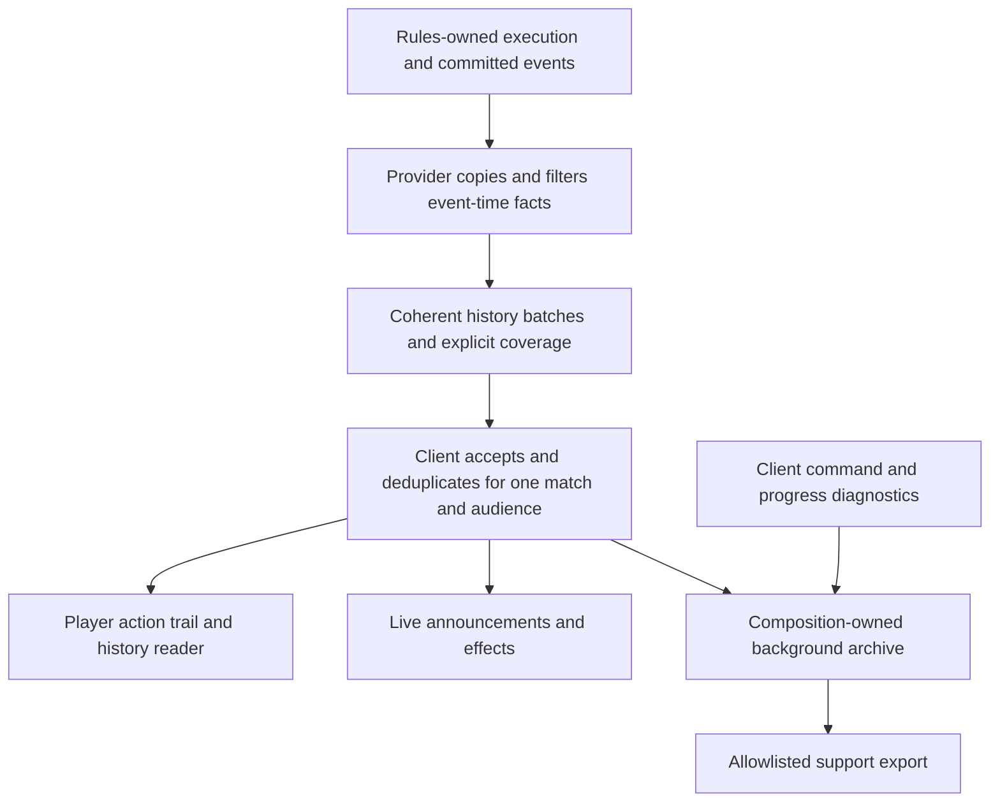

# Match history and diagnostic evidence

**First implementation candidate after 0.2.317; human review pending.**
Audited against release 0.2.317 (`293b4112c258`). The payment/history slice below
is implemented in source; the remaining sections describe the wider design. It
extends the existing rules execution and activity boundaries; it does not add
another rules engine, require event sourcing, or promise save-game replay.

## First slice in source

History now reads provider-captured activity, executions and actual mana receipts
through the optional `match-history` capability. Its read-only client owner admits
exact game/audience chunks once, preserves coverage and derives actions by actual
execution identity. Production is captured after replacement, spending at its
actual cost owner; preview payments and refunds do not masquerade as production.
Auto/manual provenance, symbolic bills, output, spending, remaining mana and
linked certified restoration are separate immutable facts.

The game replaces the ten clipped rows with a selected source and measured
cost/result detail. Previous/Next play and left/right keys navigate occurrences;
Home explicitly returns to newest. Incoming events do not move an existing
selection. Current disclosed sources open a noncommitting card reader with
Back to history/Escape. Expired faces retain only recorded permitted facts.

Saved matches are reachable from History and Recent matches on the home screen.
Background archives survive reopening the application. Save report creates a
structured local JSON report; its default scope keeps public facts, with an
explicit option to include the viewer's own private choices. Selection markers
identify only records allowed by that export scope. Nothing uploads automatically.

This slice does not yet deliver the compact live action trail, direct turn/seat
lookup, counted mass-trigger/combat workspace, historical printed-face grants or
the broader freeze/incident recorder. Existing operational logs remain separately
budgeted and retain their previous behavior. Renderer feedback still consumes its
existing activity cursor; the new history reader must not be described as a
completed migration of all live feedback. The sections below remain the target
for those follow-up migrations.

## The problem we must solve

A player should be able to answer: **What happened, who caused it, what did it
cost, what actually changed, and what is still waiting?** A developer investigating
the same play needs the underlying facts, build identity and progress evidence.

The Elevator report exposed both failures. The screenshot showed 32 charge
counters and the player reported Auto choosing three colorless mana. Independent
real-input tests reproduced an output-ranking defect, fixed in 0.2.317. The exact
historic spell remains unknown: the installed journal retained 88 events spanning
about 43 seconds, after the payment had rotated away. A colorless deck does not
establish an explicit `{C}` cost. History must retain the bill and actual payment
rather than require somebody to remember which spell they cast hours ago.

## What the source already has, and what it loses

| Current owner | Useful existing facts | Failure or limitation |
| --- | --- | --- |
| `Mana.Game/TableApplication.Overlays.cs`, `DrawHistory` | Activity messages and notices | Ten fixed rows, two lines each; no card reading or causal expansion. All notices appear before all activity, not in a shared chronology. |
| `forge-api/MatchActivity` and `Mana.Contracts/ActivityEntry` | Actor, turn/phase, source, execution, cause, actual impacts, counter before/after, outcome and count | The screen flattens them into prose. Ordinary retention is roughly 120 entries, with special cause/finite-resolution retention. |
| Rules `ExecutionTracker`, `MatchExecutions`, `ActionExecutions` | Exact occurrences, parent relationships, steps and terminal results | Ordinary transition retention is 512. Missing ancestry cannot be reconstructed from the last board. |
| Renderer `ActionFeedback`, `PublicChangeFeedback` | Costs versus effects, grouped counter changes, incomplete results | Transient presentation retains 32 action results and eight counter groups; it is not a match archive. |
| `Mana.Client/ClientDiagnostic` and `ClientDiagnosticJournal` | Admission, dispatch, return, observation and acceptance; current remaining mana symbols | Two 64-event files share a budget dominated by transport stages. No selected producer/output or durable match history. |
| `Mana.Forge/ForgeEngine` | Java stderr in `engine.log` | RPC results are parsed, not retained; stderr and exception logs are not a record of normal gameplay. |

Undated string notices cannot safely be interleaved later by guessing. New
notices need typed occurrences at their real source. Legacy ones remain a
separate, clearly untimed section. An accepted command and a resolved spell
remain different facts, even if they arrive in the same observation.

## Game references and the proposed adaptation

[Hearthstone's developer description](https://hearthstone.blizzard.com/en-gb/news/16421344/fireside-chat-developer-panel-recap/)
describes reviewing earlier actions while watching a live game. Its
[history-tile changes](https://hearthstone.blizzard.com/en-gb/news/21098848/10-18)
explicitly show the minion pulled by Dirty Rat and destruction by Ice Breaker.
That is the useful precedent: an identifiable source and its actual result.
Blizzard also fixed a [hidden-card disclosure through a history tile](https://hearthstone.blizzard.com/en-gb/news/23831411).
Historical information needs its own visibility rules.

[Magic Online's gameplay guide](https://www.mtgo.com/getting-started/getting-started-gameplay)
describes a toggleable Game Log beside the battlefield, including prior casts
and activations. Its [support guide](https://help.mtgo.com/hc/en-us/articles/6046177142811-Finding-your-League-Game-ID-number)
uses a stable game ID to investigate reports and identifies local game history.
[Arena's support flow](https://mtgarena-support.wizards.com/hc/en-us/articles/360000726823-Creating-Log-Files-on-PC-Mac-Steam)
offers Capture Log and separates gameplay, startup, installation and crash logs.

Our adaptation is a readable action trail beside the same table, expanding into
one play and its consequences, with an export tied to that play. These sources
do not establish a solution for four-player Commander or hundreds of triggers.
The counted groups, causal navigation and storage budgets below are Mana Table
design decisions, not claims about those games' implementations. We should test
them on our mass-draw and combat cases rather than copy a small recent-history
surface and assume it scales.

## The player journey

1. **Catch up without leaving the table.** Open History to the most recent
   meaningful play. A quiet action trail uses recognizable card faces, acting
   seat, a short verb and actual outcome. Full names remain readable. Routine
   empty priority passes stay out of the default trail.
2. **Choose the play.** Selecting an occurrence opens its source, choices,
   affected cards/players and before-to-after results. Costs and results have
   distinct positions. A source that generated mana belongs under the payment
   it funded. Pending, declined, countered, cancelled, failed and resolved have
   distinct meanings; a cast announcement never claims resolution.
3. **Follow the cause.** Expand a play into the exact activations, triggers,
   replacements and state checks it caused. Preserve rules order and simultaneous
   groups. A prevented five damage is not displayed as five damage dealt.
4. **Navigate a large game.** Expand into a turn-oriented review workspace with
   recognizable source cards and related recipient groups before shrinking any
   cards. Turn/seat navigation changes the historical selection, not the live
   camera or table state. A direct card-name lookup supplements browsing. The
   existing ten-row, clipped text modal is replaced, not restyled.
5. **Keep reading.** New events do not move the selected occurrence, reset its
   expanded branch or force the reader to newest. A quiet new-events indication
   offers a deliberate return to live history. Close/Escape restores the prior
   table/camera context and reconciles the current authoritative decision.
   Preserve a staged choice only while its exact current scope still matches;
   reading cannot restore an expired decision. The configured clock continues.
6. **Report this moment.** A deliberate export from the selected play includes
   its permitted causal context and recorder coverage, with match/build identity.
   The same export is available after leaving the match or restarting.

For 50 draws, show the generating action and related counted source groups,
such as Toothy triggers and Panther Idol triggers. Each group distinguishes
pending, completed and declined members; it opens to exact individual outcomes.
Grouping is navigation, not bulk payment consent or priority permission. Do not
combine effects merely because they share a name or poll. An intervening response,
different target, replacement or uncertain parent must remain evident. A combat
episode similarly connects assignments, actual damage, deaths and rules results
instead of presenting a paragraph for each of 100 tokens.

Reading is strictly noncommitting. Do not call `InspectPendingEffect`: its current
stack path can route to `CardClick` for an actionable target. Historical entries
hold no live `Card`, decision handle or action key. A separate read-only resolver
may open a currently disclosed occurrence; otherwise it presents only recorded
permitted facts. A historical public name does not grant current hidden-zone
inspection. Audience changes revoke private readers and cached material.

For the first slice, recognizable source faces require current disclosure. When
that permission has expired, use the recorded complete source name and permitted
effect/result facts, not a name-based artwork lookup. This fallback is an explicit
limitation. Keeping an immutable public printed face/rules record readable later
would need its own audited historical-disclosure contract; it is not implicit
permission to retain an occurrence's face or current characteristics.

The arrangement and gestures above require rendered review at 1000 x 740 and a
larger window, enlarged text, reduced motion and crowded four-player states.
Automated geometry and semantic checks do not establish human readability.

## One factual foundation with separate consumers

Reuse `ExecutionTracker`, `MatchActivity`, `MatchExecutions`, `ExecutionCursor`
and `PublicActivityCursor`. Move accepted activity consumption and reusable action
reduction from renderer ownership into `Mana.Client`; rendering keeps layout and
motion. The archive and history consume the same accepted facts as live feedback.
Do not introduce another event bus, infer causes by diffing snapshots, parse
`Message`/`Detail`, or make recorded history authoritative game state.

An archival batch wraps the existing typed activity and execution payloads plus
the missing committed payment facts. It needs game/audience identity, schema,
source cursor, event-time turn/phase, capture disclosure, exact occurrence/parent
references and coverage. Activity IDs and execution sequences are different
streams: preserve their typed source cursors. A common commit ordinal, when
needed for cross-stream order, must be assigned by the provider at the actual
capture boundary, never by sorting client arrival times.

Keep the current coherent capture and lock ordering. Historical metadata must
not be injected back into `GameSnapshot.Executions` to make an old reference
pass current-frame validation. Rules mutation and disk I/O have separate owners.

`ParentId` supplies causal ancestry. `BudgetRootId` supplies finite-yield allowance;
each trigger may have its own allowance root even when caused by the same draw.
It is not the user-facing grouping key. Group only disclosed, proven ancestry
and equivalent effects while retaining every member ID and its actual order.
One event can have several useful representations. A library-to-hand movement
and its draw result are not two draws; damage dealt and resulting life loss are
not two damage events. The reducer uses typed meaning and exact correspondence,
never the sum of every `Count` field or an adjacency guess.

### Capture before eviction, admit once, label gaps

Persisting periodic snapshots alone cannot preserve a full match. More than
120 activity records or 512 transitions can occur before the next publication.
Capture immutable, audience-scoped archival records alongside existing event-time
projection, before live-tail eviction. Hand them off in bounded chunks at the
existing coherent session boundary. Expose that retrieval through a provider-
neutral history port; the renderer never owns persistence or the engine process.

Retain small live frames for responsive observation. Chunks must support exact
deduplication and known retained-range/acknowledgement semantics. Reconnects start
from an explicit baseline and may retrieve available historical chunks without
replaying commands or animations. Missing retention ranges remain visible;
filtered private sequence holes are not transport loss. Unknown ancestry stays
unknown. Archive append order is not permission to invent a causal relationship.
Semantic acceptance, storage enqueue and durable acknowledgement are distinct.
Advance a provider retention acknowledgement only according to its documented
storage guarantee; a queued but unwritten chunk cannot certify durable coverage.
Crash recovery must report any uncertain tail rather than mark it complete.

There is no infinite, lossless, nonblocking recorder under an arbitrary disk or
queue failure. Bound memory and disk, preserve explicit loss/coverage metadata,
and never label a partial archive complete. Presentation grouping must not discard
the underlying records to meet its visual budget.

### The payment receipt we are missing

Capture from actual production, cost and spending owners, not projected available
mana or the final pool difference:

- The paid execution and symbolic original, adjusted and remaining bill, including
  X and explicit colorless requirements when known.
- Manual versus automatic origin; exact chosen producer occurrence and mode;
  disclosed source facts relevant to that mode, such as its charge count.
- Actual produced colors and quantities, spending restrictions, actual consumption
  and pool remainder. Distinguish estimate, selection, production and spending.
- Committed tap/counter/life/sacrifice costs and terminal status. Cancellation may
  leave a committed cost; it must not be described as a completed spell.

If the existing certified restoration reverses a mana activation, append a
correction referring to the original receipt. Keep the historical commitment
visible while presenting the corrected resource state; do not silently erase
the event or count both productions as spendable mana.

`GameEventManaPool` currently reports Add/Remove/Clear and colors, not the required
quantities, producer and bill. Extending typed commit facts is necessary; more
words around that event cannot reconstruct a receipt.

For the independent generic-three reproduction, a useful view could show
**The Eternity Elevator: 32 blue produced, 3 spent, 29 remaining; charge counters
32 to 32**, nested beneath the paid spell. An explicit-colorless bill explains
the selected colorless mode instead. This example is not a recovered record of
the player's earlier game. If Auto's selection rationale is retained, it must
come from the actual selector, not a retrospective UI explanation.

## Match-scoped storage and diagnostics

Composition owns a background recorder behind a narrow service port. Keep the
existing journal's single-writer queue, immutable bounded records, loss accounting
and harmless storage failures. Extend or replace its app-wide two-file lifecycle
with per-match archives; do not add a second competing writer. Separate semantic
records from operational attempts so repeated passing cannot evict the last play.

Provisional tuning targets are the active match plus the last ten completed
matches, a 30-day age bound and 256 MiB total, with a 32 MiB per-match cap. These
are proposed budgets to measure against real Commander traces, not shipping
limits. Prune completed matches by policy before the active match; a per-match
cap or failed write records incomplete coverage instead of silently losing the
beginning. Keep bounded terminal-incident capacity apart from routine traffic.

Each manifest identifies schema, match/local session/audience, client source and
version, available engine identity, start/end, recorder health and retained/lost
ranges. UTC is descriptive; source sequences order facts and monotonic durations
measure waits. Restarting must preserve the previous match. An unfinished
manifest means unclean closure, not proof of a crash.

Operational diagnostics retain command family, attempt correlation, execution
reference, turn/phase, dispatch/return/observation/acceptance distinction, elapsed
time, decision age and last committed progress. A provider return does not certify
an applied action. A freeze monitor reads an immutable progress summary without
waiting for the engine lock that may be blocked. Engine exit, AI failure and
transport interruption remain operational failures, not rules defeat.

Reserve an incident record on failure, with pending operation, last progress,
related IDs and a bounded error category. A slow storage device, full disk or
invalid record cannot block rules or input; recorder health becomes observable.
Flushes improve recovery but cannot guarantee survival of power loss.

## Disclosure and export

Classify each fact at provider capture as public or seat-private. Keep host-private
failure/AI evidence in its existing separate channel; it never enters a player's
history merely because the host owns the engine. An owner-authorized preparation
event can name a hand card, so a viewer archive is not automatically safe to share.

Disclosure also applies to fields and references. A public mana activation may
fund a private, not-yet-announced hand spell. Its output may be public while the
bill, paid execution and causal parent remain seat-private. Project or split
mixed receipts accordingly, removing private links as well as private names.
A later public announcement is a new disclosed fact, not permission to rewrite
earlier private preparation into a public record.

Default support export uses a strict schema allowlist of public history and
sanitized operational facts. No raw snapshots, live capabilities, private hands,
face-down identities, chat, arbitrary exception text or private bot observations.
Private detail requires a separate, explicit local export choice with clear scope;
do not assemble a host-wide omniscient bundle. Export never uploads automatically.

State exactly what is present, missing, redacted or truncated. Include schema,
build/engine identity, selected occurrence, coverage and file hashes. A developer
must be able to read the exported record without loading a live engine, renderer,
action catalog or the original player's profile. Older schemas are read-only
inputs; unsupported payloads produce an explicit unsupported segment, not a guess.

## Delivery and acceptance

The first implementation slice should capture and retain a real payment end to
end and make it readable/exportable by match. Then replace the text history with
the shared causal projection and game-native reader. Extend grouping to mass
triggers and combat using the same records. Remove superseded reducers/cursors
as each consumer migrates; do not leave history, live feedback and reports with
three independent interpretations of the same action.

| Real journey | Required proof |
| --- | --- |
| Elevator at 19/20/32 counters; generic and explicit `{C}` costs | Exact bill, mode, actual output/spending/remainder, one tap, unchanged charge count; readable after long play and restart. |
| Loch Mare activation and cancellation | Counter removal is a committed cost; draw is a separate result; repeated activations never inherit one another's outcomes. |
| Certified mana restoration | Linked correction preserves the original commitment and corrected state without erasing or double-counting output. |
| 70 to 1000 related triggers | Readable counted groups, exact individual outcomes/order, intervening response preserved; no loss between snapshots before eviction. |
| One draw with a zone movement; one damage event with life loss | Distinct linked facts remain inspectable without double-counting the gameplay result. |
| Mass combat and planeswalker death | Actual damage, prevention, deaths and rules result; an engine exit never becomes a fabricated defeat. |
| Reconnect, repeated/stale observations, seat switch | Deduplication, correct baseline, honest missing ranges, no private-sequence false gap or cross-audience detail. |
| History entry while a legal counterspell target exists | Read/expand/return sends zero game commands and preserves the current selection/decision. |
| New live events during historical reading | Selected occurrence and expanded branch remain stable; explicit return to newest. |
| Restart, forced termination, full disk and queue overflow | Bounded readable artifacts, explicit unclean/lost coverage and recorder health; play stays responsive. |
| Default export with hidden cards, private bot errors and chat | None of those secrets or action handles appear in any exported field or file. |
| Public mana activation funding an unannounced private spell | Public production remains visible; private bill, spell identity and parent/execution references remain absent from public projection/export. |
| Alternate provider and archived input | Contract fixtures reduce and render without Forge classes, a live process or command authority. |

Extend existing execution-presentation, activity-cursor, privacy and real-engine
payment journeys instead of creating a parallel test harness. Measure capture
and writer overhead with a deterministic stress trace; keep performance trials
separate from fast semantic CI. Human review must check source identity, costs,
results and navigation at normal and enlarged text sizes. A populated log, a
beautiful mockup or a large test count alone does not satisfy this proposal.
