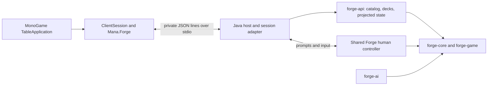

# Mana Table engine API

Mana Table includes a native desktop deck workshop and playable match table,
backed by Forge's rules and Mana Table's whole-seat AI policy.
`forge-api` supplies catalog, deck, and match hooks. It depends on the shared
`forge-gui` module (including the human controller), `forge-ai`, `forge-game`, and
`forge-core`. It creates no Swing or LibGDX UI; `HeadlessPlatform` supplies the
shared controller's platform services and preferences.

The [Windows MonoGame client](../mana-native/README.md) consumes `DesktopEngine`
through private stdin/stdout JSON pipes. The host provides deck persistence,
practice, AI games and multiplayer seats. Build with `mvn -pl forge-api -am verify`;
the executable engine is `forge-api/target/forge-engine.jar` from the repository root.

This page describes the checked-out source. Packages identify their exact source
in `SOURCE.txt` and `build.json`; an older installer may expose a smaller contract.
New public-state and deck-review fields are additive. Clients must preserve the
engine's visibility and decision scope rather than deriving permissions from them.

On the native side, `Mana.Contracts` uses deeply immutable collections for match,
catalog, deck, workshop/analysis, pregame and conversation data, including
collection-valued requests. `Mana.Forge` translates JSON arrays and objects into
those values at the provider boundary. This is a C# API change requiring providers
to rebuild, not a wire or saved-data migration: IPC/sync versions and JSON field
names remain unchanged. Optional workshop metadata collections still distinguish
omitted/null (leave unchanged) from an explicit empty array (clear).

## Implemented

| Hook | Behavior |
| --- | --- |
| `EngineResources.load(path)` | Explicit, once-per-process initialization from Forge's resource directory |
| `CardCatalog.search(query)` | Name/type/rules search across all card faces, accent-insensitive matching, color and mana-value filters, deterministic pagination, printing IDs |
| `DeckImport.preview(text)` | Forge's existing deck recognizer with line-numbered problems; imports cannot silently discard unresolved rows |
| `DeckEditor.apply(revision, edits)` | Atomic batches of absolute quantities across deck sections; stale writes fail |
| `DeckEditor.undo/redo(revision)` | Bounded history, monotonically increasing revisions |
| `DeckEditor.validate(format)` | Structural checks plus available bundled format eligibility across the playable list; separate `structureValid` and `eligibility`, with card-linked issues; no live tournament-legality claim |
| `DeckEditor.toDeck()` | Detached Forge deck for existing persistence and match setup |
| `DeckCommanders.choices/set(...)` | Rules-authorized commander/partner choices and atomic, persistent section moves; `setCommanders` requires deck ID and revision |
| `DeckInsights.analyze(...)` | Read-only role estimates and explained suggestions from a small offline candidate pool |
| `GameStateMapper.snapshot(view, viewer)` | Immutable records containing turn, phase, players, life, priority, zone counts, visible cards |
| `GameObservation` | Pollable event revision with explicit unsubscribe/close; raw events never cross the API |
| `MatchSetup` | Validated match copy with a selectable commander when an imported list has no Commander section |
| `MatchTable` | One authoritative game with human and AI seats, shared occurrence identities and publication boundaries |
| `MatchSession` | One human seat's filtered state, scoped prompts, controller input and concession, independent of transport |
| `PublicPlayerStateRegistry` (`forge-game`) | Typed descriptors and immutable snapshots of explicitly public player mechanics; the API forwards their declared values |
| `SyncTransport` | Local/TCP ordered requests, cached receipts and seat resume; no game rules or projections |
| `MatchActivity` | Immutable, viewer-filtered recent actions and event-time turn/phase metadata |

The records contain values rather than live engine objects. The desktop serializes
them through its private transport. Explicit multiplayer hosting starts the seat
synchronization listener; the desktop command API remains on private stdin/stdout pipes.
The ready message advertises `protocolVersion: 2` and the `seat-sync`, `snapshots`,
`command-receipts`, `resume`, `table-social`, `deck-workshop`, `deck-analysis`, and
`semantic-priority-actions` and `explicit-deck-setup` capabilities. All connected players
need this build; the seat synchronization handshake now uses version 3.

The optional `automated-seats` capability is confined to the private desktop
process pipe. `automatedEnable` selects external policy controllers before table
creation. `automatedState` returns independent private seat observations and
complete timing-legal action domains with structured costs/effects;
`automatedAction` takes the same scoped semantic reply plus `seatId`.
Additive operation graphs retain source/recipient/target bindings, sequence and
mode/conditional structure, and explicit known/unknown facts. Mana production
alternatives distinguish a choice of colors from a simultaneous bundle. These
are nominal facts, not a legality certificate: base mana costs have unknown
adjustment knowledge, while the current payment exposes its actual unpaid bill.
A known alternative with an empty color map is exact zero production; it is
distinct from unknown production. Supported source-counter quantities use
current visible state only when costs and other effects cannot change that count.
The exact `Combo ColorIdentity` operator can use the source controller's public
commander identity, including partner unions; a colorless identity produces no
colored mana and does not invent `{C}`. This bounded tap-only projection leaves
spending restrictions, added effects and active mana/tap interactions unknown.
The ambient check reads current public rules characteristics, including traits
currently granted to face-down permanents; it never reads their concealed
original faces. An unrelated ordinary face-down permanent does not erase known
commander-color alternatives or an available nominal tap resource.
Graphs are finite and audience-filtered; candidate references never grant action
handles. Unmodeled conditions and resource coupling remain explicit.
Source additions also put `operationGraph` on each pending stack entry, using
the same grammar rather than reconstructing outcomes from its displayed text.
These are committed operations: chosen Charm modes follow the actual sequence,
unchosen option recipes are omitted, and each known target domain has
`min == max == candidates.length` for the set already selected. Costs are empty
because the stack entry has already paid them. Dynamic quantities, hidden
recipients, optional effects, intervening conditions and unsupported mechanics
remain unknown; this is neither a guarantee of resolution nor a replacement or
prevention forecast. A concealed source supplies an empty unknown graph. The
non-acting public spectator currently supplies unknown graphs as well.

Semantic spell entities can add `stackItemId`, matching the exact current
stack entry independently of their source card. Copies and multiple abilities
from one permanent remain different occurrences. `cardId` may be empty for a
spell entity whose source permanent has departed; an available source portrait
does not invent a current card occurrence. Private decision option semantics
can add `target` with that same entity for an actual offered stack target. This
is separate from an option's prospective ability `operationGraph`. Neither
reference authorizes selecting or countering it: the current choice index and
decision scope remain mandatory.

These protocol fields are additive. Older providers omit the pending graph and
native clients retain `Unknown`; missing `stackItemId` can correlate by source
only when exactly one current stack occurrence has that identity. The shared
native `ActionOperationValidation` checks both prospective and committed graphs,
visibility, exact stack references and finite links before policy evaluation;
the provider decoder also applies it before publishing pending graphs.
Card entities require an exact occurrence in the viewer's published zones or an
explicit stack/transient source. An internal rule object can supply a readable
decision portrait without being a published card: commander replacement effects,
for example, keep Unknown graph sources rather than borrowing a card identity.
Portrait inspection does not grant selection, activation or retained disclosure.
Private decision semantics can add `numeric` for an explicit rules announcement:
`purpose`, entitled `sourceCardId`, declared `costs`, `manaCostKnowledge`, and
read-only `funding`. Funding groups production routes by physical source, with
pool counts and explicit knowledge/eligibility. It contains no action IDs or
card keys. The initial own-battlefield/unrestricted-pool projection is partial;
it can witness nominal funding but cannot certify that no other resources exist.
Current mana-bearing action semantics also carry `prospectiveFunding`, using that exact
bounded funding projection before a payment starts. It contains no future
decision or action handles. Policies can compare the same source restrictions
and unresolved outcome interactions before committing to a variable-cost action;
ordinary production alternatives remain nominal facts.
Ordinary human `sourceActions` responses expose a closed `costPreview` on those
same already offered actions: declared `costs`, `manaCostKnowledge` and `funding`.
The preview has no operation graph, target domain or extra action handles. The
response's `revision` identifies the published frame; an optional request
`expectedRevision` rejects stale reads without advancing the game. Each owned
mana-payment prompt freshly publishes actual `payerId`, `unpaidManaParts`, `fundingContext` and
`usablePoolManaColors`, so manual payments shrink the displayed bill and consumed
inputs cannot retain those facts. The final adjusted bill remains authoritative.
These prompt fields and private automated payment facts share one per-seat
publication capture, made after all-audience visibility reconciliation. AI
observation does not reopen the live payment to reconstruct its bill or source.
A new publication replaces the capture even when the same input remains pending;
an outdated capture is not an empty cost. Current command checks still use live
authority and funding support. The wire fields and command scopes are unchanged.
Each unpaid part is `{symbol,count}`: generic mana uses one numeric symbol such
as `{129}`, while colored and hybrid symbols retain their exact multiplicity.
Projection visits distinct shard kinds without allocating one object per unpaid
mana. Older public `unpaidMana` arrays remain a client compatibility input only.
`AnnounceX` comes from the controller callback, never a localized prompt label.
This additive private metadata needs no persisted-data migration; older
observations without it retain unknown numeric purpose. Actual current payment
inputs still own spending and activation authority.
Actual Convoke, Improvise and related reduction selections additionally expose
public `manaReduction: {remainingManaParts: [...]}` using the same counted bill.
An absent context means unknown progress; a present empty list means the cost
is fully reduced. Current selectable cards are productive contributors according
to the engine's reduction rules, plus already selected cards retained for undo.
These facts neither finish the selection nor replace its current Complete button.
Private decision episodes follow that same actual reduction input across refreshed
scopes and its nested color choices; a new input receives a separate episode.
This ownership now applies to every actual controller Input: refreshed prompt
UUIDs and nested GUI choices share its opaque private `episodeId`, while a new
input receives a new token. Combat retains its existing causal declaration
grouping. This is input lifetime, not a complete cast/cost/resolution lifecycle.
Current target card offers use the same nonmutating joint-admissibility checks
as an actual target click. Already selected cards remain selectable/highlighted
for undo; they are distinct from productive additions. A Complete offer remains
authoritative even when the maximum target count has not been reached.
Target limits, player choices, effect/search context and private target semantics
share one immutable per-seat publication capture, scoped to the exact decision,
board and source version after visibility reconciliation. Target observation does
not repeat live effect or funding analysis. A refreshed selection replaces its
capture while keeping the actual input episode. Missing or stale captures are
rejected, not interpreted as empty domains. Current card/player commands still
recheck live eligibility; selected targets remain available for deselection.
The public pending-damage summary can resolve supported captured bindings while
the private legacy amount remains literal-only; neither invents an unknown amount.
Multiple-entity selections use the same publication owner for their existing
player choices, staged selections, Convoke reduction, counter allocations and
private cost context. Their current cost-stack entry is checked across funding
queries. A changed entry withdraws the old decision; a fresh input publication
must establish its replacement. Copied facts never retain a live cost entry.
Each concrete input still decides whether another click toggles an entity or
allocates another counter. Shared capture adds no selection-limit fields or
parent payment commands, and nested color choices keep their own scope.
Current mana inputs can add `payment` provenance: `purpose` (`SpellCost`,
`ActivatedAbilityCost`, `TriggeredAbilityCost`, `EffectCost` or `Unknown`), actual
`payerId`, entitled `sourceCardId` and the input's `mandatory` fact. The current
unpaid symbols remain the bill; this metadata does not reuse the printed source
cost or grant permission to spend. Canceling an optional triggered payment is
a valid decline, distinct from abandoning a spell that the policy initiated.
The payer can differ from a source's controller or the observing controller.
Provenance ends with the current input; hidden source identities are not added.
Ordered cost-part prompts additionally publish semantic `orderingPurpose:
CostPayment` and `defaultOrder`, the engine's complete ordered list of current
choice indices. This is distinct from ordering cards by value. The native
boundary rejects a partial, duplicate or foreign default permutation and metadata
on another task. Missing metadata remains unknown for older providers.
Current nonmana cost selections can additionally carry `costPayment`: the
actual payer/source, remaining adjusted cost parts, mana-cost knowledge and a
read-only `ManaFundingContext`. `currentCostIndex` identifies the selected part
within that current list; an older provider may omit it, leaving distinct source
commitments unknown. Already-paid parts are excluded. This lets a
policy preserve a funding witness while choosing a creature to tap or a
permanent to sacrifice. It does not authorize producing mana, reuse the
initiating action's handles or promise that unsupported costs are affordable.
Older providers omit this context; absence remains unknown. The metadata ends
with the owning selection and requires no persisted-data migration.
Ordinary non-library effect choices may also carry current `disclosedCards`
rows `{label, card}` for delayed-reveal faces absent from the eligible options.
These anonymous portraits have no index, physical identity, card key or action
permission. Native decoding places them in the current selection's read-only
disclosures; only ordinary offered indices can be chosen. A previous reveal
cannot supply this permission after its own scope has ended. Existing library
choice metadata remains separate; no persisted-data migration is required.
Accepting a decision revokes its temporary hidden-card window and card keys in
the resolving receipt, independently of queued rules cleanup. Persistent look
permissions remain readable. Past authorized knowledge is not a current offer
or permission to publish a library window without its owning choice.
`automatedFault` stops the table with an explicit diagnostic; it never substitutes
the legacy strategy. These commands are absent from network seat dispatch and
cannot be addressed using a `connectionId`.
`automatedSimulationStart` takes four Commander opponent IDs (`green`, `red`,
compatible `preset:` IDs or `deck:<saved-id>`), creates only automated seats and
returns a public read-only spectator. `automatedSimulationState` observes its
cached public state; `automatedSimulationStop` requires its `sessionId`.
Spectator ID -1 has no action keys, prompt, hand/library faces or private activity.
Ordinary live tables retain their human-seat invariant. Existing deck files,
network protocol and non-negotiating clients keep their previous formats.
Printing IDs are opaque, case-sensitive identifiers; clients must round-trip them.
`cardPrintings` takes `{cardId, offset, limit, text, finish}` (limit 1–200, default 6) and returns
a catalog page of exact printings of that card, including alternate artwork and
foil finishes. Optional `text` filters set codes/collector numbers, and `finish`
is empty, `foil` or `nonfoil`. `replacePrinting` takes `{deckId, revision, section, cardId,
printingId}` and replaces every copy in that section with the chosen printing.
It checks the active document/revision and card identity, merges existing copies,
and preserves commander partners and other sections. It is one undoable edit and
merges manual categories and preserves either printing's favorite status. Existing deck
files and printing IDs keep their version-1 format; no migration is required.
Text exports now retain separate printing rows with set, collector number and
`*F*` for foils; cards without a collector number use Forge's art-index notation.
Visible card snapshots add `artSet` (the edition's Scryfall code), `edition` and
`collectorNumber`. Hidden cards omit these fields. Native image caches include
set/collector number and face; old name-only caches remain valid for unspecified
art requests. An unavailable exact image uses the readable card fallback.

Optional match `playAccesses` describes only the current viewer's retained plays
from already disclosed external zones. Entries contain `playerId` (the physical
zone owner), `zone`, `cardId` (the existing visual occurrence) and `routes`.
A route contains `id`, numeric `kind` (`0` cast, `1` play land), visible
`sourceCardId`/`sourceName`, engine `detail`, and `canStart`. Membership is distinct
from current timing: access may remain while `canStart` is false. The latter
reports permission to initiate a current route, not mana affordability. Resolving
clears current-start flags without deleting retained access. No generic expiry
text is invented; the engine removes the route when its permission ends.

These display route IDs are not action handles. `matchSourceActions` and
`useSourceAction` remain the authority for an exact current cast/play. Access
references never disclose additional card faces, and another player's permission
cannot populate this viewer's list. Command-zone cards retain their dedicated
representation; prepared linked spell copies remain attached to their source
action rather than entering this list.

`multiplayerState` includes `tableId`. Pass that ID to `tableSocial` to read the
table conversation, `tableChat` with `kind` (`chat` or `emote`) and `text` to send,
or `tableName` with `name` to change your display name between games. Sender
identity comes from the seat connection, never supplied message metadata. Names
are limited to 24 characters and chat to 300 single-line characters. The fixed
emotes are Hello!, Good luck!, Nice play!, Thinking…, Thanks!, and Good game!.
The table retains 200 ordered entries, including system activity, across games.
These commands return `{tableId, revision, localSeat, members, messages}`; social
revisions are independent of game decisions. Chat sends have a 750 ms per-person
cooldown and use the existing duplicate-safe receipt transport.
Catalog construction eagerly indexes the supplied printings. Initialize it once
on a worker thread; search results include alternate printings rather than grouping
them into a single card. Color masks are W=1, U=2, B=4, R=8, G=16; zero finds colorless
cards. A nonzero allowed-color mask also includes colorless cards. This is a card
color filter, not a Commander color-identity legality check.

`CardCatalog.fromDatabases(data.getAvailableDatabases().values())` includes both
ordinary and supplemental cards. The desktop uses `browse(..., unique=true)` to
group printings by name. Each page includes `catalogTotal` before filtering, while
`total` counts matching cards. `CardInfo.deckSection` identifies the appropriate
section for supplemental cards. Resource loading includes scripted casual cards
and scripts whose edition is unknown; it does not invent unsupported card rules.

## Build and run

From the repository root, with JDK 17 and Maven 3.8.1+:

```sh
mvn -pl forge-api -am verify
mvn -pl forge-api -am verify -Papi-example
```

The optional `api-example` profile loads the real resource database, searches printings, imports a deck
with a sideboard, and verifies unknown-card detection. It does not start a match.
Tests include lightweight projections and real four-seat rules scenarios that load
the checked-in card database. Keep the complete `forge-gui/res` directory available;
the initial resource scan can take time. CI also tests Java 21 compatibility.
Packaging additionally creates `forge-engine-fixtures.jar`, containing only the
test-classpath fixture launcher. It depends on the adjacent `forge-engine.jar`
and uses the same production controllers, protocol and rules with pregame
registered-player setup. It is verified separately in CI and is never shipped
inside the native application or accepted as a production fixture command.

To run the private command host directly, supply the resource directory and a
separate writable **decks directory** (not its parent profile):

```sh
java -Xmx2g -Dfile.encoding=UTF-8 -Djava.awt.headless=true -jar forge-api/target/forge-engine.jar forge-gui/res /path/to/profile/decks
```

Send one JSON request per line to stdin; reserve stdout for replies and capture
stderr for diagnostics. Applications normally manage this child process themselves.

Set `JAVA_HOME` to your JDK installation and put Maven on `PATH`. No particular
JDK vendor, local tool directory, or custom dependency cache is required. See
the [native setup guide](../mana-native/README.md) for the application and
the [testing guide](../docs/Development/Mana-Table-Testing.md) for real-engine tests.

```java
var data = EngineResources.load(Path.of("forge-gui/res"));
var catalog = new CardCatalog(data.getCommonCards());
var page = catalog.search(new CardCatalog.Query("draw", 2, 3, 0, 40));
var editor = new DeckEditor(catalog, new Deck("Blue practice"));
var state = editor.apply(0, List.of(
    new DeckEditor.Edit("Main", page.cards().get(0).id(), 4)));
var restored = editor.undo(state.revision());
```

An existing Forge process should reuse its initialized `StaticData`, not call
`EngineResources.load` again. Include the variant database in the catalog if the
editor needs schemes, planes, and other supplemental cards. Use
`DeckSerializer.writeDeck(editor.toDeck(), file)` for Forge-native saving.
File locations and persistence are the host application's responsibility.

## Desktop transport and deck commands

### Multiplayer hosting and invites

`multiplayerHost {format, playerCount, autoPortForward?}` starts a native network
lobby. `autoPortForward` defaults to false for API callers; the desktop's visible
checkbox supplies the choice explicitly. It uses Forge's UPnP mapping lifecycle
without changing the user's persistent UPnP preference. Host results and
`multiplayerState` include `portMapping` (`disabled`, `searching`, `mapped`, or
`failed`), `addressLookupPending`, `internetInvite` (nullable), and `addresses`.
Local address entries also carry `invite` when IPv4 encoding is available.

`multiplayerJoin {address}` accepts either the complete `MT1-…` invite or the
existing direct host/port syntax. Invites contain the endpoint and a CRC32 typo
checksum, with no authentication or directory service. Invalid invites are
rejected before closing the current connection. `multiplayerClose` stops the
listener and its UPnP service. Mapping callbacks from an older hosting attempt
cannot update a newer lobby's status. Router acknowledgement does not prove
external reachability; the UI must not label it as a successful internet test.

`multiplayerConfigure {tableId, format, playerCount}` changes the current host's
setup before a game. The table ID is required to reject stale controls from an
earlier lobby. Commander supports 2–6 seats in the API; three human players can
use three seats without AI. Reducing the count cannot remove a connected human.
Selected human decks remain when the format is unchanged, but people must ready
again. Compatible AI choices remain ready; changing format clears them.

`multiplayerSetSeat {tableId, seat, type, opponentId?}` changes an open or AI seat
before a game. `seat` is its zero-based slot index, `type` is `AI` or `OPEN`, and
`opponentId` selects one of the lobby's compatible `aiOpponents` (`id`, `name`,
`description`); omitted AI choice uses the default. Only the host may call it,
against the current table ID, and seat zero or a connected human is never
replaceable. The host validates the selected deck with the same deck checks as
other match setup. With `automated-seats` negotiated, compatible saved decks
also appear as `deck:<saved-id>` choices and are detached/validated at start.
Mid-game takeover is unsupported.

Lobby slots add `type: AI` and `opponentId`, retain their public `deck` name, and
report AI readiness automatically. AI slots do not claim a human connection;
joining takes an open human seat. Changing AI choices leaves human readiness
unchanged. Negotiated matches use the host's external policies through normal
rules inputs; non-negotiating callers retain Forge AI controllers.
Returning after a game preserves AI decks/readiness while humans ready again.

Source candidate: lobby snapshots include a table-local monotonic `revision` and
each selected slot's immutable `deckPreview` (`selectionId`, `name`, public
`commanders`, and a generic `problem` for an incomplete draft). Human and AI slots
use the same captured assignment. The legacy `deck` name is derived from it.
Commander faces contain printing/art metadata, not game occurrence or action
handles; no private main-deck list or detailed legality diagnostics are disclosed.

The native setup port accepts `LobbyDeckSelection(tableId, deckId, libraryToken)`
and returns the authoritative `Lobby` receipt. On the wire,
`multiplayerSelectDeck {tableId, deckId, libraryToken}` checks the current table
and exact saved-file token before replacing the assignment and withdrawing Ready.
An empty deck ID explicitly clears the assignment. Saved incomplete drafts may
be shared, but Ready and Start still reject them. Failed persistence cannot be
assigned. Legacy raw callers may omit the added scope fields; the shipping client
always supplies them. This is a C# setup-interface change requiring providers to
rebuild, with additive wire fields and no saved-data migration.

### Optional decision tempo (source candidate)

The additive `decision-tempo` ready capability enables `multiplayerTempo
{tableId, preset, expiry}`. Only the host may change it, before a match. Presets
are `off` (default), `relaxed` (120 seconds), `standard` (60) and `fast` (30), per
human decision. Expiry is `pass`, `loss` or `warn`. With `pass`, actual priority
passes on expiry; other choices receive 60 seconds of grace, then the player
loses through the existing engine concession path. Three consecutive unattended
priority expiries also lose the seat; an accepted player action clears that
count. `loss` loses immediately at the base deadline. `warn` only displays expiry.
No timer chooses cards, targets, payments, modes or combat assignments.

Lobby `tempo` contains `{preset, expiry, seconds, graceSeconds, revision}`. A
policy change clears human Ready states while retaining decks. A timed lobby
requires `multiplayerReady {tableId, ready: true, tempoRevision}` matching the
policy actually displayed. Missing/stale acknowledgements are rejected, including
old clients that cannot display the policy. Untimed lobbies retain legacy Ready
compatibility. Timing cannot change during play; it remains selected for rematches.

Optional snapshot `tempo` contains `settings`, settled `timedOutPlayers` IDs and public `clocks`, each with
`playerId`, opaque `id`, `phase` (`preparing`, `thinking`, `grace`, `expired`),
`remainingMs`, `limitMs` and `strikes`. Terminal snapshots retain timing policy
and confirmed timeout losses with no running clocks. Clock reads do not change board/decision
revisions or disclose private choices. Clocks follow actual waiting human inputs,
including simultaneous/off-turn decisions, and pause during accepted input
processing. Updating a selection, reading, polling or reconnecting does not refund
the current input's time. AI work and rules resolution have no decision clock.

`matchTempoPresented {sessionId, clockId}` acknowledges that the authenticated
seat can see its current choice after artwork/presentation. It returns `accepted`;
another seat's ID or an old episode cannot arm/reset a clock. The host bounds
preparation at 30 seconds of waiting time, then starts the budget even without an
acknowledgement. Disconnects therefore cannot freeze a timed match indefinitely.
A monotonic host scheduler enforces expiry independently of polling; clients only
interpolate the displayed countdown and never dispatch a timeout themselves.
This retains IPC 2, seat synchronization 3 and all saved-data versions.

### Deck commands

`deckState.commanderChoices` entries include `id`, compatible in-deck `partners`,
and additive discovery hints `canPartner` and `partnerName`. The engine's rules
determine those hints even when the named counterpart is absent from the list.
They guide searching and never authorize a pair: `setCommanders` still requires
current in-deck IDs and validates the actual combination. Generic pairing opens
the normal card library rather than claiming to filter every compatible partner.
Older clients ignore the hints; older engines omit them, with native clients
retaining the existing compatible-ID selection path.

`DesktopEngine` reads newline-delimited UTF-8 JSON from its private stdin:
`{id, method, params}`. Replies are `{id, result}` or `{id, error}`. Startup emits
`{event: "loading", message}` and `{event: "ready", printings}`. Diagnostics go to
stderr; stdout is reserved for protocol messages. `Mana.Forge` correlates request
IDs and records diagnostics in the active profile's log.

| Command | Parameters / behavior |
| --- | --- |
| `search` | Optional `text`, `colors`, `colorIdentity`, `role`, `maxManaValue`, `type`, `sort`, `unique`, `offset`, `limit`; paginated catalog results |
| `deckInsights` | Current deck ID/revision, color identity, estimated main-deck role counts, per-card roles and explained suggestions; no mutation |
| `deckAnalysis` | `{deckId, revision}`; strategy profile, conditional card functions, metrics, engine dependencies, explained paired swaps, and versioned review history |
| `analysisProfile` | `{deckId, revision, metadataRevision, fingerprint, profile}`; save shared goals and favorites separately from the playable list and recompute the review |
| `analysisReview` | `{deckId, revision, metadataRevision, fingerprint, recommendationId, decision, note}`; `consider`, `keep`, `dismiss`, `reopen`, `tested`, or a manual `observation` with no recommendation ID |
| `analysisConsider` | Same version guards and recommendation fields as `analysisReview`; save the suggestion to Considering and return `{analysis, workshop}` together |
| `list`, `open` | List saved decks; open by `{id}` |
| `deleteDeck` | `{deckId, libraryToken}`; move the exact saved deck out of the active library; return `{deckId, name, restoreToken, deletedAt}` |
| `deletedDecks` | List recoverable deleted decks, newest first; no implicit open or selection |
| `restoreDeck` | `{deckId, restoreToken}`; restore the same deck ID without overwriting an existing deck or selecting it |
| `new` | `{name, format}`; create a saved deck |
| `snapshot` | Current deck, revision, validation, format and save state |
| `deckTokens` | `{deckId, revision}`; exact token definitions created by the deck, creator names, effective/default printing and automatic/unavailable status |
| `tokenPrintings` | `{deckId, revision, tokenId, offset?, limit?}`; exact-definition printing page, newest released first; default limit 4, maximum 30 |
| `setTokenPrinting` | `{deckId, revision, tokenId, printingId}`; save an offered exact token printing; null resets to automatic newest |
| `edit` | `{revision, edits}`; absolute quantities using `DeckEditor.Edit` entries |
| `rename`, `format` | `{deckId?, revision, name}` or `{deckId?, revision, format}`; a supplied ID must name the current document |
| `duplicate` | `{deckId, revision, name}`; save and open an independent copy preserving exact printings and sections |
| `undo`, `redo` | `{revision}`; deck-editor history |
| `save` | Retry saving the current deck |
| `importPreview`, `import` | Preview `{text}`; import `{text, name, format?}` as a new deck; line-numbered problems block import, and preview `warnings` reports supported-printing substitutions for unbundled sets |
| `export` | `{kind: "text"}` or `{kind: "forge"}`; deck-list text |
| `deckPresets`, `presetImport` | List attributed presets; import one by `{id}` |
| `practice` | `{action: "shuffle" / "mulligan" / "draw" / "bottom", index?}`; opening-hand sandbox |
| `workshop` | `{deckId, revision}`; durable playable-content version, plan/question, roles, pins, Considering, source link, history and draft-safe estimates |
| `workshopMetadata` | `{deckId, revision, metadataRevision?, plan?, question?, roles?, considering?}`; optimistic metadata edits; roles may overlap and Considering never enters a game |
| `workshopRestore` | `{deckId, revision, versionId}`; restore immutable played contents while preserving current notes and source link |
| `workshopInspectVersion` | `{deckId, revision, versionId}`; inspect a saved list and compare playable quantities with the current list without restoring or saving |
| `workshopInspectTest` | `{deckId, revision, testId}`; inspect the exact frozen played list and compare it with the current list without mutation |
| `workshopMove` | `{deckId, revision, metadataRevision, cardId, to, cutCardId?}`; move Main/Considering or swap one candidate for one main-deck card as one durable transaction |
| `workshopSourcePreview` | `{url}`; bounded public Archidekt fetch, mapping preview, categories and excluded rows; no deck mutation |
| `workshopSourceRefresh` | `{deckId, revision}`; fetch linked source and compare accepted baseline, current local deck and remote contents |
| `workshopSourceApply` | `{token, deckId?, revision?, choice}`; `remote`, `local`, conflict-free `merge`, or independent `copy`; stale previews and unresolved mappings fail |
| `workshopPractice` | `{deckId, revision, action, index?, question?}`; `new`, `draw`, `mulligan` (redraw), `bottom`, `keep`; version-bound draw-only samples, not rules-aware London mulligans |
| `workshopStartTest` | `{deckId, revision, opponents, question?}`; persist exact saved playable version before launching a real Forge solo match; Commander tests require explicit commander sections |
| `workshopTests`, `workshopTestNote` | `{deckId}` or `{deckId, testId, note}`; durable observed facts and separate player notes, including interrupted tests |

The optional `deck-library` ready capability enables these delete/restore commands.
Saved summaries and deck details add `libraryToken`, a hash of the saved file's
exact bytes. Deletion rejects a stale token rather than removing a newer saved
list. These commands are available while offline and outside an active game;
leave a connected lobby before changing the library this way. Deleted deck files
remain recoverable across restart, and their workshop versions, notes, source
links, analysis and test records retain their original deck ID. There is no
automatic permanent purge. Existing version-1 deck files remain compatible and
the synchronization protocol is unchanged.

Workshop content IDs hash rules-card quantities, sections and format independently
of the editor revision. Renaming, printing choices, tags and notes preserve test
evidence. Metadata has its own revision guard. Existing version-1 deck files remain
readable; workshop metadata/history and test records live in separate subdirectories.
Source applications and Main/Considering swaps use a durable intent journal so both
deck contents and their metadata recover together after an interrupted write.
Undo/redo follows the same in-memory deck-history boundary for card moves and
applies the corresponding Considering count delta, preserving unrelated notes and
manual Considering edits. A conflicting manual removal fails before changing the
deck. Durable versions remain available after restarting, when transient undo
history is no longer present. Duplication copies the current workspace and source
baseline into a fresh history without copying another deck's test records.

The optional `deck-tokens` ready capability enables per-deck token cosmetics.
`IDeckTokens` keeps definition and printing handles opaque to the native game.
Definitions come from Forge's registered token scripts, recursively including
tokens created by tokens; equal display names do not imply equal rules. The
catalog uses edition release dates, excludes future editions and honors each
edition's `TokensCode` for exact image addressing, including reprints.
Deck details add `tokenPreviews` for known cosmetic faces only; these are not
playable entries, legal actions or hidden opponent information.

Version-1 saved decks add an optional `tokenPrintings` object mapping exact
definition IDs to printing IDs. Missing metadata means automatic newest, with
no migration or new playable-content version. A missing saved printing falls
back to newest and is marked unavailable until reset or replaced. Choice edits
use the existing deck revision, save, undo/redo and duplication paths; ordinary
deck-list exports omit cosmetics. Multiplayer deck selection carries the same
optional map through the existing seat protocol: older peers ignore it, and
absent preferences default on new hosts. The host validates the metadata before
accepting a deck. Mana Table sets the automatic-newest policy on registered match
decks; upstream clients retain their existing token-art policy. `TokenInfo`
selects and pins an exact `PaperToken` per owner/definition, preserving distinct
deck choices at one table. Projection reads the actual token image key and keeps
the ordinary visibility gate. Rules, effective stats and controller changes never
come from the artwork selection.

`DeckVersionView` returns `versionId`, `name`, saved `format`, `currentFormat`,
saved `entries` and `differences` (`section`, `card`, `saved`, `current`).
Differences compare rules-card names and quantities within each section;
alternate-printing changes are not tuning changes. Inspection requires the
active deck ID/revision and does not create a version or change the current list.

Validation returns `structureValid` independently of `eligibility`, which is
`bundled-rules`, `failed`, or `unknown`. Bundled checks cover every actual deck
section and sum restricted copies across sections and printings; Considering is
metadata outside the playable list. Missing rules and generic Constructed remain
unknown. Match setup uses the same validation as the editor. A structurally valid
list with unknown eligibility is not presented as verified tournament legality.

Archidekt integration reads public decks only. Original source JSON preserves
printing, finish, categories, notes and excluded cards; unmapped rows block import
instead of disappearing. Refresh never overwrites the local deck before a preview
is accepted. Independent quantity changes can merge; conflicting edits require a
choice, and an unchanged source does not manufacture a gameplay version. Source
checking requires no account credentials. Returning changes to Archidekt uses deck
export and opening the source site; authenticated remote write-back is not provided.
The native confirmation lists every affected quantity before applying a choice,
including local-only and Considering rows, and explains source-baseline changes.
A separate-copy confirmation lists the complete source copy. Reviewing, paging
and canceling do not mutate the deck; applying still requires a valid preview token
and unchanged deck, editor revision and source/metadata baseline.
Archidekt's separate 1v1 Commander and Duel Commander formats block import with an
explanation; they are not converted into regular 40-life Commander games.

Text imports use Forge's recognizer after normalizing exported annotations:

| Text convention | Example |
| --- | --- |
| Plain / Arena / MTGO text | `4 Forest` |
| Printing-aware Arena / ManaBox text | `1 Lightning Bolt (M11) 146` |
| Archidekt rich text | `1x Force of Vigor (h1r) 21 *F* [Removal]` |
| Explicit commander tag | `1x Toph, the First Metalbender (tla) 247 [Commander{top}]` |
| Section headings / row prefixes | `Commander`, `Deck`, `Sideboard`, `SB: 2 Lightning Bolt` |
| Deckstats | `4 [M11] Lightning Bolt`, `//Sideboard`, `#!Commander` |
| Forge printing rows | Quantity followed by the exported opaque printing request |

The supported conventions follow the publishers' own examples:
[Arena](https://mtgarena-support.wizards.com/hc/en-us/articles/360049857771-Importing-a-Deck),
[ManaBox](https://www.manabox.app/guides/decks/import-export/),
[Archidekt](https://archidekt.com/forum/thread/6024990/1), and
[Deckstats formatting help](https://deckstats.net/decks/30300/190225-tapped-out/en?is_copy=1&show_form=1).
Moxfield's Arena/MTGO text exports use the same quantity/name conventions.
MTGO's structured `.dek` files require a separate parser; use its text export
([official guide](https://www.mtgo.com/getting-started/getting-started-deckbuilding)).

Categories apply only to their own row and do not change the current deck section.
Quantities, explicit sections, supported printings, foil markers and double-faced
card names are preserved. Unknown cards or invalid requests block the whole import
with the original line number and text; they cannot silently produce a partial deck.
Companion, Maybeboard and excluded-board metadata currently produce an explicit
unsupported-section problem. CSV, XML and deck URLs are not text card rows.

The host owns one current deck editor. Successful edits autosave. Saved files use
opaque UUID filenames, schema version 1, printing IDs, quantities, and explicit
sections. Writes use temporary files and atomic replacement where supported.
Save failures remain visible and block switching decks until saved. The legacy
`practice` sandbox is transient; version-bound `workshopPractice` samples are saved
with their test records. Neither is a playable match.

Native callers scope `edit`, `rename`, `undo`, `redo`, `save`, `export` and
`duplicate` with `deckId` plus `revision`. When supplied, both must match the
active document before the command runs. Legacy protocol calls that omit
`deckId` retain their revision behavior. `format` applies the same guard when
an ID is supplied. `setCommanders` always requires both.

`search.colorIdentity` is an additional allowed-color-identity mask (0..31),
including symbols in rules text and alternate faces. It is independent of the
existing card-color filter. Both filters include colorless cards. `role` accepts
`Lands`, `Ramp`, `Draw`, or `Interaction`; absent/empty leaves roles unfiltered.
Role estimates inspect bundled card types and rules text and can overlap or miss
unusual wording. They are building aids, not engine rules or legality judgments.

`deckInsights` uses the union of explicit Commander entries for Commander decks
and the union of main-deck identities for Constructed. A missing commander or an
empty main deck produces a null identity; a colorless identity is zero. Role
counts include quantities from Main only. Suggestions come from the named pool
in `DeckInsights.java`, exclude names present in any section/printing, and respect
color identity. Their order favors roles with fewer copies; creature-dependent
and basic-land-search suggestions have additional prerequisites. Limited has no
suggestions because the API has no draft/sealed pool. These are starting points,
not live popularity, budget, set/ban-list, or synergy rankings. The response
includes the limitations and the reason for each suggestion.

For exact request/response fields, see
[`DesktopEngine.java`](src/main/java/forge/api/DesktopEngine.java) and the
[native real-engine journey](../mana-native/Mana.Table.Tests/HeadlessEngineSmoke.cs).
Protocol changes also update `Mana.Contracts` and the `Mana.Forge` adapter.
Preserve scoped input and visibility checks when changing this boundary; see
[contributing](../CONTRIBUTING.md) for validation gates.

## Game integration contract

Bind a session's viewer in the trusted Java host. Do not accept an arbitrary
viewer ID from the renderer on each request. Capture a snapshot on the thread
that owns the view, after a stable GUI update and after tracker unfreeze. Raw
game events can occur mid-transition; an observation revision is an invalidation
signal, not a promise that a complete state is ready. Do not poll mutable views
from a network/renderer thread. Cache and publish the immutable snapshot instead.

Hidden zones publish counts and only cards Forge allows the viewer to see. Unseen
hand/library cards receive no persistent correlation IDs or positional placeholders.
`GameStateMapper` redacts face-down identity, type, mana cost and power/toughness,
even for the controller. The richer `MatchSession` battlefield and allocation
projections preserve public current type, power/toughness, marked damage and
combat keywords on anonymous permanents while masking printed identity, rules
text, mana, artwork and alternate faces. Anonymous battlefield occurrences can
retain an opaque `combatId`; that ID never authorizes an action or identifies a
hidden card outside its current public occurrence.
Scoped selection keys authorize input; presentation IDs do not.
Readable battlefield occurrences can carry `blockingCapacity`: either a finite
nonnegative `maximum` or explicit `unlimited: true`. It is an effective public
upper bound, not individual block permission. Missing metadata is unknown;
hidden, face-down and nonbattlefield cards omit it. Forecasts must not assume
that every creature can block only once. Current combat offers and the rules
engine still own legal declarations.
Card identity fields (`key`, `visualId`, `combatId`) use empty strings when
absent, including readonly historical faces. Native card values canonicalize
legacy null identities without creating authority; scoped decision portraits
still reject explicitly malformed identity fields. A finished table may retain
exact cards from registered players' final rules zones for reading, with no
pending choice or action domain.
The original
`GameStateMapper` excludes stack
entries, combat assignments, attachments, counters, mana pools, temporary reveal
prompts, face-down controller previews, and spectator sessions. Never serialize
`Game`, `CardView`, alternate states, raw events, or logs directly to a client.

Close `GameObservation` when the host session closes. It retains the game until
closed. Its revision is local to that observation and is not a game replay cursor,
action authorization token, or durable resume ID.

## Playable desktop integration



`MatchSession` adapts `IGuiGame` to structured prompts and reuses
`PlayerControllerHuman`, its input queue, and the existing AI. Snapshots add the
stack, combat flags, counters, mana, and transient reveal choices. Card handles
are scoped to a prompt; the renderer never receives hidden card IDs or raw logs.
The original `GameStateMapper` remains a smaller projection for other consumers.

`MatchSession` players include a `counters` map of positive public counter totals.
They also include `states`, an array of active public mechanics with stable `id`,
`label`, `kind` (`counter`, `progress`, or `status`), nullable numeric `value` and
`maximum`, and contextual `detail`. This covers all positive player counters,
Speed, monarch, initiative and the city's blessing. Values come from the rules
engine at publication boundaries; clients render new entries through the same
state display rather than recognizing individual card names. An absent state is
inactive. The existing `counters` map remains available to older clients.

`forge.game.player.PublicPlayerStateRegistry` owns these definitions in the rules
engine. Its `Descriptor` declares a stable ID, label, typed `PublicPlayerState.Kind`,
progress maximum and explanation; its provider reads the authoritative player at
the publication boundary. Speed uses the same `Player.MAX_SPEED` constant as its
rules and trigger. The counter family includes every positive player counter,
including energy, rad and custom types. `PublicPlayerStates` only translates these
immutable values into the wire schema; the native client shows MAX when a progress
entry reaches its declared maximum, without a mechanic-specific switch.

Adding a public player mechanic requires an explicit engine descriptor/provider
and review of visibility, lifetime/reset behavior, explanation and any real
progress ceiling. Update the catalog coverage and snapshot/transition regressions,
including an unfamiliar provider passing unchanged through the API. The registry
validates provider IDs, kinds and ranges; it does not discover arbitrary engine
fields. Current scalar coverage remains counters, Speed, monarch, initiative and
the city's blessing. Table-wide mechanics and card/player relations need their
own appropriate projection rather than invented player counters.

Visible card objects include `gamePieceType`. An `effect` is an intangible rules
object, including status markers and emblems. Its name is not a printed-card
artwork identifier: clients must not look up an unrelated card image by that
name. An effect with no printed type is labelled `Effect`; hidden faces retain
their existing masked projection.

Public `priorityPlayerId`, `decisionOwnerId` and `actionClass` distinguish priority,
a required choice, simultaneous choices and resolution. They do not disclose
another seat's private prompt or legal options. Stack entries include
`controllerId`; a decision with a visible source may include `sourceCard` and
`sourceControllerId`. The optional partner-search confirmation retains that source
so clients can explain whose effect is asking, without choosing a recipient.

Targeting prompts and stack entries may include an optional `effect` containing
an opaque `id`, `kind: damage`, nullable `amount`, `amountBasis` (`base`, `trigger`
or `dynamic`) and `distribution` (`single`, `each` or `divided`). The amount is a
pre-replacement/pre-prevention value from allowlisted engine bindings, not a
prediction of final damage. A divided amount is a total pool. Unknown amounts
are null, distinct from a known zero. Unsupported effects omit the descriptor;
clients must not reconstruct it from formatted rules or prompt text.
Only standalone, simply targeted damage opts into this complete numeric summary.
Chained, conditional, alternate-source or unmodeled effects retain their full
existing description instead of losing follow-up results.

Its optional `counterChange` captures the triggering additions: an authorized
`card` or `playerId` when available, optional `actorPlayerId`, and `counters`
entries with `type`, `label` and `added`. This increment is independent of the
recipient's current counter total. Source/recipient faces remain viewer-filtered;
an undisclosed card recipient omits the entire counter context. Read-only context
cards have no action key or selection flags. The effect ID and counter context
grant no input permission. Targeting `min` and
`max` describe the current prompt's engine-owned target limits. Older payloads
without `effect` keep the existing text presentation.

Activity entries add `outcome` (`resolved` or `notResolved` for a resolution) and
`count` (positive actual draw/shuffle events). Library-to-hand movement alone is
`moved`, not proof of a draw. Clients must not guess a missing outcome from prose
or animate an untyped movement as a draw. Event IDs deduplicate presentation;
neither these events nor public role fields change legal input permissions.
Generic `playerState` activity reports changes between authoritative published
states, including additions and removals. Initial state establishes a baseline
without replaying past changes, and unchanged publications produce no event.
These summaries do not infer a cause or claim to record intermediate values
within one uninterrupted resolution.

Damage, life and published battlefield movements may contain an `impact` with typed actual
event-time results. `kind: damage` carries the engine's actual `amount`, separate
from a pending effect's base amount. Its recipient is either `playerId` or a
public `cardId`/`cardName`; the activity entry's older top-level `cardId` may refer
to the source and must not be used as the damage recipient. Optional
`sourceCardId`/`sourceName` identify only a disclosed public source. Card damage
reports `damageType` as `normal`, `m1m1Counters`, `deathtouch`, `loyaltyLoss` or
`defenseLoss`. Current damage events report `combat`; player damage also reports
`infect`. Missing older metadata remains unknown.
Damage is not necessarily life loss or marked damage; clients must not subtract
it from a life total or reconstruct counters from these descriptors.

`kind: life` contains the signed 64-bit `amount` (`after - before`), exact integer
`before`/`after` totals and recipient `playerId`. It has no inferred source or
damage metadata. A life change and a damage event remain separate facts even
when observed together. Clients must not join impacts to pending effects by
proximity, card name or amount.

Optional `sourceControllerId` is the physical damage source's event-time/LKI
controller; `recipientControllerId` is the affected card's event-time controller
or the damaged player's ID. The separate activity `cause`, when disclosed,
identifies the actual producing ability and its `controllerId`. That controller
can differ from the physical source's controller after a control change.
Neither field is reconstructed from the source's later board position or owner.
Undisclosed sources retain no source identity/controller; an unknown producing
ability stays unknown rather than borrowing the nearest stack entry.

`kind: zone` reports one actual movement (`amount: 1`) with `fromZone`/`toZone`
among `Battlefield`, `Stack`, `Graveyard`, `Exile`, `Command`, `Hand` and `Library`;
one endpoint is the battlefield. `recipientControllerId` retains the departing
controller, independently of the destination zone's owner. Its producing ability
is the optional activity `cause`; the physical source controller remains unknown
unless separately reported. Concealment can leave an anonymous movement with no
card ID/name. A state-based departure has no invented producing player. Distinct
affected occurrences remain separate facts, even within the same execution.

Impact card references copy only public opaque occurrence IDs and authorized
names, never card faces or action keys. A public face-down battlefield recipient
uses its anonymous occurrence ID and `Face-down card`; a private recipient omits
the impact. A public battlefield-to-graveyard/exile transition retains the
occurrence, while concealment revokes it. Retained historical names do not grant
permission to inspect a now-hidden face. Missing `impact` on older payloads
remains unknown; formatted messages are not a numeric fallback.

Battlefield cards include `attachedTo` (a card reference or null) and `attachments`
(an array of card references). Each reference has `id`, `name`, and `type`; `id`
matches the referenced card's opaque `combatId`, including face-down permanents.
Face-down references use `Face-down permanent` and an empty type. Relationships
include only visible battlefield occurrences and are rebuilt on each snapshot;
phasing retains the public relationship. Older native snapshots default to no
attachment and an empty attachment list.

Match card snapshots include the public boolean `phasedOut`, including on
face-down permanents. The card keeps its battlefield position and visual identity
while phased out. Clients display this state directly; they must not infer it
from printed phasing text or count turns. Older snapshots without the field
default to false in the native contract; older clients ignore the added field.

The desktop host disables automatic passing when no actions are available.
An action such as playing a land returns to a visible priority prompt before
the game can advance. Explicit pass and end-turn inputs still use engine rules.

The private desktop transport exposes:

`matchSourceActions {sessionId, promptId, key}` reads a visible source's current
engine-owned actions without answering priority or payment. Results carry
`gameId`, `decisionId`, `sourceCardKey`, `sourceCardId` and `actions`; each action
has an opaque `id`, `kind` (`play`, `cast`, `activate`) and engine `text`.
An action may additionally include `card` and `zone` for a disclosed linked spell.
That preview has no action key or selection permission. Invoke the original
source using `matchAction {sessionId, promptId, action: "useSourceAction", key,
actionId}`. An exact mana action may additionally supply
`manaOutput: {colors: {"R": 1}}`. This closed selection must match one finite
known production alternative of that same current offered ability; it grants no
action or source authority. Canonical positive W/U/B/R/G/C counts have a total
limit of 1024. Validation precedes consuming the input and repeats on execution.
The ordinary mana effect retains its selected alternative across payment and
priority activation, including independent nested choices and simultaneous fixed
bundles. Without this field, an explicit source action presents its genuine
color choice instead of guessing a color from the unpaid bill. Legacy raw-card
selection keeps its existing express-mana behavior.
A prepared creature can therefore offer its actual spell copy in
exile without pretending that casting is an activated ability of the creature.
Source identity, linked occurrence, location, visibility and engine legality are
revalidated at invocation; reading does not authorize a later changed action.
Optional fields are additive: older clients may ignore previews and still use
the exile card directly; absent previews retain the ordinary source-action path.

Card `states` also includes the authoritative `prepared` status, separate from
legal actions and available mana. Casting the prepared copy removes that status;
the permanent stays on the battlefield. Source departure or unpreparing revokes
the unused copy and its linked action. Prepared copies project their spell face
and avoid source-creature printing metadata in artwork requests.

| Request | Parameters / result |
| --- | --- |
| `matchOpponents` | Lists AI decks for the current deck's format, including Commander preset opponents |
| `matchSetup` | Optional `{deckId, commanderId}`; an explicit deck ID reuses the current editor or opens the requested saved document through its save guards. Returns the actual deck ID/revision, candidate commanders, validated setup, opponents, and `commanderAvailable` for a Commander-ready list saved as Constructed |
| `matchStart` | `{opponents: [...], commanderId?, deckId?, revision?}`; validates a detached match deck and rejects stale setup; legacy `opponent` accepts one deck ID |
| `matchState` | Cached snapshot with session `id`, `revision`, `boardRevision`, `status`, `players`, `stack`, `prompt`, `activity`, and `result` |
| `matchAction` | `{sessionId, promptId, ...answer}`; replies once to the current prompt |
| `matchConcede` | `{sessionId}`; accepts this seat's concession without editing the deck; subsequent snapshots report rules cleanup and other human seats continue |
| `multiplayerReconnect` | Resumes an interrupted TCP connection to its existing seat while the host remains alive |
| `multiplayerSetSeat` | `{tableId, seat, type: "AI" / "OPEN", opponentId?}`; host-only setup operation on an open/AI slot |
| `multiplayerConfigure` | `{tableId, format, playerCount}`; host-only setup changes, preserving occupied human seats and rejecting stale table IDs |

Explicit setup requires the `explicit-deck-setup` capability in the matching
native build. Repeated setup for the selected ID preserves its editor revision,
undo and practice attachment; switching uses the existing save-failure guard.
Omitting `deckId` retains the legacy selected-document read. Editing and starting
still validate their supplied document/revision and never select an unrelated
target. Setup responses report the actual selected ID rather than echoing a
requested association. This additive IPC-2 capability changes no saved-data or
multiplayer synchronization format.

A concession receipt does not wait for surviving players to acknowledge loss
revelations. The departing seat's action scope is revoked at admission; normal
rules work performs the loss, and subsequent observations report its result.
Conceding the host's seat keeps the server and automated seats running while
another human remains. Closing the hosted table is a separate operation.

Input answers use `action: ok/cancel/attackAll/card/player`, with `key` for a
visible card or `playerId` for a player. Dialog answers use `choices` (indices in
selection order), `value` (number/text), or `values` (allocations). Reveal prompts
need only the two IDs. The prompt supplies cardinality and range constraints;
the host validates them before dispatch. Combat allocations may allow `action:
skip`. Old session IDs and prompt IDs fail rather than being replayed.

London bottom-card inputs publish their exact total `min` and `max`; highlighted
cards remain selected until explicit confirmation. A free multiplayer mulligan
draws seven and returns to the opening-hand decision without publishing a
zero-card bottoming input. Forge owns the free-mulligan policy: three or more
players receive the multiplayer free redraw; two-player Commander uses its
ordinary paid mulligans. This adds no command, capability or saved-data version.

The native adapter also sends `expectedTask` (`openingHand`, `priority`, `mana`,
`attack`, `block`, `selection`, `confirmation`, `choice`, `reveal`, `number`,
`text` or `allocate`). The host checks the actual pending task before accepting
an answer. This prevents a typed Keep-hand or Pay-mana operation from becoming
a different operation through the private protocol's generic `ok` action.
Legacy protocol-2 callers may omit this discriminator; the new native client
requires the `semantic-priority-actions` capability and validates its immutable
last observation before encoding any command.

Priority prompts project `priorityAlternative: "passTurn" / "none"`; certified
Undo has its own optional snapshot field and command. Legacy `priorityUndo` and generic priority `cancel`
requests are rejected before queuing or changing any rules state. Native
permission checks also reject the retained legacy Undo command, even when an
older provider advertises it. This does not change deck editing Undo, payment
cancellation or internal cost rollback. `passPriority` invokes the pass operation
directly, independently of a pending Forge yield suggestion; the legacy
`priorityPassTurn` operation retains its distinct owned-input recheck.
These changes do not alter saved decks, profiles or the seat-sync protocol.

The optional protocol-2 capability `certified-one-step-undo` adds snapshot `undo`:
`{barrierVersion, restorationVersion, offer, lastRestoration}`. Its one-use actor
offer contains `{id, actionId, executionId, decisionId, playerId, sourceCardId,
sourceName, barrierVersion}` and names a current disclosed battlefield occurrence,
never a historical portrait or source action key. Other seats and spectators
receive no offer. `lastRestoration` is null at version zero, otherwise retains
`{version, actionId, executionId, playerId}` after bounded history expires.

`undoCertifiedAction` takes `{promptId, expectedTask:"priority", offerId, actionId,
undoBarrierVersion}` in the existing session-scoped action lane. Admission consumes
the prompt and returns resolving state with `offer:null`; that receipt is not an
applied inverse. Both admission and queued execution check current ownership and
the exact rules record. A successful restore publishes a newer shared board and
fresh decision/source handles with a higher restoration version. Every audience
gets that public marker. An expired queued offer performs no inverse; uncertain
receipts require observation, never replay. A publication fault interrupts with
the last committed consistent board/marker rather than exposing partial state.

The first supported operation is a manually selected fixed unrestricted `{T}`
mana activation at retained priority, outside another payment. All costs, exact
mana units/provenance and activation/tap ledgers restore together. Pending triggers,
unsupported effects/choices/costs, new information, randomness or subsequent
accepted actions close or prevent the offer. The record and engine-specific state
never cross IPC. Older providers may omit the capability and `undo`; no data
migration or new top-level connection API is needed, and legacy Undo stays denied.

An input prompt's `inputType` uses its nearest named input class, including for
anonymous subclasses such as cleanup discards (`InputSelectCardsFromList`).
That field is private provider diagnostics. Every published prompt also carries
an engine-classified `task` and `purpose`; native code consumes and validates
these semantic fields instead of classifying Java names itself. Unknown tasks,
task/kind contradictions and invalid purpose/alternative combinations fail at
the native boundary rather than falling back to a generic confirmation.
The native boundary maps these private fields once to the closed `DecisionTask`
contract: priority, opening hand, payment, combat, target/entity selection,
confirmation, ability/options/ordering, reveal, number, text or allocation.
Native permission checks and presentation consume that task; they do not
reconstruct it from parallel kind/intent/purpose classifiers. The adapter maps
the task back to `expectedTask` only when encoding a scoped command. This is an
in-process native contract change, not a new seat-sync or saved-data version.
`InputPassPriority` means an optional opportunity to act, not a required payment
or selection. Clients can explain the current `phaseKey`, but must retain the
prompt's actual message and enabled actions for costs, discards, and combat.

Selection inputs used while paying costs must publish their current legal
selectable objects when active and clear that publication on stop. A server-side
`getActivateAction` alone does not expose a candidate to the snapshot. The
shared `InputSelectManyBase` owns publication and cleanup; each concrete input
must implement its candidate provider. This includes counter costs and
Convoke/Improvise/Waterbend. Clients cannot infer permission from the source
face, prompt prose or counters.
A fixed-source remove-counter payment with exactly one legally removable type
and sufficient counters has no further source/type choice and pays through the
normal engine cost path. Mixed types, distributed payments, cancellation and
ordinary mana payment retain their explicit current input and scoped keys.

Remove-counter cost inputs additionally publish `counterPayment: {amount,
remaining}` for a positive total counter cost: `amount` is the complete cost and
`remaining` is its currently unallocated part. This is separate from target
selection and never authorizes choosing the ability source automatically.
A nontrivial counter-type payment retains ordinary `kind/task: choice`, indexed
`choices`, and the same scoped answer, with additive `counterPaymentChoice`:
`{amount, permanent: {cardId, card, controllerId, zone}, options: [{index, type,
label, available}]}`. Here `amount` is the debit allocated by this one choice
(currently one), not the total remaining payment. `available` excludes counters
already allocated by earlier choices in the same cost. Options preserve the
ordinary choice's indices and human-readable labels; `type` is the stable engine
counter identifier such as `M1M1` or `STUN`.
The affected permanent is distinct from the ability's existing `sourceCard`.
Its viewer-filtered current face is keyless and grants no action permission.
Only a disclosed battlefield occurrence receives this metadata. Face-up
`cardId` matches the face's `visualId`; a face-down permanent keeps its masked
public characteristics and anonymous `combatId`, with no disclosed `visualId`.
Other seats do not receive the chooser's prompt or private option metadata.
Older GUI clients use the default ordinary indexed choice; this adds no command,
saved-data migration or seat-sync version.

Synchronous dialogs publish a snapshot before waiting on a response future.
Replies complete that future directly; controller input runs on the dedicated
UI executor. This avoids queuing replies behind the blocked game thread. Engine
state is projected at input boundaries, never read live by the IPC request loop.

`activity` retains the latest 120 viewer-filtered event summaries with increasing
IDs, turn/phase, kind, actor or affected player, and a message. Permitted resolution
details copy the engine's stack description and visible spell text; raw event
objects and logs are never exported. A `resolved` entry's typed `outcome`
distinguishes resolution from non-resolution. Actual `draw` and `shuffle` entries
carry positive counts and omit hidden card identities; a library-to-hand move
without a draw event remains `moved`. Older untyped entries cannot establish an
outcome or a true draw merely from their kind or prose. During `resolving`, polling may
advance `revision`, turn/phase metadata, and activity while keeping the last stable
board. `boardRevision` changes only when a fresh board snapshot is published.
Clients can update status and history without rebuilding cards during AI work.

Cast/ability and resolution entries may carry `stackId`, copied from the exact
engine stack instance at the event boundary. This joins an announcement to its
actual settlement; source names, source card IDs and activity cause IDs cannot
establish that relationship. It is historical correlation, never action authority.
Older providers omit it and clients must retain that uncertainty.

### Execution occurrences

Current source adds an optional `executions` snapshot frame. This is a read-only
projection of actual rules execution, separate from command/decision authority:

- `firstSequence`/`lastSequence` bound the provider's retained transition window.
  Audience filtering can leave sparse visible sequence numbers.
- `occurrences` carry opaque `id`, `parentId`, `budgetRootId`, `kind`, actor and
  authorized source anchors, current `step`, and a terminal `outcome` when known.
  A copied trigger or repeated activation has a distinct ID. Nested mana payment
  keeps the initiating action's budget root; a triggered action has its own root.
- `transitions` carry ordered `sequence`, `executionId`, `step` and optional
  terminal `outcome`. Steps are `preparation`, `choice`, `cost`, `stack`,
  `resolution`, `complete`; kinds are `spell`, `activation`, `trigger`, `mana`,
  `rules`. Outcomes are `resolved`, `declined`, `cancelled`, `countered`, `failed`.
- Rules occurrences may add `ruleKind: replacement | stateBased`. A replacement's
  terminal occurrence/transition may add `ruleResult: notReplaced | replaced |
  prevented | updated | skipped`, separately from the ordinary `outcome`.
  Successful replacement processing can therefore be `resolved` with a
  `prevented` result while its calling spell still resolves. A buffered aggregate
  follow-up has its own replacement occurrence and may leave `ruleResult` unknown;
  it is not assigned an arbitrary individual application result.
- Current prompts and historical activity may carry `executionId` and
  `executionStep`; stack entries may carry `executionId`. These references join
  only included, audience-authorized occurrences. Hidden ancestry is redacted.

A source-less state-based check becomes readable only when it commits an
allowlisted public mutation or owns that audience's actual required input.
An empty/private-only check does not reveal an execution to other audiences.
Owned input admission happens after the session's existing input validation;
an earlier priority prompt grants no such admission. Source/actor remain absent,
and a missing active parent is not replaced with the last stack action. Earlier
filtered transitions stay omitted rather than receiving invented sequence IDs.

The client admits transitions once. Reconnection and an expired retention window
establish a baseline rather than replaying old casts or inventing missing steps.
Historical source anchors supply neither card-selection handles nor permission
to read a currently hidden face. Old providers can omit the entire frame and
references; unmigrated engine paths omit references too. Clients must not join
legacy changes by shared polling time, card names or nearby stack entries.
No persisted data or command protocol version changes. Provider assemblies must
rebuild for the additive immutable native projection. Older frames can omit rule
metadata and event-time attribution; clients preserve unknown values. The current
source covers shared replacement processing and state-based checks with focused
rules journeys, without claiming every indirect path is instrumented.

Snapshots may also carry `stackInterruptionVersion`, a table-local monotonic
generation for new actions, required choices and rollback/restart. Resolving
already pending entries and their resulting counter/stat changes do not advance
it. A finite current-stack continuation sends ordinary `passPriority` with the
optional captured generation. The adapter validates both the current prompt
and generation at acceptance and again on the owned input executor; a mismatch
restores priority without passing. A guarded pass requires a nonempty stack.
The client separately freezes exact current entry IDs, order, controller, kind
and targets, stops for any new entry or required input, and retains no intent
after that queue empties. This grants no permission to choose targets, pay costs,
answer another seat or accept future triggers. Legacy providers without the
generation retain ordinary passes but cannot arm this continuation. The additions
are optional protocol-2 data; no deck or player-save migration is required.

The private `automatedState` read can be superseded while source actions are
being discovered. That exact consistency failure returns
`errorCode: "observation-superseded"`, with no accepted observation or command
receipt. The native adapter revokes its automated action scopes, and the host
waits for its next ordinary complete observation before deciding again. It does
not repeat an action, retain a partially discovered batch or parse exception
prose. The same message without the typed code, or that code on an action
request, remains an ordinary failure. Other protocol/decoding/strategy failures
still stop automation and preserve diagnostics.

Visible cards also have an opaque `visualId` for animation correlation. These
handles are discarded on hidden-zone transitions and omitted for face-down or
hidden cards. They cannot authorize actions: use the current prompt's `key`.
Event IDs and visual IDs belong to one session, not a replay or durable save.

Action keys are unique to a prompt; an old key is rejected even when paired with
a newer prompt ID. Renderers must retain the session and prompt that produced a
clicked card instead of borrowing the newest decision's identity. The desktop
also checks the pointer-down target before accepting a click after a refresh.
User-initiated ability choices carry `context: playAbility`, a card-specific
title, and optional option details. An empty choice list cancels that selection.

Input prompts expose `canAutoPass`. It is true only for a priority window where
the controller's current availability scan finds no playable non-mana action
that the seat has chosen to stop for.
The scan considers costs, targets, and playable zones, and conservatively stops
on a scan timeout. An untapped mana source alone does not require a response.
Main phases become eligible after the last playable action, including land
plays, affordable spells, activated abilities, and commanders. Required decisions
(attacks, blocks, targets, payments, and other choices) always return false.
`matchAction {action: "passIfNoResponse", sessionId, promptId}` checks this
published permission and passes priority through the normal engine input;
ineligible or stale requests are rejected without advancing the game.
The desktop remembers Auto/Full control and optional own-turn phase stops,
including both main phases. It briefly pauses before each pass and stops when
a play becomes available. Hold this turn resets at the next turn; saved mode
and phase stops persist across games. These client preferences can suppress an
eligible pass but never authorize one the engine has rejected.
This is an additive protocol change: existing manual actions remain valid, and
clients must treat a missing `canAutoPass` field as false.

An eligible empty-stack priority prompt on either the viewer's or an opponent's
turn also exposes an opaque `quietYieldToken`. Explicit
`matchAction {action: "passUntilPublicAction", sessionId, promptId, yieldToken}`
requires that original token at both acceptance and execution. This permission
is independent of available instants and never broadens ordinary Auto. Quiet
phase changes, the opponent's exact turn-based draw and empty attacker selection
retain it; actual attacks, public actions/state changes, other required choices
and turn changes revoke it. The viewer's own attack selection is a required
choice and returns control; their own draw also revokes the permission because
it changes the visible hand. Clients never adopt a replacement token or answer
another seat's input. Every continuation passes only one current priority input;
it never arms the engine's end-of-turn yield. Revocation after enqueue restores
the unanswered prompt. The existing `priorityPassTurn` operation remains a
distinct legacy operation with its broader end-of-turn semantics.
Activity entries retain their normal content and add `interruptsQuietYield`:
the routine turn marker and explicitly tagged routine opponent draw entries use
false. A turn marker is history rather than a player action; the changed turn
and active-player scope independently ends the old token's permission. Other
actions reported in that same observation remain interrupting. A missing flag
means true; clients must not infer an exemption from `kind`, phase or message.

Priority prompts also expose `priorityAbilities`, with opaque ability `id`,
prompt-scoped `sourceCardKey`, `sourceName`, `text`, and `ignoredUntilNextTurn`.
`matchAction {action: "setAbilityAutoPass", sessionId, promptId, abilityId,
ignored: true}` tells Auto to disregard that exact activated ability until the
start of the seat's next turn. It changes a preference without consuming priority
or activating the card. Other abilities on the same card, another copy, playable
spells and land plays still require a response. Incomplete scans never permit Auto.
Policies expire when that seat starts its next turn, including extra turns, and
are revoked when a subsequent scan finds that the source changed zones, instance,
or controller. They are never saved across matches.

Snapshots include `ignoredPriorityAbilities` between decisions. Undo uses the
same action with `ignored: false` and may omit `promptId`, so a seat can restore
an ability as a stop reason while another player has priority. Both setting and
Undo publish a new snapshot revision while preserving the board revision and
current decision. A setting never overrides Full control, Hold, phase stops,
or a required choice. Missing ability arrays mean no available preference controls.

Some priority abilities also publish `eligibleHandKeys` and `handPlacementLimit`.
Use `matchAction {action: "useHandPlacement", sessionId, promptId, abilityId, handKey}`
for that exact available route. The host rechecks the ability and hand occurrence,
then follows its normal activation, response window and later selection. This is
not an extra ordinary land play or permission inferred from card text. See
[`HandPlacements`](../forge-gui/src/main/java/forge/player/HandPlacements.java).

Local and remote seats use this same permission, prompt and action path. Controller
actions run on the input executor, outside the snapshot lock and request loop.
An in-flight action hides its consumed prompt, while nested ability/color dialogs
remain available. Canceling a nested dialog republishes the payment input with
fresh handles. Synchronization retries return a cached command receipt rather
than executing the input twice.

`SyncTransportTest` checks ordering, retry receipts, revocation and resume.
Java API/rules regressions cover authoritative game behavior. Native real-engine
journeys exercise the shipped C# adapter, process handshake and scoped actions;
controlled presentation fixtures remain separate from those engine checks.

Library choices carry `context: librarySearch` and combine the delayed reveal
with the actual selection in one prompt. `choices` retains the engine's eligible
indices and min/max constraints. `libraryCards` contains only the cards supplied
for that choice/reveal, sorted by name, with viewer-filtered `card` details and
an `index` into `choices` (null for cards that can be inspected but not selected).
Clients may group identical copies but must return distinct original indices.
No card-catalog search is needed. A read-only library reveal uses `kind: reveal`
with no selectable indices. Temporary visibility follows the shared controller;
these details do not grant later access to hidden library cards.

Each `Library` zone also includes `topCard`: the actual first card's snapshot
when the viewer has engine permission to see it, otherwise `null`. This is the
same card object represented in the zone's filtered `cards` array, with the same
prompt-scoped action key. Never infer the top from the first *visible* card:
effects can reveal other cards in a library. Looking at a top card does not grant
permission to play it; use its current `selectable` state and the engine's normal
card action. Visibility is recomputed for local and network viewers, including
after draws and when the granting permanent leaves. Opaque local visual handles
are forgotten after visibility revocation, hidden-zone moves, and shuffles.

Allocation prompts describe `allocationKind` (`combat` or `generic`), a localized
`amountLabel`, source and recipient snapshots, and optional public occurrence or
player/controller links. Each choice retains its original `index`, prompt-scoped
`id`, `minimum`, `maximum`, and any engine-supplied `lethal`/`isDefender` constraint.
Combat may expose `overrideOrder` and `maySkip`. Return `values` in the original
choice order; skip only when offered. Generic allocations also cover counters and
other amounts. Do not guess lethal damage, reorder recipients, or turn presentation
links into action keys. See `describeAllocation` and `validateDialog` in
[`MatchSession`](src/main/java/forge/api/MatchSession.java).

Input prompts may include `sourceCard` and `sourceZone` for the card associated
with a target, payment, or other engine instruction. A `playAbility` choice also
supplies its visible source. These are presentation snapshots with an empty
action `key`; they never authorize playing the source. They expire with the
prompt. Clients may retain the presentation across the transient `resolving`
transport snapshot, then reconcile it against the next published board.

**Source candidate:** library-search targeting and optional confirmation can
include `librarySearch: {libraryOwnerId, destination, cardName}`. A null owner
means the target is still being chosen; a confirmation names the actual resolved
library owner. `cardName` is an optional public exact-name criterion, not an
availability claim. These facts come from the live effect, not formatted prompt
text. Before acceptance this context reveals no library contents, candidate
counts or matching-card availability. Search and decline remain separate engine
answers. A real target is never submitted automatically, even if only one is
legal; forced singleton effect-recipient choices retain Forge's existing path.
Accepting a search may still shuffle when the named card is outside the library.
Partner-with targeting may choose another legal player, whose own seat then owns
the optional confirmation and private search.

Opening-hand decisions also carry `openingHand: {handSize, nextHandSize,
cardsToReturn, freeMulligan}` from the active mulligan policy. The counts describe
the next redraw and its bottom-card requirement. Native code uses them to explain
Keep/Mulligan without inferring free redraws from format or player count.
These optional projection additions preserve existing protocol-2 answers;
clients without the context continue using the original labels and constraints.

Stack entries include an `id` for the stack instance, an `ability` flag, and a
viewer-filtered source `card` (or null when unavailable), alongside the existing
name, text, and controller. The stack instance ID correlates presentation and
read-only semantic references; it is never a decision or action handle.
Card-valued `choices` include `card` details using the same visibility filter as
library choices. In particular, ordinary `kind: reveal` prompts can display card
portraits without a catalog query. Discard these details after acknowledgement;
the reveal does not authorize future access to that player's hidden hand.

Color production choices use `context: colorChoice`, a source-specific title,
and a `mana` symbol on each choice. `sourceCard` remains an explicit snapshot of
the source even when activation costs have sacrificed it. Answer with the
original choice index. The shared GUI's default `chooseColor` hook delegates
to the existing picker for other clients; the API adapter preserves the context.
Genuine two-color choices use that same typed callback, rather than a generic
yes/no confirmation. Singleton choices and remembered macro choices retain
their existing engine behavior.
When that genuine callback belongs to the currently owned mana payment, it also
includes `manaPaymentContext: {payerId, unpaidManaParts, source}`. The readonly
`source` (`cardId`, optional `card`, `controllerId`, `zone`) is the ability being
paid for; the ordinary choice source remains the mana producer. These fresh
counted-bill facts grant no source or pool gesture and end with that exact choice.
Color choices outside a payment do not inherit an earlier cost.
Nested Convoke color choices retain their actual reduction bill through this
same context. Their generic contribution is `{1}`, distinct from producing or
spending `{C}`; the ordinary choice source remains the contributing creature.

The match beta supports two-player Constructed and 2–6 player Commander games
with one local human and AI opponents. `matchSetup.maxPlayers` reports the limit.
`matchStart.opponents` takes 1–5 opponent deck IDs in seat order; the legacy
singular `opponent` starts a two-player game. Invalid sizes and unknown decks
fail before a session starts. Each AI receives a detached deck and unique name.
Snapshots include `playerCount`, each player's `seat` and `eliminated` flag,
and commander-damage `ownerId`/`owner`. Attacking cards include `defender` and a
`defenderId` when attacking a player; raw engine card IDs are not exposed.
Lost opponents remain in the snapshot; the local session finishes
when its human concedes or loses, using the engine's `AllHumansLost` termination.
Input prompts can include `playerChoices` for required selections such as
choosing the starting player. Dispatch those through the usual `action: player`.

`deckPresets` returns four attributed offline Commander precons with card counts,
commander entries, and source links. `presetImport {id}` validates the complete
list before creating a new saved Commander deck; existing decks are never replaced.
Commander opponents include `preset:<id>` for these same lists. Constructed games
reject Commander preset opponents.

`importPreview` includes `suggestedFormat`. Imports default to `format: Auto`:
assigned commanders imply Commander, and an unassigned 100-card list must validate
with at least one commander before it is detected as Commander. Explicit formats
remain authoritative. Existing decks only change format through the `format`
command, including the desktop's explicit **Use Commander** action.

Commander setup uses `RegisteredPlayer.forCommander`, the engine's Commander
variant, 40 life, and 100-card singleton AI decks. Missing commander assignments
can be supplied from the main deck for that game without changing the saved list.
Existing commanders, including legal partner pairs, remain intact. Color identity
and deck conformance are checked before launching.

Visible card snapshots include `commanderTax`: the extra generic mana for that
commander's next cast from the command zone, based on its owner's engine cast
count. It is separate from the printed `manaCost` and is not a quote of the final
cost after other modifiers. Non-commanders and concealed cards report zero;
older adapters without the field can be read as zero. Partner commanders have
independent taxes. Casting from another zone or dying does not increase it.

Network human seats use the same table and controller path as solo play. There is
no sideboarding, Limited match setup, or durable match save. Complex card-specific
interactions need broader coverage. Unsupported adapter calls surface an error
and terminate that session so another game can be started safely.

Catalog and visible match cards expose `artName` and `artFace` (`front`/`back`)
for physical double-faced cards. `otherFace` provides its name, mana cost, type,
rules (`oracleText`), power/toughness, and artwork identity. Match fields continue
to describe the current face; inspecting `otherFace` never performs a game action.
Face-down cards and cards the viewer cannot see never expose alternate identities,
including in library-search choices. Split cards do not claim to have back artwork.

Match snapshots include `combat` with attackers, their player/permanent defenders,
assigned blocker IDs, the defending player for each attack, and the engine's
blocked status (which can remain true after a blocker leaves). During declaration,
the snapshot includes attacker candidates, legal blocker pairs, the selected
defender, and any final block-validation problem. IDs refer to visible cards'
`combatId`, falling back to `visualId`; face-down battlefield cards receive distinct
opaque position handles, reset on zone changes, without exposing their identities.

Each attack also reports `hasDefender`. When an attacked planeswalker or battle
leaves combat, Forge keeps the attacking creature in combat without a current
defender (CR 506.4c). The adapter reports `hasDefender: false` and `defender: null`,
retaining the attacker, blockers, blocked status, and original `defendingPlayerId`
for the blocking relation. That player is not a replacement damage recipient.
Internal absent-target helpers receive no public card identity or name and are
excluded from current defender choices. Clients treat an omitted `hasDefender`
as true for older engine snapshots; false with a non-null defender is invalid.

`matchAction {action: "block", attackerKey, blockerKey, sessionId, promptId}` toggles
one block through the engine's normal input. Both card keys must belong to the
same current prompt and form a legal or already assigned pair. The adapter rejects
stale keys, non-blocking phases, and illegal pairs before making changes. Confirming
blocks still uses `action: "ok"`, including engine enforcement of menace and other
requirements. No damage outcome is predicted by the client.

During an invalid owned block declaration, additive `combat.blockRepair` may
contain a complete desired subset of this seat's currently assigned
`{attackerId, blockerId}` pairs. Absent/null remains unknown for older providers;
`[]` certifies removing all of this seat's blocks. The provider validates each
candidate against the whole declaration on detached assignment maps, preserving
foreign blocks and live views. It tries at most 128 deterministic removal
candidates; failure to find a witness makes no completeness claim. This is a
removal-only legality witness, not an optimal blocking plan. Every removal still
requires a currently offered pair and fresh keys; existing commands and
permissions remain unchanged. Native decoding rejects malformed, unchanged,
foreign or unoffered witnesses. Accepted repair is scoped to the existing stable
combat episode so a renewed prompt cannot restart the invalid tactical plan.

During attacker declaration, `combat.attackOptions` lists each candidate's legal
defenders. `matchAction {action: "attack", attackerKey, defenderPlayerId, sessionId,
promptId}` selects a player defender and toggles that attacker as one scoped action.
For a planeswalker or battle, supply `defenderKey` instead of `defenderPlayerId`.
The adapter validates the published pair before invoking the normal controller;
illegal defenders and stale handles fail without changing assignments. Confirming
attackers still uses `action: "ok"` and the engine's full combat validation.

Every seat exposes this same combat contract. Each completed assignment issues
fresh prompt handles and publishes all seat views. Attack/block answers use
atomic controller operations with both endpoints, revalidated by the authority.
Public assignments reach all seats, including planned blocks before confirmation.
Legal choices are never inferred from highlighted cards or another player's view.

## Upstream maintenance

Keep `upstream` pointed at Card-Forge/forge and the integration repository at
proflayton/Mana-Table. In a contributor's clone, `origin` may point to their own fork.
Shared changes include `Game.unsubscribeFromEvents`, explicit resource/profile
path overrides, reusing initialized `StaticData` from `FModel.getMagicDb`, and a
default GUI hook that preserves a color choice's source card for API clients.
The new host, protocol, and renderer live in their own modules. Preserve
the repository's existing license and attribution. Forge's existing resources
remain the source of truth for card definitions and rules.

The [architecture guide](../docs/Development/Mana-Table-Architecture.md) maps the
desktop modules and explains how to extend prompts, snapshots, and host commands.

## Strategy analysis

`DeckAnalysis` produces a shared analysis report. `DeckAnalysisStore` keeps its
profile and review events in the existing schema-1 workshop sidecar,
`decks/workshop/<deck UUID>.json`. The builder and analysis share one primary
plan, favorite cards, Considering list, and metadata revision. Metadata writes
use atomic replacement. A malformed or unsupported metadata file produces an
error and is preserved. Playable deck validation and undo history continue to
use the existing deck model.

The sidecar's `analysis` field holds its schema-1 profile and history. Existing
`decks/analysis/<deck UUID>.json` files remain readable and migrate on the first
analysis profile or review write; the original file is preserved. Reading a report creates
no analysis files or playable versions. Duplicating a workspace copies its goals
and starts a fresh analysis history.

Every analysis command requires the active `deckId` and editor `revision`.
Profile and review writes also require the shared `metadataRevision` and report
`fingerprint`. The fingerprint uses the workshop's playable-content version:
rules identity, quantities, sections and format. Renaming, printing choices,
artwork, goals and notes preserve it. A changed playable list receives a different
version, and undo can return to the earlier version. Earlier observations retain
their original version. `report.versionId` is an alias for this fingerprint.
History retains the most recent 2,000 decisions and manual notes. Actual hand
samples and games remain in `workshopTests`, with their
observed counters and player notes; review decisions are not game samples or
win-rate statistics.

The `consider` decision saves the proposed addition in shared Considering and
records the reason in one metadata transaction. `analysisConsider` returns both
updated views for clients that display them together. `decisions` contains the
latest entry per recommendation for the current playable fingerprint. Keep,
Dismiss and Tested remain reviewed until Reopen; historical entries remain in
`history` when a changed playable list starts its own review. An `observation`
requires a nonempty manual note. Suggested swaps are previews; changing the
playable list uses the existing workshop move or paired-swap operation.

A profile contains `rulesFormat`, `strategy`, `plan`, `backup`, `pace`,
`targetTurn` (0 means automatic), `protectedCards`, and `pool` (available addition
names for Limited). Strategies are unspecified, aggro, midrange, control, combo,
landfall, and artifact-recursion. Paces are relaxed, balanced, and fast. Empty
rules format uses the saved deck's format. Constructed analysis may select
Standard, Pioneer, Modern, Legacy, Vintage, or Pauper. Commander and Limited
retain their saved deck structure. Limited uses supplied pool names plus unused
Sideboard cards, and never treats Considering as owned inventory. Pool membership
is name-based; inventory quantity is not modeled yet.

Defaults produce a review without a plan, strategy label or profile write.
An automatic land target uses the highest positive commander mana value,
otherwise the first three land drops, including for zero-mana-value commanders.
Explicit positive targets override it. Probability assumptions disclose the target
source; inferred values are not persisted as player choices. Actionable checks
precede rules notes. Clients offer optional preferences as direct questions, with
missing-pool and unspecified-Constructed-format questions beside the review.

The report separates functions and requirements from raw counts. Lands may also
have draw functions; cast-triggered draw is distinct from entering or dying.
Every finding and suggested swap carries evidence or a tradeoff and confidence.
Player-preserved cards and pieces of complete recognized engines are excluded
from cuts. Swap previews replace one main-deck copy, show mana-value and role
deltas, respect copy limits across main/sideboard, and enforce Commander identity.
They never edit the deck. Generic efficiency comparisons and the Toph case study
are curated examples, not exhaustive ranking of the card catalog.

The optional `DeckAnalysisFormats` adapter reads shipped Forge format definitions
without FModel. The editor uses the same rules for full-list checks, and analysis
excludes ineligible additions and handles restricted-copy limits. Eligibility is
explicitly unknown without that data; the bundled snapshot is not a claim of live
tournament legality. Generic Constructed has no specific tournament eligibility
assertion. Missing prices, matchup statistics, alternate casting routes and
unsupported interactions are not invented.

The land probability is an exact hypergeometric land-count calculation under
shown assumptions: seven-card keep; on the play for two-player Constructed and
Limited; first-turn draw for multiplayer Commander; no mulligans, ramp, color,
tapped-land, or selection model. Incomplete lists receive no shortage diagnosis
or probability. It is not a castability, win-rate, or bracket estimate.

The initial engine registry checks self-renewing ETB earthbenders with Ashaya
(or Toph plus Lattice), free sacrifice outlets, damage payoffs, and Bumi combat.
It lists setup, missing pieces, outputs, and interaction windows. Optional damage payoffs are separate from the pieces required to sustain a loop. Piece presence
is not a simulator proof. Add new curated lines with explicit prerequisites and
regressions for their missing-piece and conflict cases; do not label pairwise
keyword overlap an infinite loop.

Native consumers use the `IDeckAnalysis` capability and its records in
`Mana.Contracts/DeckAnalysis.cs`; `ForgeEngine.Analysis.cs` translates it to the
same API. The native Analyze tab sits beside Build, Test and Results and uses
their existing workspace. Review decisions are saved through the engine instead
of implementing analysis logic in the renderer. The original `deckInsights` API
remains compatible.

### Finite resolution consent and combat domains

Current stack entries can add `repetition: {groupKey, sourceCardId}`. The provider
derives equivalence from the actual rules ability, source incarnation, controller
and committed targets; names, descriptions and matching budget roots do not prove
equivalence. An owned optional mana payment can add `optionalDecline` containing
`groupKey`, `paymentKey`, `producingTriggerExecutionId`, `sourceCardId`, `purpose`,
`payerId`, `mandatory: false`, `offerId` and `previousOfferId`. The producing
trigger must be linked through disclosed execution parents. `paymentKey` binds
the actual remaining counted bill and literal mana-only cost terms. Mixed,
variable, mandatory, private or unsupported commitments omit these facts. Offer
lineage follows actual owned input episodes, including other groups; it cannot
reset to skip a payment. These facts never authorize a positive payment or a
future answer. `InputConfirm` repetition is not certified here.
Certification follows the actual cancellable payment and producing trigger;
it does not require an `OptionalDecider` parameter in the card's script.

**Source candidate:** a supported fixed literal mana payment can additionally
publish `optionalPaymentSupport: {policyKey, originalManaParts, availability,
canAutoPay}`. These facts require the existing certified `optionalDecline` offer.
Supported bills contain generic or ordinary W/U/B/R/G/C mana; snow, hybrid,
Phyrexian and variable bills omit support in this first scope.
The policy key binds its actual original bill after modifiers, source ability and
payer; remaining payment terms can change during partial funding. Availability
is `Unknown`, `Payable` or `Unpayable`. A failed bounded witness is unknown. Only
a separate absence proof across currently available mana routes can establish
unpayability. `canAutoPay` requires a complete safe witness using eligible pool
units and supported ordinary taps, without nonmana commitments or nested choices.
The typed `autoPayOptionalPayment` match action requires `sessionId`, current
`promptId` and exact `offerId`. It rechecks live support and resource version and
executes one ordinary funding gesture, then requires a fresh observed decision.
It does not invoke strategic AI. Original bills are captured when the actual
input begins, never reconstructed from its first observed partial state.
Missing support preserves manual answers. These additive protocol-2 fields and
the new typed command need no deck or player-save migration; future-answer
preferences live only in the client's current match.

Snapshots add `stackActionVersion` and viewer-local `resolutionChoiceVersion`.
Actual nonpass actions, including mana abilities during payment, advance the former. New owned
nonpriority inputs advance the latter unless the provider certifies the current
cancellable trigger payment. Other seats' private choices are not disclosed.
The existing `stackInterruptionVersion` keeps its full choice/action behavior;
ordinary finite passing does not silently refresh that older fence.

An optional `finiteStackYield` snapshot advertises server support and retains
`grantId`, `status` (`Idle`, `Active`, `Completed`, `Revoked`), original
`executionIds`, `remainingExecutionIds`, original action/choice versions,
`reasonCode` and `automaticPasses`. Absence means unsupported. Remaining IDs
include a resolving occurrence which has left the stack; completion requires
actual terminal execution receipts, never disappearance. Declining an optional
payment can leave its trigger `resolved`: negative answers and execution outcomes
are separate evidence.

The existing `matchAction` endpoint accepts two additional typed operations:

- `grantFiniteStackYield` requires `sessionId`, current owned priority `promptId`,
  fresh `grantId`, exact **entire** current known stack `executionIds` (maximum
  256), `stackActionVersion` and `resolutionChoiceVersion`.
- `revokeFiniteStackYield` requires matching `sessionId` and `grantId`, and remains
  available while another seat owns input. Exact repeated consent and revocation
  receipts are idempotent; an old ID cannot restart revoked consent.

Each seat consents independently. Every automatic pass rechecks the live owned
`InputPassPriority` on its input thread. The internal queue witness keeps relative
order, controller, kind, source occurrence, target occurrences and their
controllers/divided allocations, plus supported repetition facts. Normal removal
of resolved members is allowed; retargeting, reordering, changed source/controller,
new stack executions, outside actions, unsupported owned choices, changed phase/turn,
match closure and connection replacement stop the grant. Mutable power, counters
and ordinary resource values are not queue identity. Certified owned payments
pause yielding; only the exact manually/client-authorized negative cancellation
may resume it. The server never answers payment, targets, confirmation, or another
seat's choice. The seat's positive payment/source use stops its consent. Connection loss and
reattachment clear seat consent; delayed cleanup from an old socket cannot revoke
a newer connection's grant. Local guest closure also clears consent. Read/pause
requires acknowledged revocation; resume needs a fresh grant.

While one grant is advertised, each audience pins its original executions and
proven parent descendants, plus their event-time activity. The added pin sets
are bounded at 4096 occurrences/entries. Overflow exposes `history-overflow` and
stops later automatic passes without throwing into the current rules resolution.
A single resolution can exceed the bound; this is explicit incomplete history,
not a claim that every event was retained. The ordinary feed's existing whole
latest counter-effect retention can independently exceed its normal 120-entry
tail. No private source or same-root guess is admitted by these pins.

Combat adds `declarationId`, stable for the actual turn/combat/phase/viewer episode;
missing identity disables finite staging. Offered attack/block domains come only
from the engine's `CombatInputState` publication, bound to exact input, owner,
input sequence and rules version. Every accepted gesture invalidates the old
domain; only a new real input callback restores it. Missing/stale facts withhold
the entire executable decision while refreshing, rather than invent an empty
legal domain or fault the AI. A certified empty domain remains distinct and may
allow normal completion. Typed pair commands use existing sequence-checked
`InputProxy.assignAttack`/`assignBlock` primitives and live rules validation.
The adapter does not recompute legal pairs or auto-confirm the declaration.
One block-domain build memoizes read-only blocker and attacker/defender facts
inside its private factory; no query context survives a rules change or input
gesture, and assignment commands still evaluate the ordinary live predicates.
These additions preserve protocol-2/seat-sync compatibility and require no
saved-deck or player-profile migration.
